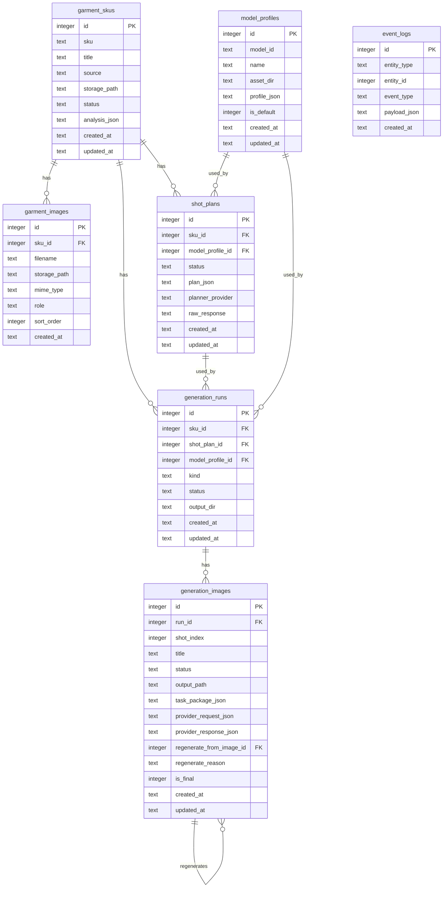

# Backend Database Schema

当前数据库为 SQLite，路径默认：

```text
backend/storage/lily_mvp.sqlite3
```

数据库初始化入口：

```text
backend/app/db.py:init_db()
```

## 1. 表总览

当前一共 7 张业务表：

| 表名 | 业务对象 | 说明 |
|---|---|---|
| `garment_skus` | `GarmentSku` | 服装货号图包 |
| `garment_images` | `GarmentImage` | 货号下的单张素材图 |
| `model_profiles` | `ModelProfile` | 数字模特档案 |
| `shot_plans` | `ShotPlan` | 组图方案 / Gemini 策划结果 |
| `generation_runs` | `GenerationRun` | 一次组图生成或重生批次 |
| `generation_images` | `GenerationImage` | 单张生成结果 |
| `event_logs` | `EventLog` | 事件日志 |

## 2. 表结构

### 2.1 `garment_skus`

```sql
CREATE TABLE garment_skus (
  id INTEGER PRIMARY KEY AUTOINCREMENT,
  sku TEXT NOT NULL,
  title TEXT,
  source TEXT NOT NULL DEFAULT 'upload',
  storage_path TEXT NOT NULL,
  status TEXT NOT NULL DEFAULT 'NEW',
  analysis_json TEXT,
  created_at TEXT NOT NULL,
  updated_at TEXT NOT NULL
);
```

字段说明：

| 字段 | 类型 | 说明 |
|---|---|---|
| `id` | INTEGER | 主键 |
| `sku` | TEXT | 货号，来自用户输入 |
| `title` | TEXT | 展示名，当前默认等于货号 |
| `source` | TEXT | 来源，当前为 `upload` |
| `storage_path` | TEXT | 上传素材所在本地目录 |
| `status` | TEXT | `NEW` / `ANALYZED` / `CONFIRMED` |
| `analysis_json` | TEXT | Gemini 输出的服装摘要 JSON |
| `created_at` | TEXT | 创建时间 |
| `updated_at` | TEXT | 更新时间 |

### 2.2 `garment_images`

```sql
CREATE TABLE garment_images (
  id INTEGER PRIMARY KEY AUTOINCREMENT,
  sku_id INTEGER NOT NULL REFERENCES garment_skus(id) ON DELETE CASCADE,
  filename TEXT NOT NULL,
  storage_path TEXT NOT NULL,
  mime_type TEXT NOT NULL,
  role TEXT NOT NULL DEFAULT 'reference',
  sort_order INTEGER NOT NULL DEFAULT 0,
  created_at TEXT NOT NULL
);
```

字段说明：

| 字段 | 类型 | 说明 |
|---|---|---|
| `id` | INTEGER | 主键 |
| `sku_id` | INTEGER | 所属 `garment_skus.id` |
| `filename` | TEXT | 上传后规范化文件名 |
| `storage_path` | TEXT | 图片本地路径 |
| `mime_type` | TEXT | 文件 MIME 类型 |
| `role` | TEXT | 图片角色，当前为 `main` / `reference` |
| `sort_order` | INTEGER | 上传顺序 |
| `created_at` | TEXT | 创建时间 |

外键：

- `sku_id -> garment_skus.id`
- `ON DELETE CASCADE`：删除 SKU 时图片元数据级联删除。当前没有删除接口。

### 2.3 `model_profiles`

```sql
CREATE TABLE model_profiles (
  id INTEGER PRIMARY KEY AUTOINCREMENT,
  model_id TEXT NOT NULL UNIQUE,
  name TEXT NOT NULL,
  asset_dir TEXT NOT NULL,
  profile_json TEXT NOT NULL,
  is_default INTEGER NOT NULL DEFAULT 0,
  created_at TEXT NOT NULL,
  updated_at TEXT NOT NULL
);
```

字段说明：

| 字段 | 类型 | 说明 |
|---|---|---|
| `id` | INTEGER | 主键 |
| `model_id` | TEXT | 业务 ID，例如 `Face-01` |
| `name` | TEXT | 展示名 |
| `asset_dir` | TEXT | 模特头部素材目录 |
| `profile_json` | TEXT | 身体参数、头部角度、禁止项等 |
| `is_default` | INTEGER | 是否默认模特，0/1 |
| `created_at` | TEXT | 创建时间 |
| `updated_at` | TEXT | 更新时间 |

约束：

- `model_id` 唯一。
- 启动时自动写入默认 `Face-01`，如果已存在则不重复写入。

### 2.4 `shot_plans`

```sql
CREATE TABLE shot_plans (
  id INTEGER PRIMARY KEY AUTOINCREMENT,
  sku_id INTEGER NOT NULL REFERENCES garment_skus(id) ON DELETE CASCADE,
  model_profile_id INTEGER NOT NULL REFERENCES model_profiles(id),
  status TEXT NOT NULL DEFAULT 'DRAFT',
  plan_json TEXT NOT NULL,
  planner_provider TEXT NOT NULL,
  raw_response TEXT,
  created_at TEXT NOT NULL,
  updated_at TEXT NOT NULL
);
```

字段说明：

| 字段 | 类型 | 说明 |
|---|---|---|
| `id` | INTEGER | 主键 |
| `sku_id` | INTEGER | 关联货号 |
| `model_profile_id` | INTEGER | 关联数字模特 |
| `status` | TEXT | 当前为 `DRAFT`，预留 `CONFIRMED` |
| `plan_json` | TEXT | 结构化组图方案 JSON |
| `planner_provider` | TEXT | `gemini` / `fallback` / `gemini-error-fallback` / `gemini-json-parse-fallback` |
| `raw_response` | TEXT | Gemini 原始响应或 fallback 原因 |
| `created_at` | TEXT | 创建时间 |
| `updated_at` | TEXT | 更新时间 |

外键：

- `sku_id -> garment_skus.id`
- `model_profile_id -> model_profiles.id`

### 2.5 `generation_runs`

```sql
CREATE TABLE generation_runs (
  id INTEGER PRIMARY KEY AUTOINCREMENT,
  sku_id INTEGER NOT NULL REFERENCES garment_skus(id) ON DELETE CASCADE,
  shot_plan_id INTEGER NOT NULL REFERENCES shot_plans(id),
  model_profile_id INTEGER NOT NULL REFERENCES model_profiles(id),
  kind TEXT NOT NULL DEFAULT 'group',
  status TEXT NOT NULL DEFAULT 'CREATED',
  output_dir TEXT NOT NULL,
  created_at TEXT NOT NULL,
  updated_at TEXT NOT NULL
);
```

字段说明：

| 字段 | 类型 | 说明 |
|---|---|---|
| `id` | INTEGER | 主键 |
| `sku_id` | INTEGER | 关联货号 |
| `shot_plan_id` | INTEGER | 本次生成使用的组图方案 |
| `model_profile_id` | INTEGER | 本次生成使用的模特 |
| `kind` | TEXT | `group` / `regeneration` |
| `status` | TEXT | `CREATED` / `RUNNING` / `SUCCEEDED` / `FAILED` |
| `output_dir` | TEXT | 本次输出目录 |
| `created_at` | TEXT | 创建时间 |
| `updated_at` | TEXT | 更新时间 |

### 2.6 `generation_images`

```sql
CREATE TABLE generation_images (
  id INTEGER PRIMARY KEY AUTOINCREMENT,
  run_id INTEGER NOT NULL REFERENCES generation_runs(id) ON DELETE CASCADE,
  shot_index INTEGER NOT NULL,
  title TEXT NOT NULL,
  status TEXT NOT NULL DEFAULT 'QUEUED',
  output_path TEXT,
  task_package_json TEXT NOT NULL,
  provider_request_json TEXT,
  provider_response_json TEXT,
  regenerate_from_image_id INTEGER REFERENCES generation_images(id),
  regenerate_reason TEXT,
  is_final INTEGER NOT NULL DEFAULT 0,
  created_at TEXT NOT NULL,
  updated_at TEXT NOT NULL
);
```

字段说明：

| 字段 | 类型 | 说明 |
|---|---|---|
| `id` | INTEGER | 主键 |
| `run_id` | INTEGER | 所属生成批次 |
| `shot_index` | INTEGER | 图位序号 |
| `title` | TEXT | 图位标题 |
| `status` | TEXT | `QUEUED` / `RUNNING` / `SUCCEEDED` / `FAILED` |
| `output_path` | TEXT | 生成图片路径 |
| `task_package_json` | TEXT | 单张生成任务包 |
| `provider_request_json` | TEXT | Provider 请求快照 |
| `provider_response_json` | TEXT | Provider 响应快照 |
| `regenerate_from_image_id` | INTEGER | 重生来源图片 |
| `regenerate_reason` | TEXT | 重生原因 |
| `is_final` | INTEGER | 是否最终图，0/1 |
| `created_at` | TEXT | 创建时间 |
| `updated_at` | TEXT | 更新时间 |

外键：

- `run_id -> generation_runs.id`
- `regenerate_from_image_id -> generation_images.id`

### 2.7 `event_logs`

```sql
CREATE TABLE event_logs (
  id INTEGER PRIMARY KEY AUTOINCREMENT,
  entity_type TEXT NOT NULL,
  entity_id INTEGER,
  event_type TEXT NOT NULL,
  payload_json TEXT NOT NULL,
  created_at TEXT NOT NULL
);
```

字段说明：

| 字段 | 类型 | 说明 |
|---|---|---|
| `id` | INTEGER | 主键 |
| `entity_type` | TEXT | 实体类型，例如 `generation_run` |
| `entity_id` | INTEGER | 实体 ID，可为空 |
| `event_type` | TEXT | 事件动作，例如 `started`、`succeeded` |
| `payload_json` | TEXT | 事件负载 |
| `created_at` | TEXT | 创建时间 |

## 3. 关系图



## 4. 当前缺口和后续候选表

以下对象当前没有独立表，后续如果业务需要再拆：

| 候选表 | 当前处理方式 | 什么时候需要拆表 |
|---|---|---|
| `brand_templates` | 写在 planner prompt / `plan_json.brandStyle` 中 | 品牌模板需要可视化维护、多模板切换 |
| `pose_templates` | 写在 Gemini 输出的 shot 中 | Pose 需要沉淀、复用、人工维护 |
| `exports` | 写入 `event_logs`，ZIP 存本地 | 需要导出列表、下载历史、过期清理 |
| `image_providers` | 写在代码 adapter 和请求快照中 | 多平台 A/B、成本、失败率统计 |
| `garment_image_roles` | `garment_images.role` 字段 | 图片角色需要人工精修和历史追踪 |
| `measurement_profiles` | 尚未实现 | 尺寸增强进入 MVP 主流程 |

