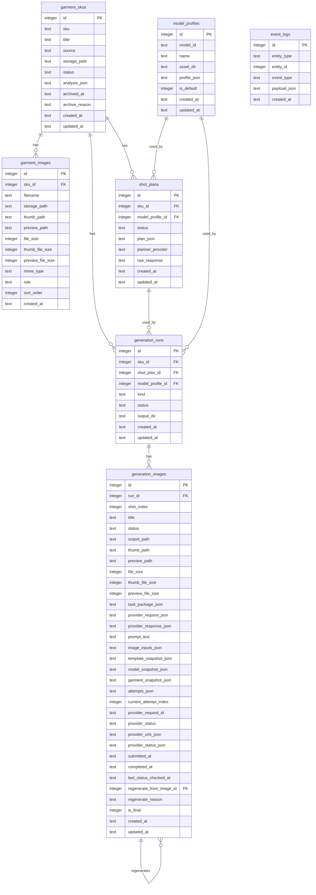

# Backend Database Schema

当前数据库为 SQLite，路径默认：

```text
backend/data/app.sqlite3
```

数据库初始化入口：

```text
backend/app/db.py:init_db()
```

## 1. 表总览

当前一共 9 张业务表，另有 1 张 schema 版本表：

| 表名 | 业务对象 | 说明 |
|---|---|---|
| `garment_skus` | `GarmentSku` | 服装货号图包 |
| `garment_images` | `GarmentImage` | 货号下的单张素材图 |
| `model_profiles` | `ModelProfile` | 数字模特档案 |
| `brand_profiles` | `BrandProfile` | admin 维护的单一品牌资料 |
| `shot_plans` | `ShotPlan` | 组图方案 / Gemini 策划结果 |
| `brand_template_versions` | `BrandTemplateVersion` | 品牌调性模板版本 |
| `generation_runs` | `GenerationRun` | 一次组图生成批次 |
| `generation_images` | `GenerationImage` | 单张生成任务记录；重生通过 attempts 追加 |
| `event_logs` | `EventLog` | 事件日志 |
| `schema_migrations` | Schema version | 已执行数据库迁移版本 |

## 2. 表结构

### 2.1 `garment_skus`

```sql
CREATE TABLE garment_skus (
  id INTEGER PRIMARY KEY AUTOINCREMENT,
  sku TEXT NOT NULL,
  title TEXT,
  source TEXT NOT NULL DEFAULT 'upload',
  storage_path TEXT NOT NULL,
  status TEXT NOT NULL DEFAULT 'NEW',
  analysis_json TEXT,
  archived_at TEXT,
  archive_reason TEXT,
  created_at TEXT NOT NULL,
  updated_at TEXT NOT NULL
);
```

字段说明：

| 字段 | 类型 | 说明 |
|---|---|---|
| `id` | INTEGER | 主键 |
| `sku` | TEXT | 货号，来自用户输入 |
| `title` | TEXT | 展示名，当前默认等于货号 |
| `source` | TEXT | 来源，当前为 `upload` |
| `storage_path` | TEXT | 上传素材对象前缀 |
| `status` | TEXT | `NEW` / `ANALYZED` / `CONFIRMED` |
| `analysis_json` | TEXT | Gemini 输出的服装摘要 JSON |
| `archived_at` | TEXT | 归档时间；归档后默认素材列表不展示，但保留素材、方案、生成记录和审计 |
| `archive_reason` | TEXT | 归档原因 |
| `created_at` | TEXT | 创建时间 |
| `updated_at` | TEXT | 更新时间 |

### 2.2 `garment_images`

```sql
CREATE TABLE garment_images (
  id INTEGER PRIMARY KEY AUTOINCREMENT,
  sku_id INTEGER NOT NULL REFERENCES garment_skus(id) ON DELETE CASCADE,
  filename TEXT NOT NULL,
  storage_path TEXT NOT NULL,
  thumb_path TEXT,
  preview_path TEXT,
  file_size INTEGER,
  thumb_file_size INTEGER,
  preview_file_size INTEGER,
  mime_type TEXT NOT NULL,
  role TEXT NOT NULL DEFAULT 'reference',
  sort_order INTEGER NOT NULL DEFAULT 0,
  created_at TEXT NOT NULL
);
```

字段说明：

| 字段 | 类型 | 说明 |
|---|---|---|
| `id` | INTEGER | 主键 |
| `sku_id` | INTEGER | 所属 `garment_skus.id` |
| `filename` | TEXT | 上传后规范化文件名 |
| `storage_path` | TEXT | 图片对象 key |
| `thumb_path` | TEXT | 缩略图衍生对象 key |
| `preview_path` | TEXT | 预览图衍生对象 key |
| `file_size` | INTEGER | 原图字节数 |
| `thumb_file_size` | INTEGER | 缩略图字节数 |
| `preview_file_size` | INTEGER | 预览图字节数 |
| `mime_type` | TEXT | 文件 MIME 类型 |
| `role` | TEXT | 图片角色，当前为 `main` / `reference` |
| `sort_order` | INTEGER | 上传顺序 |
| `created_at` | TEXT | 创建时间 |

外键：

- `sku_id -> garment_skus.id`
- `ON DELETE CASCADE`：删除 SKU 时图片元数据级联删除。当前已有删除 SKU / 删除单图接口，但为了保留生产历史，已有生成记录的 SKU 禁止删除。

实现备注：

- 当前 UI 不展示也不编辑 `role`。第一张图按 `sort_order, id` 作为封面和主要参考图。
- 上传时会生成 `thumb_path` / `preview_path` 并落库文件大小；历史数据可通过 `backend/scripts/repair_media_metadata.py` 补齐。
- 图片尺寸由前端加载图片后读取，不落库。

### 2.3 `model_profiles`

```sql
CREATE TABLE model_profiles (
  id INTEGER PRIMARY KEY AUTOINCREMENT,
  model_id TEXT NOT NULL UNIQUE,
  name TEXT NOT NULL,
  asset_dir TEXT NOT NULL,
  profile_json TEXT NOT NULL,
  is_default INTEGER NOT NULL DEFAULT 0,
  created_at TEXT NOT NULL,
  updated_at TEXT NOT NULL
);
```

字段说明：

| 字段 | 类型 | 说明 |
|---|---|---|
| `id` | INTEGER | 主键 |
| `model_id` | TEXT | 业务 ID，例如 `Face-01` |
| `name` | TEXT | 展示名 |
| `asset_dir` | TEXT | 模特头部素材目录 |
| `profile_json` | TEXT | 身体参数、头像映射、排序和元信息等 |
| `is_default` | INTEGER | 是否默认模特，0/1 |
| `created_at` | TEXT | 创建时间 |
| `updated_at` | TEXT | 更新时间 |

约束：

- `model_id` 唯一。
- 启动时自动写入默认 `Face-01`，如果已存在则不重复写入。

实现备注：

- 当前基础字段使用 `profile_json` 保存：`height`、`weight`、`bodyShape`、`bust`、`waist`、`hips`、`notes`。
- `headReferences` 中的 key 不一定总是角度。未分配角度的头像会使用 `__unassigned__...` 形式的内部 ID。
- `headReferenceOrder` 也保存在 `profile_json` 中，用于拖拽排序。
- `headReferenceMeta`、`headReferenceUrls`、`headReferenceEntries` 为运行时序列化补充信息，不是独立表字段。

### 2.4 `brand_profiles`

```sql
CREATE TABLE brand_profiles (
  id INTEGER PRIMARY KEY CHECK (id = 1),
  name TEXT NOT NULL DEFAULT '',
  tagline TEXT NOT NULL DEFAULT '',
  brand_core TEXT NOT NULL DEFAULT '',
  style_dna TEXT NOT NULL DEFAULT '',
  styling_guidelines TEXT NOT NULL DEFAULT '',
  shooting_guidelines TEXT NOT NULL DEFAULT '',
  negative_constraints TEXT NOT NULL DEFAULT '',
  created_at TEXT NOT NULL,
  updated_at TEXT NOT NULL
);
```

字段说明：

| 字段 | 类型 | 说明 |
|---|---|---|
| `id` | INTEGER | 固定为 1，保证 MVP 只维护单一品牌资料 |
| `name` | TEXT | 品牌名称；初始为空 |
| `tagline` | TEXT | 品牌标语；初始为空 |
| `brand_core` | TEXT | 品牌核心；初始为空 |
| `style_dna` | TEXT | 风格 DNA；初始为空 |
| `styling_guidelines` | TEXT | 选搭准则；初始为空 |
| `shooting_guidelines` | TEXT | 拍摄准则；初始为空 |
| `negative_constraints` | TEXT | 负向约束；初始为空 |
| `created_at` | TEXT | 创建时间 |
| `updated_at` | TEXT | 更新时间 |

实现备注：

- 启动时不 seed 默认品牌资料，admin 首次保存时创建记录。
- 当前不支持双语字段，不保存中英文 key/value 成对结构。
- 当前所有业务字段均为字符串，不保存数组结构。
- `/api/brand-info` 全部接口均为 admin-only。

### 2.5 `shot_plans`

```sql
CREATE TABLE shot_plans (
  id INTEGER PRIMARY KEY AUTOINCREMENT,
  sku_id INTEGER NOT NULL REFERENCES garment_skus(id) ON DELETE CASCADE,
  model_profile_id INTEGER NOT NULL REFERENCES model_profiles(id),
  status TEXT NOT NULL DEFAULT 'DRAFT',
  plan_json TEXT NOT NULL,
  category TEXT,
  sales_info TEXT,
  lily_tone TEXT,
  styling TEXT,
  background TEXT,
  planner_provider TEXT NOT NULL,
  raw_response TEXT,
  created_at TEXT NOT NULL,
  updated_at TEXT NOT NULL
);
```

字段说明：

| 字段 | 类型 | 说明 |
|---|---|---|
| `id` | INTEGER | 主键 |
| `sku_id` | INTEGER | 关联货号 |
| `model_profile_id` | INTEGER | 关联数字模特 |
| `status` | TEXT | 当前为 `DRAFT`，预留 `CONFIRMED` |
| `plan_json` | TEXT | 完整生图方案 JSON 快照，包含 `generationPlan` 和 5 条 `shots` |
| `category` | TEXT | 商品品类 |
| `sales_info` | TEXT | 主销售信息 |
| `lily_tone` | TEXT | Lily 调性提炼 |
| `styling` | TEXT | 服饰搭配，合并原组图搭配、颜色基调、鞋包首饰 |
| `background` | TEXT | 整组统一背景与光线要求 |
| `planner_provider` | TEXT | 当前只接受真实成功的 `gemini` |
| `raw_response` | TEXT | Gemini 的完整调用快照，包含中文 prompt、输入图片对象 key 和响应 |
| `created_at` | TEXT | 创建时间 |
| `updated_at` | TEXT | 更新时间 |

外键：

- `sku_id -> garment_skus.id`
- `model_profile_id -> model_profiles.id`

旧版兼容默认方案规则：

- 当前没有单独 `is_default` 字段。
- 一个货号可保留多条历史 `shot_plans`。
- 旧版业务上的“默认组图方案”由查询规则决定：`WHERE sku_id = ? ORDER BY updated_at DESC, id DESC LIMIT 1`。
- 旧版上传新货号后可创建默认方案。新版 AI 摄影棚主流程不读取货号默认组图方案，而是在拍摄剧本阶段为 `GenerationTask` / `GenerationStyling` / `GenerationShootScript` 生成 `generation_shot_plans`。

### 2.6 `shot_plan_shots`

```sql
CREATE TABLE shot_plan_shots (
  id INTEGER PRIMARY KEY AUTOINCREMENT,
  shot_plan_id INTEGER NOT NULL REFERENCES shot_plans(id) ON DELETE CASCADE,
  shot_index INTEGER NOT NULL,
  english_name TEXT,
  title TEXT NOT NULL,
  task TEXT,
  scene TEXT,
  crop_range TEXT,
  model_scale TEXT,
  head_treatment TEXT,
  body_position TEXT,
  pose_tone TEXT,
  image_purpose TEXT,
  shot_json TEXT NOT NULL,
  created_at TEXT NOT NULL,
  updated_at TEXT NOT NULL,
  UNIQUE(shot_plan_id, shot_index)
);
```

图位字段对应产品内的“分镜剧本”。5 条记录固定顺序为：全身主视觉、品类核心展示、设计细节近景、身位/动态补充、标准正面颜色图。`background` 属于整组共用生图方案，不在单张分镜内重复保存；模特头图参考由后端根据身位和可用头像自动选择，不由 Gemini 输出。

### 2.7 `generation_runs`

```sql
CREATE TABLE generation_runs (
  id INTEGER PRIMARY KEY AUTOINCREMENT,
  sku_id INTEGER NOT NULL REFERENCES garment_skus(id) ON DELETE CASCADE,
  shot_plan_id INTEGER NOT NULL REFERENCES shot_plans(id),
  model_profile_id INTEGER NOT NULL REFERENCES model_profiles(id),
  kind TEXT NOT NULL DEFAULT 'group',
  status TEXT NOT NULL DEFAULT 'CREATED',
  output_dir TEXT NOT NULL,
  delivery_status TEXT NOT NULL DEFAULT 'draft',
  delivered_at TEXT,
  archived_at TEXT,
  archive_reason TEXT,
  created_at TEXT NOT NULL,
  updated_at TEXT NOT NULL
);
```

字段说明：

| 字段 | 类型 | 说明 |
|---|---|---|
| `id` | INTEGER | 主键 |
| `sku_id` | INTEGER | 关联货号 |
| `shot_plan_id` | INTEGER | 本次生成使用的组图方案 |
| `model_profile_id` | INTEGER | 本次生成使用的模特 |
| `kind` | TEXT | 当前主要为 `group`；单张重生不再新建 run |
| `status` | TEXT | `CREATED` / `RUNNING` / `PARTIAL_SUCCEEDED` / `SUCCEEDED` / `FAILED` / `CANCELLED` |
| `output_dir` | TEXT | 本次输出目录 |
| `delivery_status` | TEXT | 交付状态，当前为 `draft` / `delivered` |
| `delivered_at` | TEXT | 首次标记交付时间 |
| `archived_at` | TEXT | 归档时间；归档后默认历史列表不展示，但保留记录和对象 key |
| `archive_reason` | TEXT | 归档原因 |
| `created_at` | TEXT | 创建时间 |
| `updated_at` | TEXT | 更新时间 |

### 2.8 `generation_images`

```sql
CREATE TABLE generation_images (
  id INTEGER PRIMARY KEY AUTOINCREMENT,
  run_id INTEGER NOT NULL REFERENCES generation_runs(id) ON DELETE CASCADE,
  shot_index INTEGER NOT NULL,
  title TEXT NOT NULL,
  status TEXT NOT NULL DEFAULT 'QUEUED',
  output_path TEXT,
  thumb_path TEXT,
  preview_path TEXT,
  file_size INTEGER,
  thumb_file_size INTEGER,
  preview_file_size INTEGER,
  task_package_json TEXT NOT NULL,
  provider_request_json TEXT,
  provider_response_json TEXT,
  regenerate_from_image_id INTEGER REFERENCES generation_images(id),
  regenerate_reason TEXT,
  is_final INTEGER NOT NULL DEFAULT 0,
  prompt_text TEXT,
  image_inputs_json TEXT,
  template_snapshot_json TEXT,
  model_snapshot_json TEXT,
  garment_snapshot_json TEXT,
  attempts_json TEXT,
  current_attempt_index INTEGER NOT NULL DEFAULT 0,
  provider_request_id TEXT,
  provider_status TEXT,
  provider_urls_json TEXT,
  provider_status_json TEXT,
  submitted_at TEXT,
  completed_at TEXT,
  last_status_checked_at TEXT,
  locked_by TEXT,
  locked_until TEXT,
  submit_attempts INTEGER NOT NULL DEFAULT 0,
  status_check_attempts INTEGER NOT NULL DEFAULT 0,
  status_error_attempts INTEGER NOT NULL DEFAULT 0,
  cancel_requested_at TEXT,
  timeout_at TEXT,
  review_status TEXT NOT NULL DEFAULT 'candidate',
  review_note TEXT,
  reviewed_at TEXT,
  created_at TEXT NOT NULL,
  updated_at TEXT NOT NULL
);
```

历史库升级由 `schema_migrations` 记录并执行。与 `generation_images` 相关的主要迁移包括：

`001 add_generation_image_attempt_columns` 补齐生成图片 attempt、provider queue 和快照字段：

```sql
ALTER TABLE generation_images ADD COLUMN prompt_text TEXT;
ALTER TABLE generation_images ADD COLUMN image_inputs_json TEXT;
ALTER TABLE generation_images ADD COLUMN template_snapshot_json TEXT;
ALTER TABLE generation_images ADD COLUMN model_snapshot_json TEXT;
ALTER TABLE generation_images ADD COLUMN garment_snapshot_json TEXT;
ALTER TABLE generation_images ADD COLUMN attempts_json TEXT;
ALTER TABLE generation_images ADD COLUMN current_attempt_index INTEGER NOT NULL DEFAULT 0;
ALTER TABLE generation_images ADD COLUMN provider_request_id TEXT;
ALTER TABLE generation_images ADD COLUMN provider_status TEXT;
ALTER TABLE generation_images ADD COLUMN provider_urls_json TEXT;
ALTER TABLE generation_images ADD COLUMN provider_status_json TEXT;
ALTER TABLE generation_images ADD COLUMN submitted_at TEXT;
ALTER TABLE generation_images ADD COLUMN completed_at TEXT;
ALTER TABLE generation_images ADD COLUMN last_status_checked_at TEXT;
```

`008 add_media_derivative_metadata` 补齐素材图和生成图的三档媒体元数据：

```sql
ALTER TABLE garment_images ADD COLUMN thumb_path TEXT;
ALTER TABLE garment_images ADD COLUMN preview_path TEXT;
ALTER TABLE garment_images ADD COLUMN file_size INTEGER;
ALTER TABLE garment_images ADD COLUMN thumb_file_size INTEGER;
ALTER TABLE garment_images ADD COLUMN preview_file_size INTEGER;

ALTER TABLE generation_images ADD COLUMN thumb_path TEXT;
ALTER TABLE generation_images ADD COLUMN preview_path TEXT;
ALTER TABLE generation_images ADD COLUMN file_size INTEGER;
ALTER TABLE generation_images ADD COLUMN thumb_file_size INTEGER;
ALTER TABLE generation_images ADD COLUMN preview_file_size INTEGER;
```

字段说明：

| 字段 | 类型 | 说明 |
|---|---|---|
| `id` | INTEGER | 主键 |
| `run_id` | INTEGER | 所属生成批次 |
| `shot_index` | INTEGER | 图位序号 |
| `title` | TEXT | 图位标题 |
| `status` | TEXT | `QUEUED` / `SUBMITTED` / `IN_QUEUE` / `IN_PROGRESS` / `SUCCEEDED` / `FAILED` / `CANCELLED` |
| `output_path` | TEXT | 生成图片对象 key |
| `thumb_path` | TEXT | 缩略图衍生对象 key |
| `preview_path` | TEXT | 预览图衍生对象 key |
| `file_size` | INTEGER | 原图字节数 |
| `thumb_file_size` | INTEGER | 缩略图字节数 |
| `preview_file_size` | INTEGER | 预览图字节数 |
| `task_package_json` | TEXT | 单张生成任务包；包含 SKU、服装、模特、shot、输入图、生成约束 |
| `provider_request_json` | TEXT | 最终发给 provider 的请求快照，例如 fal 的 `prompt + image_urls + quality` |
| `provider_response_json` | TEXT | provider 最终响应快照；fal 完成后保存 response_url 返回内容 |
| `regenerate_from_image_id` | INTEGER | 重生来源图片 |
| `regenerate_reason` | TEXT | 最近一次重生原因 |
| `is_final` | INTEGER | 是否最终图，0/1 |
| `prompt_text` | TEXT | 本次当前 attempt 的中文 Image 2 prompt |
| `image_inputs_json` | TEXT | 输入图片映射，包含对象 key、预签名 URL、角色、fal URL |
| `template_snapshot_json` | TEXT | 本次生成使用的品牌模板、shot plan 等快照 |
| `model_snapshot_json` | TEXT | 本次生成使用的数字模特快照 |
| `garment_snapshot_json` | TEXT | 本次生成使用的服装事实快照 |
| `attempts_json` | TEXT | 初次生成和每次重生的历史 attempt 数组 |
| `current_attempt_index` | INTEGER | 当前生效 attempt 序号 |
| `provider_request_id` | TEXT | fal queue `request_id` |
| `provider_status` | TEXT | fal 原始状态，例如 `IN_QUEUE` / `IN_PROGRESS` / `COMPLETED` |
| `provider_urls_json` | TEXT | fal `status_url` / `response_url` / `cancel_url` |
| `provider_status_json` | TEXT | 最近一次 fal status 响应 |
| `submitted_at` | TEXT | 提交 provider 的时间 |
| `completed_at` | TEXT | 完成、失败或取消时间 |
| `last_status_checked_at` | TEXT | 最近一次状态查询时间 |
| `locked_by` | TEXT | 后台 poller 抢占任务的 worker id |
| `locked_until` | TEXT | 任务 lease 过期时间，过期后可被再次抢占 |
| `submit_attempts` | INTEGER | 提交 provider 的尝试次数 |
| `status_check_attempts` | INTEGER | 查询 provider 状态的总次数 |
| `status_error_attempts` | INTEGER | 连续状态查询失败次数 |
| `cancel_requested_at` | TEXT | 用户请求取消时间 |
| `timeout_at` | TEXT | 任务超时截止时间 |
| `review_status` | TEXT | 业务审核/交付状态：`candidate` / `approved` / `needs_regen` / `needs_retouch` / `delivered` |
| `review_note` | TEXT | 审核备注 |
| `reviewed_at` | TEXT | 最近一次审核状态更新时间 |
| `created_at` | TEXT | 创建时间 |
| `updated_at` | TEXT | 更新时间 |

外键：

- `run_id -> generation_runs.id`
- `regenerate_from_image_id -> generation_images.id` 为历史兼容字段。当前重生默认不新增新的 `generation_images`，而是在同一记录的 `attempts_json` 中追加。

`attempts_json` 示例：

```json
[
  {
    "attemptIndex": 1,
    "kind": "initial",
    "prompt": "中文 Image 2 prompt",
    "imageInputs": [],
    "providerRequest": {},
    "providerResponse": {},
    "providerRequestId": "fal request id",
    "providerStatus": "SUBMITTED",
    "outputPath": ".../01-首图.png",
    "createdAt": "2026-05-07T16:00:00"
  },
  {
    "attemptIndex": 2,
    "kind": "regeneration",
    "reason": "姿势不合适",
    "note": "更自然一点",
    "prompt": "追加重生要求后的中文 prompt",
    "providerRequest": {},
    "providerRequestId": "fal request id",
    "providerStatus": "IN_PROGRESS",
    "outputPath": ".../01-首图-regen-160500.png",
    "createdAt": "2026-05-07T16:05:00"
  }
]
```

### 2.9 `event_logs`

```sql
CREATE TABLE event_logs (
  id INTEGER PRIMARY KEY AUTOINCREMENT,
  entity_type TEXT NOT NULL,
  entity_id INTEGER,
  event_type TEXT NOT NULL,
  payload_json TEXT NOT NULL,
  created_at TEXT NOT NULL
);
```

字段说明：

| 字段 | 类型 | 说明 |
|---|---|---|
| `id` | INTEGER | 主键 |
| `entity_type` | TEXT | 实体类型，例如 `generation_run` |
| `entity_id` | INTEGER | 实体 ID，可为空 |
| `event_type` | TEXT | 事件动作，例如 `started`、`succeeded` |
| `payload_json` | TEXT | 事件负载 |
| `created_at` | TEXT | 创建时间 |

### 2.10 `brand_template_versions`

```sql
CREATE TABLE brand_template_versions (
  id INTEGER PRIMARY KEY AUTOINCREMENT,
  template_id TEXT NOT NULL,
  version TEXT NOT NULL,
  name TEXT NOT NULL,
  snapshot_json TEXT NOT NULL,
  is_active INTEGER NOT NULL DEFAULT 0,
  created_at TEXT NOT NULL,
  UNIQUE(template_id, version)
);
```

字段说明：

| 字段 | 类型 | 说明 |
|---|---|---|
| `template_id` | TEXT | 模板稳定 ID |
| `version` | TEXT | 模板版本 |
| `name` | TEXT | 模板名称 |
| `snapshot_json` | TEXT | 品牌调性、背景、光线、搭配边界等模板快照 |
| `is_active` | INTEGER | 是否当前默认模板 |

### 2.11 `schema_migrations`

```sql
CREATE TABLE schema_migrations (
  version TEXT PRIMARY KEY,
  name TEXT NOT NULL,
  applied_at TEXT NOT NULL
);
```

当前迁移版本：

| Version | Name | 说明 |
|---|---|---|
| `001` | `add_generation_image_attempt_columns` | 补齐生成图片 attempt、provider queue、快照字段 |
| `002` | `add_generation_run_archive_columns` | 补齐生成批次归档字段 |
| `003` | `normalize_planning_schema` | 规范化 `shot_plans` / `shot_plan_shots` schema |
| `004` | `add_generation_task_control_columns` | 增加任务锁、重试、取消、超时字段 |
| `005` | `add_generation_review_delivery_columns` | 增加审核/交付状态字段 |
| `006` | `add_brand_template_versions` | 增加品牌模板版本表 |
| `007` | `add_garment_sku_archive_columns` | 增加货号归档字段 |
| `008` | `add_media_derivative_metadata` | 增加素材图和生成图的 `thumb` / `preview` 路径与三档文件大小字段 |
| `013` | `add_generation_task_archive_columns` | 增加新版拍摄任务归档字段 |

## 3. 关系图



## 4. 当前缺口和后续候选表

以下对象当前没有独立表，后续如果业务需要再拆：

| 候选表 | 当前处理方式 | 什么时候需要拆表 |
|---|---|---|
| `brand_templates` | 写在 planner prompt / `plan_json.brandStyle` 中 | 品牌模板需要可视化维护、多模板切换 |
| `pose_templates` | 写在 Gemini 输出的 shot 中 | Pose 需要沉淀、复用、人工维护 |
| `exports` | 写入 `event_logs`，ZIP 写入对象存储 | 需要导出列表、下载历史、过期清理 |
| `image_providers` | 写在代码 adapter 和请求快照中 | 多平台 A/B、成本、失败率统计 |
| `garment_image_roles` | `garment_images.role` 字段 | 图片角色需要人工精修和历史追踪 |
| `measurement_profiles` | 尚未实现 | 尺寸增强进入 MVP 主流程 |
