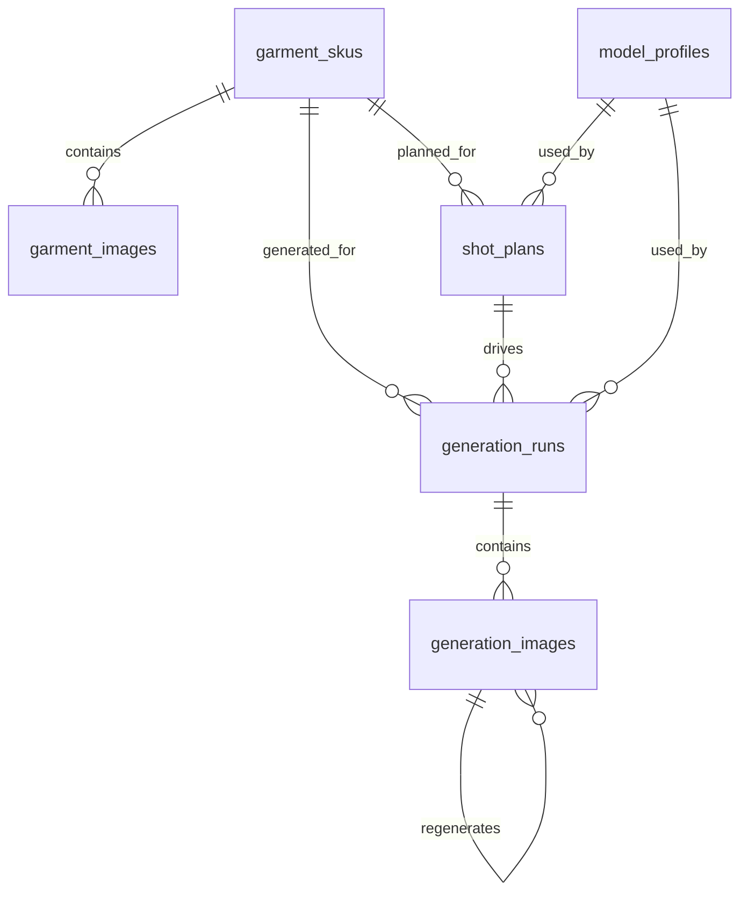

# Backend Domain Model

本文件记录当前 MVP 后端的实际业务对象、Domain 边界和对象关系。它描述的是当前代码已经落地的实现，而不是未来完整商业化系统。

## 1. 领域边界

当前后端围绕一条核心生产链路建模：

```text
搭配服饰库导入并打标
-> AI 摄影棚上传主推款
-> Gemini 从 READY 搭配服饰 tags 中智能选搭
-> 生成 3x2 六宫格预览
-> Image-2 并发生成前 5 张成片
-> 生成记录复盘
```

MVP 当前不实现多租户、权限、计费、模板市场，也不做复杂素材资产管理。所有对象暂时默认属于单一工作空间，但领域模型应保留后续 SaaS 化扩展空间。

## 2. Domain 总览

| Domain | 业务含义 | 当前主要对象 | 当前代码位置 |
|---|---|---|---|
| Styling Library | 搭配服饰库和 AI 标签 | `StylingGarment`, `StylingGarmentImage`, `MediaAsset` | `app/main.py`, `app/db.py` |
| Studio Task | 主推款拍摄任务和输入版本 | `GenerationTask`, `GenerationTaskInputVersion`, `GenerationTaskImage` | `app/main.py`, `app/db.py` |
| Model Profile | 数字模特档案 | `ModelProfile` | `app/db.py` |
| Styling & Planning | 智能选搭、ShotPlan、六宫格预览 | `GenerationStyling`, `GenerationShotPlan`, `GenerationPreview` | `app/main.py` |
| Generation | 最终结果批次、结果图、attempt | `GenerationResultSet`, `GenerationResultImage`, `GenerationAttempt` | `app/main.py`, `app/image_provider.py` |
| Audit Log | 操作和系统事件留痕 | `EventLog` | `app/db.py` |

## 3. 新版核心业务对象

### 3.1 StylingGarment

搭配服饰库中的一套配角服装。当前只支持真实服装，不支持鞋、包、首饰入库。

当前职责：

- 保存全局唯一 `code`、状态、AI 标签、官方标题标签、人工业务标签、生效标签、标签元信息和打标错误。
- 通过 `StylingGarmentImage` 关联 1-6 张图片，排序第一张作为封面和主要参考图。
- 导入后由前端默认触发 `/save-and-tag`，服务端进入 `TAGGING_RUNNING` 并调用 Gemini 打标。
- 只有 `READY` 且未被人工标签标记 `do_not_use_for_styling` 的服饰进入智能选搭候选。
- 默认删除为归档：写入 `DELETED/deleted_at`，不影响已冻结的历史生成快照。

状态：

| 状态 | 含义 |
|---|---|
| `DRAFT` | 已创建但尚未完成打标 |
| `TAGGING_RUNNING` | 正在打标；此时禁止修改和归档 |
| `TAGGING_READY` | 标签已生成但需要复核，不进入智能选搭候选 |
| `READY` | 可进入智能选搭候选 |
| `TAGGING_FAILED` | 打标失败，保留素材但不参与选搭 |
| `DELETED` | 已归档，日常列表隐藏 |

### 3.2 GenerationTask

AI 摄影棚中的一次主推款拍摄任务。

当前职责：

- 保存任务名、主推款图片、当前输入版本和权威状态。
- 点击智能选搭时创建 `GenerationTaskInputVersion`，冻结主推款图片快照。
- 通过 `GenerationStyling` 保存候选搭配服饰 ID、选中 ID、选中服饰快照、理由和 warnings。
- 预览阶段生成 6 条 `GenerationShotPlan`，并保存一张 3x2 六宫格 `GenerationPreview`。
- 最终阶段创建 `GenerationResultSet`，并按前 5 条 ShotPlan 并发生成 `GenerationResultImage`。

### 3.3 GenerationAttempt

所有 Gemini / Image-2 调用的过程记录。保存 provider、状态、开始/完成/失败时间、request/response 快照、错误信息和输出媒体，用于技术详情与问题排查。

搭配服饰打标使用 `owner_type = styling_garment_tagging`、`owner_id = StylingGarment.id` 记录 attempt。请求快照包含 Gemini prompt、schema version、模型名与输入图片元数据；响应快照包含原始返回和归一化后的结构化标签。详情 UI 默认折叠展示这些技术信息。

## 4. 旧版兼容对象

### 4.1 GarmentSku

服装货号图包，是用户在“服装素材”页面上传和选择的核心对象。

当前职责：

- 记录货号、标题、素材来源和对象存储前缀。
- 记录当前状态：`NEW` / `ANALYZED` / `CONFIRMED`。
- 缓存 Gemini 输出的服装识别摘要 `analysis_json`。
- 作为后续 `ShotPlan` 和 `GenerationRun` 的上游对象。
- 支持编辑货号、标题、状态。
- 支持删除未产生生成记录的应用内素材副本。
- 上传入口支持散图、单文件夹、多文件夹；保存前会先在浏览器本地形成待上传图包，用户可编辑货号/标题、删除图片，再保存上传。
- 保存上传后会为该货号创建一条默认 `ShotPlan`。后续“生成组图”页不再临时策划，而是直接使用货号默认组图方案。

当前状态含义：

| 状态 | 含义 |
|---|---|
| `NEW` | 已上传素材，尚未生成组图方案 |
| `ANALYZED` | 已由 Gemini 生成过组图方案，并写入服装摘要 |
| `CONFIRMED` | 预留状态，表示人工确认过服装信息；当前 UI 尚未实现 |

### 3.2 GarmentImage

单张服装素材图，属于某个 `GarmentSku`。MVP 的产品规则是：排序第一张图片默认作为封面和主要参考图。

当前职责：

- 记录上传后的文件名、对象 key、MIME 类型和排序。
- 数据库仍保留 `role` 字段以兼容后续扩展；当前 UI 不展示也不允许用户编辑图片角色。
- 当前 MVP 只由后端自动标记第一张为 `main`，其余为 `reference`。
- 支持追加图片、删除单图。
- API 响应会返回文件大小；前端通过图片加载读取尺寸，用于素材卡片和上传预览卡片展示。

后续可扩展角色：

- `front`
- `back`
- `detail`
- `fabric`
- `color`
- `3d`

当前暂不做图片角色精修，也不做“素材解析与服装图片类型识别”，避免在 MVP 阶段过度设计。图片角色字段是工程兼容字段，不是当前用户可操作字段。

### 3.3 ModelProfile

数字模特档案。

当前职责：

- 保存模特业务 ID，例如 `Face-01`。
- 记录头部素材目录 `asset_dir`。
- 在 `profile_json` 中保存基础身体参数、头部参考图映射、排序和图片元信息。
- 当前启动时自动种子化 1 个默认模特 `Face-01`。
- 支持完整 CRUD。
- 新建模特时，基础档案和头像素材可以一起编辑，最后一次保存。
- 头像上传后默认不分配角度，需要人工逐张指定。
- 每张头像支持删除、替换、改角度和拖拽排序；上传占位卡固定排第一。
- `front` 仍然是预览封面优先来源，但当前只做缺失提醒，不做强制锁定。

当前 `profile_json` 结构示例：

```json
{
  "height": "170cm",
  "weight": "48kg",
  "bodyShape": "H型",
  "bust": "80cm",
  "waist": "59cm",
  "hips": "89cm",
  "notes": "都市、通勤、轻熟、自然、克制",
  "headReferences": {
    "front": "front.png",
    "left45": "left45.png",
    "__unassigned__a1b2c3d4e5": "draft-side.png"
  },
  "headReferenceOrder": [
    "front",
    "__unassigned__a1b2c3d4e5",
    "left45"
  ],
  "headReferenceMeta": {
    "front": { "fileSize": 6476302 },
    "__unassigned__a1b2c3d4e5": { "fileSize": 6123456 }
  }
}
```

说明：

- 当前基础参数字段为：`height`、`weight`、`bodyShape`、`bust`、`waist`、`hips`、`notes`。
- `headReferences` 仍以对象形式存储，但 key 不再总是角度；未分配角度的图片会使用 `__unassigned__...` 伪 ID。
- 当前支持的角度集合为：`front`、`left45`、`right45`、`right90`、`left90`、`up45`、`down45`、`back`、`backTurnLeft45`、`backTurnRight45`。
- 同一个具体角度只能绑定一张图；未分配角度的图片可以存在多张。
- 文件保存时优先保留上传文件名，仅在重名时追加去重后缀。
- API 序列化时会额外返回 `headReferenceEntries`，供前端按“逐张图片”而不是“角度字典”来管理。

### 3.4 ShotPlan

组图方案，是 Gemini 策划层的输出结果。

当前职责：

- 绑定一个 `GarmentSku` 和一个 `ModelProfile`。
- 保存 Gemini planner 输出的完整 `plan_json`。
- 保存 `planner_provider` 和原始响应 `raw_response`，用于调试和复盘。
- 作为生成批次 `GenerationRun` 的输入。
- 一个货号可以有多条历史 `ShotPlan`。当前默认方案规则为：取该货号最新的未失败 Gemini 方案；`PLANNING` 方案表示已持久化、等待后台 Gemini 策划完成。
- “服装素材”页负责生成/更新默认组图方案；“生成组图”页只读取并使用默认方案。
- 上传新图包保存成功或点击“更新默认方案”后，后端先创建 `ShotPlan.status = PLANNING` 并立即返回；后台 planner poller 再调用 Gemini。Gemini 不可用、SDK 缺失、引用文档缺失或返回格式异常时，该方案更新为 `FAILED` 并写入事件日志，不创建假方案。

当前 `plan_json` 约定：

```json
{
  "sku": "125309C7948510",
  "modelId": "Face-01",
  "category": "连衣裙",
  "garment": {
    "category": "连衣裙",
    "summary": "一句话服装摘要",
    "color": "主颜色",
    "fabric": "面料视觉特征",
    "keyStructures": ["关键结构"],
    "preserveStrictly": ["必须保真的点"]
  },
  "brandStyle": {
    "name": "默认棚拍风格",
    "summary": "白/浅灰背景，自然姿态，简洁搭配，商品优先"
  },
  "generationPlan": {
    "salesInfo": "主销售信息",
    "lilyTone": "Lily 调性提炼",
    "styling": "服饰搭配，合并整组搭配、颜色基调、鞋包首饰",
    "background": "浅灰白棚拍背景、轻微落地阴影"
  },
  "shots": [
    {
      "shotIndex": 1,
      "englishName": "Full-length hero shot",
      "title": "全身主视觉",
      "task": "先给完整穿着比例；全身或近全身，头脚完整，商品无遮挡",
      "scene": "全身图",
      "cropRange": "头顶到脚尖完整入画，包含鞋",
      "modelScale": "75%-86%",
      "headTreatment": "完整露头",
      "bodyPosition": "正面或轻斜正",
      "poseTone": "稳定站姿，肩颈打开",
      "imagePurpose": "先给完整穿着比例"
    }
  ]
}
```

实现上，`shot_plans` 会冗余保存品类、主销售信息、Lily 调性、服饰搭配和整组背景；`shot_plan_shots` 保存 5 个固定分镜的可编辑明细。`plan_json` 仍保留完整快照，方便历史复盘和任务包生成。Gemini 不再输出 `evidenceLevel`、`stylingPlan`、`colorPalette`、`accessories`、`slotName`、`unifiedRequirement`、`headReference` 或单张 `background`；旧数据不做兼容承诺，启动迁移会重写为新版结构。

### 3.5 GenerationRun

一次生成任务批次，也是前台“生成记录”的主记录粒度。

当前职责：

- 记录一次用户触发的整组生成。
- 同一个素材包重复生成一次，会产生新的 `GenerationRun`。
- 单张重生不再新建 `GenerationRun`，而是追加到对应 `GenerationImage.attempts_json`。
- 绑定 `GarmentSku`、`ShotPlan` 和 `ModelProfile`。
- 记录输出目录 `output_dir`。
- 聚合多个 `GenerationImage`。

当前 `kind`：

| kind | 含义 |
|---|---|
| `group` | 由一个 `ShotPlan` 生成整组图；当前主要使用值 |
| `regeneration` | 历史兼容值；当前单张重生默认不再新建 run |

当前状态：

| 状态 | 含义 |
|---|---|
| `CREATED` | 已创建，尚未执行；当前很少停留在此状态 |
| `RUNNING` | 正在串行生成 |
| `SUCCEEDED` | 批次生成成功 |
| `FAILED` | 批次生成失败 |

### 3.6 GenerationImage

一次图位生成任务记录。

当前职责：

- 保存图位序号、图位标题、生成状态和输出路径。
- 保存完整 `task_package_json`，这是后续接真实 GPT Image-2 三方平台的核心契约。
- 保存 provider 请求和响应，保证可复盘。
- 保存最近一次重生原因 `regenerate_reason`。
- 通过 `attempts_json` 保存初次生成和每次重生的调用记录，包括 prompt、输入图、provider request/response、fal request id、输出路径和时间戳。
- 支持标记为最终图 `is_final`。

当前 `task_package_json` 结构：

```json
{
  "sku": "125309C7948510",
  "garment": {},
  "model": {
    "modelId": "Face-01",
    "profile": {},
    "identityLock": "high"
  },
  "brandStyle": {},
  "shot": {},
  "generation": {
    "targetModel": "GPT Image-2",
    "provider": "fal",
    "output": {
      "aspectRatio": "1:1",
      "size": "1200x1200"
    },
    "constraints": [
      "服装参考图是商品事实源",
      "保持同一模特身份和身体比例",
      "保持白/浅灰棚拍风格",
      "不生成无关文字、水印、logo"
    ]
  }
}
```

生成任务以 `generation_runs` 作为一次用户任务的容器：预览、最终 5 张图、重生预览图、重生结果图都归属于同一条生成记录。预览图在 `generation_images` 中使用 `shot_index = 0`；最终组图使用 `shot_index = 1..5`。点击“生成”时如果已经有预览 run，后端必须在该 run 下追加最终图，并把 run 升级为完整组图任务，不得新建第二条生成记录。

最终生图阶段采用“图片事实授权型 prompt”：九宫格预览图只作为导演分镜参考，服装素材图是唯一商品事实来源。Prompt 不默认复述 Gemini 自动识别出的具体颜色、扣子数量、刺绣位置、口袋数量或面料名称，只声明图片角色、事实优先级、当前图位脚本、保真范围和禁止项。用户人工确认的“硬保真点”可以作为具体文字约束进入 prompt。

最终生图图片顺序固定为：图1 是已确认九宫格；图2~M 是数字模特身份图，最多 4 张；图(M+1)~10 是服装素材图。5 张最终图共享同一套参考图和公共 prompt 前缀，每张只替换当前图位脚本。

预览任务 `generation.stage = preview_grid` 时，实际语义为 `2x3 分镜预览 / Contact Sheet`：

- 输出一张 2x3 视觉预览图，前 5 格对应 `ShotPlan.shots` 的 5 条分镜，第 6 格为备用候选姿势。
- 画面中禁止出现文字、编号、标签、水印、logo、脚本说明或边框说明。
- 图片入参固定为“模特身份参考图在前、服装素材参考图在后”，且总数最多 10 张，遵守 fal `image_urls <= 10` 的限制。
- 模特图按数字模特 UI 当前显示顺序取前 4 张；若不足 4 张，以实际数量为准。
- 服装图按当前货号素材 UI 当前显示顺序补齐剩余额度；通常为 6 张，但如果模特图少于 4 张则服装图可超过 6 张，总数仍不超过 10；如果服装图不足则以实际数量为准。不要求维护 `main/front/back/detail` 等角色。
- prompt 的“生图方案/分镜剧本/服饰搭配/统一背景”必须来自当前货号最新可用 Gemini 方案；服装具体事实默认由服装素材图主导，不由 Gemini 文本复述。如果缺少服饰搭配等关键策划信息，应让任务失败并在 UI 暴露错误，不允许静默使用兜底文案。
- 发给 Image-2 之前，所有图片都必须先上传 fal，最终 `provider_request_json.image_urls` 只允许 fal 返回的 Image URLs。
- `image_inputs_json` / `attempts_json.imageInputs` 必须保留每张输入图的 `role`、`filename`、`sourceObjectKey`、`providerUrl`，用于审计图片编号与 prompt 中“图片角色”的对应关系。
- 对预览图点击“重生”时，不复用历史 `task_package_json` 中可能过期的预览规则；必须按当前货号最新可用 `ShotPlan` 和上述预览规则重新构建 task package，再追加 `regeneration` 要求。若历史预览记录绑定了旧方案，重生时要自动切到最新可用方案。
- 预览类 Image-2 请求使用 fal 合法枚举 `image_size = square_hd` 和 `quality = high`，避免 `auto` 尺寸导致 Contact Sheet 比例漂移。

重生时会在 task package 中追加：

```json
{
  "regeneration": {
    "fromImageId": 1,
    "reason": "姿势不合适",
    "note": "希望更自然一点"
  }
}
```

### 3.7 EventLog

系统事件日志。

当前职责：

- 记录重要业务动作和系统动作。
- 同步写入 SQLite 的 `event_logs` 表和 `backend/data/logs/YYYY-MM-DD.jsonl`。
- 用于调试、审计和后续排查。
- 前台“生成记录”的主视图不直接展示 `event_logs`，而是展示 `GenerationRun` 任务列表；事件日志只作为详情页或调试信息的补充来源。

当前事件示例：

- `garment_sku.uploaded`
- `shot_plan.created`
- `generation_run.started`
- `generation_run.succeeded`
- `generation_run.failed`
- `generation_image.started`
- `generation_image.succeeded`
- `generation_image.regenerate_requested`
- `generation_image.final_updated`
- `generation_run.exported`

代码中 `event_type` 只保存动作名，例如 `uploaded`、`created`；语义由 `entity_type + event_type` 组合得到。

## 4. 对象关系



## 5. 对象存储布局

SQLite 只保存对象 key 和元数据，真实图片和导出文件在 S3 兼容对象存储中。

| 目录 | 用途 |
|---|---|
| `uploads/` | 上传后的服装素材副本 |
| `outputs/` | 生成图输出目录 |
| `exports/` | ZIP 导出文件 |
| `backend/data/logs/` | JSONL 事件日志 |

上传路径格式：

```text
uploads/{sku}-{YYYYMMDD-HHMMSS}-{shortId}/
```

输出路径格式：

```text
outputs/{sku}/{YYYYMMDD-HHMMSS}/
```

## 6. 当前实现取舍

- JSON 字段用于保存变化快、尚未完全稳定的结构，例如 `analysis_json`、`profile_json`、`plan_json`、`task_package_json`。
- 关键可查询关系用独立表和外键表达，例如 SKU、模特、方案、生成批次、生成单图。
- 当前没有独立 `exports` 表。导出作为事件写入 `event_logs`，ZIP 文件写入 `exports/`。
- 当前没有独立 `brand_templates` 表。品牌默认模板暂时内嵌在 planner 输出和 task package 中。
- 服装素材删除分为两类：默认操作为归档货号，从日常列表隐藏但保留素材、方案、生成记录和审计；勾选“同时删除关联记录和文件”并输入完整货号确认后，才会级联删除该货号的素材、方案、生成记录、已归档记录和对象存储输出。
- 删除操作只删除对象存储中的应用内上传副本和本系统生成输出，不删除客户原始素材目录。
