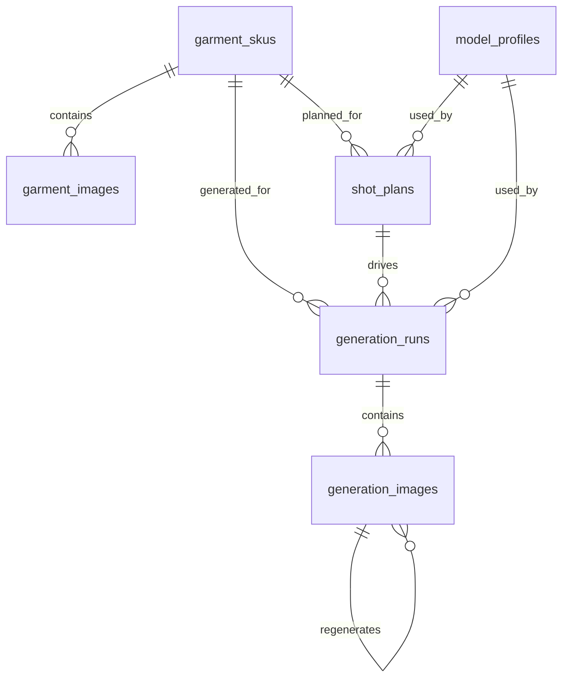

# Backend Domain Model

本文件记录当前 MVP 后端的实际业务对象、Domain 边界和对象关系。它描述的是当前代码已经落地的实现，而不是未来完整商业化系统。

## 1. 领域边界

当前后端围绕一条核心生产链路建模：

```text
上传服装货号图包
-> 选择数字模特
-> Gemini 生成组图方案
-> GPT Image-2 Provider 逐张生成
-> 单张重生 / 设为最终图
-> 导出和留痕
```

MVP 不做多租户、权限、计费、模板市场，也不做复杂素材资产管理。所有对象都默认属于 Lily 内部单一工作空间。

## 2. Domain 总览

| Domain | 业务含义 | 当前主要对象 | 当前代码位置 |
|---|---|---|---|
| Garment Asset | 服装货号和上传素材 | `GarmentSku`, `GarmentImage` | `app/main.py`, `app/db.py` |
| Model Profile | 数字模特档案 | `ModelProfile` | `app/db.py` |
| Planning | 组图策划和服装识别摘要 | `ShotPlan`, `GarmentAnalysis`, `Shot` | `app/planner.py`, `app/main.py` |
| Generation | 生成批次、单张图、重生链路 | `GenerationRun`, `GenerationImage`, `TaskPackage` | `app/main.py`, `app/image_provider.py` |
| Export | 最终图导出 | ZIP 文件，无独立表 | `app/main.py` |
| Audit Log | 操作和系统事件留痕 | `EventLog` | `app/db.py` |

## 3. 业务对象

### 3.1 GarmentSku

服装货号图包，是用户在“服装素材”页面上传和选择的核心对象。

当前职责：

- 记录货号、标题、素材来源和本地存储目录。
- 记录当前状态：`NEW` / `ANALYZED` / `CONFIRMED`。
- 缓存 Gemini 输出的服装识别摘要 `analysis_json`。
- 作为后续 `ShotPlan` 和 `GenerationRun` 的上游对象。

当前状态含义：

| 状态 | 含义 |
|---|---|
| `NEW` | 已上传素材，尚未生成组图方案 |
| `ANALYZED` | 已由 Gemini 生成过组图方案，并写入服装摘要 |
| `CONFIRMED` | 预留状态，表示人工确认过服装信息；当前 UI 尚未实现 |

### 3.2 GarmentImage

单张服装素材图，属于某个 `GarmentSku`。

当前职责：

- 记录上传后的文件名、本地路径、MIME 类型和排序。
- 用 `role` 标记图片角色。
- 当前 MVP 只自动标记第一张为 `main`，其余为 `reference`。

后续可扩展角色：

- `front`
- `back`
- `detail`
- `fabric`
- `color`
- `3d`

当前暂不做图片角色精修，避免在 MVP 阶段过度设计。

### 3.3 ModelProfile

数字模特档案。

当前职责：

- 保存模特业务 ID，例如 `Face-01`。
- 记录头部素材目录 `asset_dir`。
- 在 `profile_json` 中保存身体参数、发型、气质、头部角度映射和禁止项。
- 当前启动时自动种子化 1 个默认模特 `Face-01`。

当前 `profile_json` 结构示例：

```json
{
  "height": "170cm",
  "bodyType": "标准偏瘦",
  "shoulder": "标准",
  "legRatio": "标准偏长",
  "hair": "短棕色 bob，轻薄刘海",
  "temperament": "都市、通勤、轻熟",
  "headReferences": {
    "front": "front.png",
    "left45": "left45.png",
    "right90": "right90.png",
    "back": "back.png"
  },
  "forbidden": ["不改变发型长度", "不改变刘海形态"]
}
```

### 3.4 ShotPlan

组图方案，是 Gemini 策划层的输出结果。

当前职责：

- 绑定一个 `GarmentSku` 和一个 `ModelProfile`。
- 保存 Gemini 或 fallback planner 输出的完整 `plan_json`。
- 保存 `planner_provider` 和原始响应 `raw_response`，用于调试和复盘。
- 作为生成批次 `GenerationRun` 的输入。

当前 `plan_json` 约定：

```json
{
  "sku": "125309C7948510",
  "modelId": "Face-01",
  "garment": {
    "category": "连衣裙",
    "summary": "一句话服装摘要",
    "color": "主颜色",
    "fabric": "面料视觉特征",
    "keyStructures": ["关键结构"],
    "preserveStrictly": ["必须保真的点"]
  },
  "brandStyle": {
    "name": "Lily 默认棚拍风格",
    "summary": "白/浅灰背景，自然姿态，简洁搭配，商品优先"
  },
  "shots": [
    {
      "shotIndex": 1,
      "title": "首图",
      "frame": "正面全身",
      "angle": "正面",
      "focus": "商品展示重点",
      "pose": "模特姿势",
      "headReference": "front.png",
      "background": "白/浅灰棚拍",
      "styling": {
        "shoes": "鞋履建议",
        "bag": "包建议",
        "jewelry": "配饰建议",
        "forbidden": ["禁用搭配"]
      }
    }
  ]
}
```

### 3.5 GenerationRun

一次生成批次。

当前职责：

- 记录一次整组生成或一次单图重生。
- 绑定 `GarmentSku`、`ShotPlan` 和 `ModelProfile`。
- 记录输出目录 `output_dir`。
- 聚合多个 `GenerationImage`。

当前 `kind`：

| kind | 含义 |
|---|---|
| `group` | 由一个 `ShotPlan` 生成整组图 |
| `regeneration` | 针对某张图发起的一次重生 |

当前状态：

| 状态 | 含义 |
|---|---|
| `CREATED` | 已创建，尚未执行；当前很少停留在此状态 |
| `RUNNING` | 正在串行生成 |
| `SUCCEEDED` | 批次生成成功 |
| `FAILED` | 批次生成失败 |

### 3.6 GenerationImage

一次生成产出的单张图记录。

当前职责：

- 保存图位序号、图位标题、生成状态和输出路径。
- 保存完整 `task_package_json`，这是后续接真实 GPT Image-2 三方平台的核心契约。
- 保存 provider 请求和响应，保证可复盘。
- 保存重生来源 `regenerate_from_image_id` 和重生原因 `regenerate_reason`。
- 支持标记为最终图 `is_final`。

当前 `task_package_json` 结构：

```json
{
  "sku": "125309C7948510",
  "garment": {},
  "model": {
    "modelId": "Face-01",
    "profile": {},
    "identityLock": "high"
  },
  "brandStyle": {},
  "shot": {},
  "generation": {
    "targetModel": "GPT Image-2",
    "provider": "third-party-placeholder",
    "output": {
      "aspectRatio": "1:1",
      "size": "1200x1200"
    },
    "constraints": [
      "服装参考图是商品事实源",
      "保持同一模特脸、发型、气质",
      "保持 Lily 白/浅灰棚拍风格",
      "不生成无关文字、水印、logo"
    ]
  }
}
```

重生时会在 task package 中追加：

```json
{
  "regeneration": {
    "fromImageId": 1,
    "reason": "姿势不合适",
    "note": "希望更自然一点"
  }
}
```

### 3.7 EventLog

系统事件日志。

当前职责：

- 记录重要业务动作和系统动作。
- 同步写入 SQLite 的 `event_logs` 表和 `backend/storage/logs/YYYY-MM-DD.jsonl`。
- 用于前端“生成记录”以及后续排查。

当前事件示例：

- `garment_sku.uploaded`
- `shot_plan.created`
- `generation_run.started`
- `generation_run.succeeded`
- `generation_run.failed`
- `generation_image.started`
- `generation_image.succeeded`
- `generation_image.regenerate_requested`
- `generation_image.final_updated`
- `generation_run.exported`

代码中 `event_type` 只保存动作名，例如 `uploaded`、`created`；语义由 `entity_type + event_type` 组合得到。

## 4. 对象关系



## 5. 文件系统对象

SQLite 只保存路径和元数据，真实图片和导出文件在本地文件系统中。

| 目录 | 用途 |
|---|---|
| `backend/storage/uploads/` | 上传后的服装素材副本 |
| `backend/storage/outputs/` | 生成图输出目录 |
| `backend/storage/exports/` | ZIP 导出文件 |
| `backend/storage/logs/` | JSONL 事件日志 |

上传路径格式：

```text
backend/storage/uploads/{sku}-{YYYYMMDD-HHMMSS}-{shortId}/
```

输出路径格式：

```text
backend/storage/outputs/{sku}/{YYYYMMDD-HHMMSS}/
```

## 6. 当前实现取舍

- JSON 字段用于保存变化快、尚未完全稳定的结构，例如 `analysis_json`、`profile_json`、`plan_json`、`task_package_json`。
- 关键可查询关系用独立表和外键表达，例如 SKU、模特、方案、生成批次、生成单图。
- 当前没有独立 `exports` 表。导出作为事件写入 `event_logs`，ZIP 文件保存在 `backend/storage/exports/`。
- 当前没有独立 `brand_templates` 表。Lily 品牌默认模板暂时内嵌在 planner 输出和 task package 中。
- 当前没有删除接口。破坏性操作需要后续单独设计确认流程。

