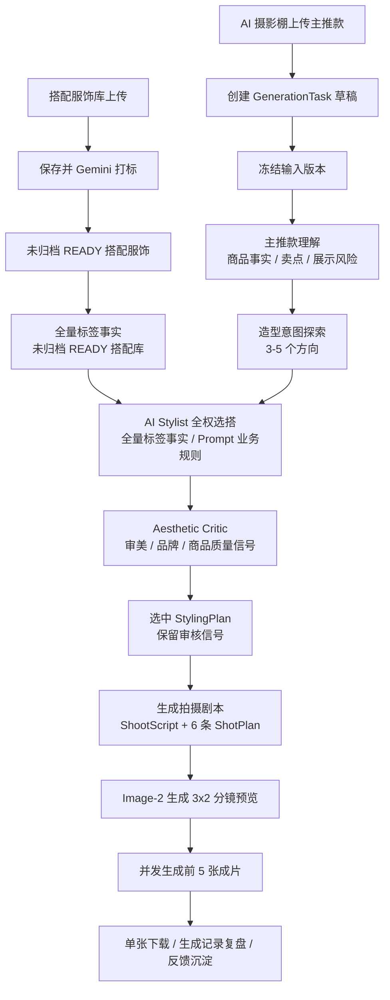

# 生成流程

## 1. 总体流程

Ruyi-Dream 的新版生成链路以 `AI Stylist` 为策划核心。系统不是把主推款和搭配库交给模型直接返回几个 ID，也不是只检查主推款是否露出，而是让模型像品牌造型师一样先理解主推款，再探索造型方向、生成多套 outfit 候选，用 Aesthetic Critic 判断这套搭配是否真正好看、符合 Lily 并让主推款更好卖，最后输出可追溯的 `StylingPlan`。



职责边界：

- `AI Stylist` 负责主推款理解、造型方向探索、候选 outfit 组合、审美与商品可见性自评，并输出 `StylingPlan`。
- `Aesthetic Critic` 是 AI Stylist 的必经质量信号，负责记录逻辑可穿但视觉难看、比例失衡、色块沉重、品牌感不足或模板化的 outfit 风险，并供系统改选、客户审核和后续流程优化使用。
- MVP 阶段不做后端预筛选、召回排序、兼容性评分、outfit 草案或后端质量判断；未归档 READY 搭配服饰库经全量 AI 标签事实卡进入 AI Stylist Prompt，`ai_tags_json` 是选搭业务输入。
- 不设独立库内供给评估步骤；若更适合空库内搭配、库内配角不成立或需要补充素材，必须体现在 `StylingPlan` 的候选比较、拒绝理由、`warnings` 和 `quality_signals` 中。
- `StylingPlan` 是选搭阶段的结构化产物，记录造型意图、候选方案、选中 outfit、拒绝理由、评分和警告。
- `ShootScript` / 拍摄剧本承接 `StylingPlan`，一次性生成整组全局导演设定和 6 条 `ShotPlan`，负责穿着关系、图位、景别、姿势、身位、走位、环境、光影、镜头、构图、主推款展示重点、搭配服饰风险、生成配饰调整和最终配饰方案。
- `Image-2` 负责按输入图片、`StylingPlan`、`ShootScript` 和单镜头 `ShotPlan` 生成分镜预览与最终成片，不负责选搭、导演决策、状态管理或历史追溯。
- 鞋、包、饰品在 MVP 阶段不是可售级商品事实源，只能作为生成配饰文字边界出现。

核心原则：

```text
搭配服饰服务主推款，而不是主推款服务整套造型。
```

模型可以探索，但每个探索都必须回答：是否好看、是否符合 Lily、是否让主推款更好卖。主推款可见只是底线，不是充分条件。

## 2. 搭配服饰库预处理

搭配服饰库保存可被真实生成到最终图里的配角服装。MVP 暂不支持鞋、包、饰品入库。

上传规则：

- 散图上传视为一套搭配服饰。
- 单文件夹视为一套搭配服饰。
- 多个一级文件夹视为多套搭配服饰。
- 单套服饰最多 6 张，推荐 1-3 张。
- 前端批量上传图片或文件夹时可以先列出超过 6 张，便于用户删除和排序；点击 `导入` 保存前必须降到 6 张以内。
- 不做图片角色识别，只保留排序；第一张默认主视图。

状态：

```text
DRAFT -> TAGGING_RUNNING -> READY
DRAFT -> TAGGING_RUNNING -> TAGGING_READY
DRAFT -> TAGGING_RUNNING -> TAGGING_FAILED
DELETED
```

点击 `导入` 后保存搭配服饰并触发 Gemini 打标。导入动作本身表示搭配服饰已经进入库；后续打标状态显示在新建搭配服饰卡片上并自动刷新。打标执行期间锁定该搭配服饰的图片集合、排序、标签编辑和归档。已保存搭配服饰的图片排序、替换、删除或追加会影响打标，UI 应提供 `仅保存` 与 `保存并重新打标`。打标使用 `lily-garment-tags-v1` 的完整判定规程并由后端校验；低置信度、fallback 或品类风险结果进入 `TAGGING_READY`，不参与选搭。列表保持标签摘要，详情展示完整分层标签和默认折叠的调用快照。

## 3. 主推款输入版本

主推款只属于本次 `GenerationTask`，MVP 不建立长期主推款商品库。

上传规则：

- 最多 8 张，推荐 3-5 张。
- 支持散图或单文件夹。
- 文件夹名可作为默认任务名。
- 任务名可重名、可修改。
- 同一任务内文件名重名需提示。
- 不做图片角色识别，排序越靠前越重要。

点击 `AI 智能选搭` 后冻结当前输入，创建 `GenerationTaskInputVersion`。用户之后返回上一步修改主推款图片，会创建新的输入版本，并要求后续阶段重新生成；旧版本数据保留。

## 4. AI Stylist 智能选搭

### 4.1 输入

- 当前输入版本的主推款图片。
- 当前输入版本冻结的用户要求，包括上传阶段的补充服装信息或拍摄要求，以及本次重新选搭时填写的微调要求。
- `runtime.candidate_retrieval`：当前未归档 READY 搭配服饰的全量 AI 标签事实卡，只暴露搭配服饰 `code`、`ai_tags`、必要人工业务标记和复核信息，不暴露系统内部 ID、图片快照或候选排序。
- Prompt 维护中的 AI 选搭业务规则、品牌边界、配饰边界和 Aesthetic Critic 维度。
- 与本次主推款和候选最相关的 Lily 官方品牌样本摘要。阶段 1 可用品牌边界文本占位，阶段 2 必须使用 `Lily Brand Style Index`。
- Lily 品牌边界、商品主角原则和生产验收维度。

MVP 阶段不输入用户长 prompt，但允许用户输入简短业务要求。用户要求是本次任务的高优先级业务输入，在不违反商品图片事实、搭配库事实、品牌硬边界、输出 schema 和安全规则时，AI Stylist 必须优先满足。若用户要求与硬边界冲突，AI Stylist 必须在结构化输出中说明冲突原因和替代处理。

### 4.2 工作流

`AI Stylist` 至少分为三个逻辑步骤，可在工程上按多次 Gemini 调用实现，也可先以一次调用返回完整结构，但输出必须保留分步结果。

1. **Hero Understanding**
   - 识别主推款事实、品类、颜色、廓形、关键卖点和不可遮挡区域。
   - 判断主推款是否本身已经是完整 look，例如连衣裙、套装、强设计上衣。
   - 主推款品类必须来自图片视觉理解，任务名和文件夹名只能作为辅助证据；不能因为 SKU 名不含“裤/裙/上衣”等字样就把品类降为 `unknown`。
   - 主推款品类、卖点、图位需求和遮挡风险由 AI Stylist 基于主推款图片判断；后端不做任务名启发式品类推断。
   - 输出主推品类对应的图位需求，例如裤装必须覆盖全身、腰脚、腰膝/腰胯、侧身/动态和正面颜色图。
   - 输出 `hero_visual_summary`、`hero_selling_points`、`hero_visibility_risks`。

2. **Styling Intent Exploration**
   - 生成 3-5 个造型方向，例如单穿主推、轻通勤、松弛叠穿、同色系高级感、反差色、轻社交。
   - 每个方向说明适用条件、商品展示收益和风险。
   - 允许探索，但不能把主推款降级为整套 look 的背景元素。

3. **Outfit Proposals + Aesthetic Critic**
   - 基于搭配服饰库全量标签事实和 Prompt 业务规则提出多套完整 outfit 候选。
   - 每套候选说明真实搭配服饰、生成配饰、穿着方式、主推款展示重点。
   - 每次必须比较空库内搭配、低存在感生成配饰和库内配角方案；若库内配角不如空库内搭配，必须选择空库内搭配或明确解释为什么仍选择库内配角。
   - 由 Aesthetic Critic 同时诊断：色彩重量、廓形体量、腰线比例、季节材质、模板化风险、穿法合法性、塞腰/半塞质量、官方样本证据和品牌采用可能性。
   - 同时打分：`aesthetic_score`、`brand_fit_score`、`hero_visibility_score`、`commercial_readiness_score`。
   - 最终选择一套 outfit；空的库内搭配是合法优秀结果，不是失败。

### 4.3 输出

选搭阶段输出 `StylingPlan`，而不是只输出 ID。

```json
{
  "schema_version": "styling-plan-v1",
  "hero_understanding": {
    "hero_visual_summary": "深蓝色V领短袖牛仔连衣裙，附带棕色收腰皮带",
    "hero_selling_points": ["V领", "腰带", "裙身廓形", "面料肌理"],
    "hero_visibility_risks": ["外套可能遮挡前襟和腰带"]
  },
  "styling_intents": [
    {
      "intent_key": "hero_first_single_piece",
      "title": "主推款单穿",
      "reason": "连衣裙本身已经构成完整通勤 look",
      "risk": "需要用鞋包丰富画面但不能抢主推款"
    }
  ],
  "outfit_candidates": [
    {
      "outfit_key": "candidate_a",
      "title": "主推款单穿",
      "mode": "hero_first_single_piece",
      "selected_material_ids": [],
      "selected_material_codes": [],
      "selected_materials": [],
      "generated_accessories": ["低存在感棕色乐福鞋"],
      "wearing_notes": "主推连衣裙单穿，鞋包呼应腰带",
      "hero_focus": ["腰带", "V领", "裙摆比例"],
      "aesthetic_diagnosis": {
        "color_weight": "鞋包只做低存在感呼应，不形成大面积深色压迫",
        "silhouette_balance": "单穿保持连衣裙完整腰线和裙身比例",
        "waistline_proportion": "腰带和收腰位置完整可见",
        "season_material_fit": "牛仔连衣裙适合轻通勤表达",
        "template_risk": "避免套用外套叠穿模板",
        "wearing_method_validity": "单穿方式由主推款结构支持",
        "tuck_quality": "不涉及塞腰",
        "official_style_evidence": "参考 Lily 官方连衣裙全身和轻斜正棚拍样本",
        "shotplan_readiness": "可支持全身、3/4、胸腰近景、侧身/背面和标准正面图",
        "brand_read": "干净、利落、轻熟通勤"
      },
      "scores": {
        "aesthetic_score": 0.86,
        "brand_fit_score": 0.9,
        "hero_visibility_score": 0.95,
        "commercial_readiness_score": 0.92
      },
      "risk_notes": []
    }
  ],
  "selected_outfit_key": "candidate_a",
  "selected_material_ids": [],
  "selected_material_codes": [],
  "selected_materials": [],
  "reason_summary": "主推连衣裙自带完整造型，采用单穿并以生成鞋包补足通勤氛围。",
  "user_requirement_resolution": {
    "user_requirement_summary": "用户要求避免外套并突出腰线",
    "satisfied": ["未选择外套", "前 5 个图位保留腰线展示"],
    "not_satisfied": [],
    "conflicts": []
  },
  "rejected_candidates": [
    {
      "outfit_key": "candidate_b",
      "reason": "外套会弱化V领、腰带和连衣裙廓形",
      "material_codes": []
    }
  ],
  "warnings": []
}
```

### 4.4 业务校验与质量信号

后端不写死审美规则；它只对工程/数据不可继续的问题做硬失败，对审美、穿法和品牌风险记录 `quality_signals`：

- 选中的搭配服饰系统 ID 必须来自当前未归档 READY 候选 `material_cards[].id`，并只用于后端关联、快照和任务包组装。
- 面向 UI、生成记录和人工审核时展示搭配服饰业务主键 `code`；`selected_material_codes` 只能原样复制候选 `material_cards[].code`，不能替代系统 ID 参与关联。
- 当前主推款同 `code`、同输入素材或同商品身份不得作为搭配服饰候选或选中结果。
- 不允许重复 ID。
- `selected_material_ids` 可为空。
- 组合应该是一个可穿 outfit；如果选择多个外套、多个互斥上装或其它明显冲突组合，`StylingPlan` 应解释具体穿着方式。缺少解释时记录审核信号，不直接让普通用户看到失败。
- 当 `aesthetic_score`、`brand_fit_score`、`hero_visibility_score` 或 `commercial_readiness_score` 任一低于阈值时，记录低分信号，供客户审核和后续优化使用。
- 如果所有评分都是满分，但 `risk_notes` 和 `aesthetic_diagnosis` 缺失，记录低可信自评信号。
- 选择外套搭配高腰裤、连衣裙或强腰线商品时，应说明外套如何不破坏腰线和主推比例；否则记录比例/遮挡风险。
- `wearing_notes` 中的穿法应被搭配服饰事实支持。搭配服饰推荐穿法不包含 `tucked` 时，不应要求全塞；开衫、外套、厚针织、明显门襟/纽扣/镂空下摆结构默认是塞腰风险信号。
- 主推款是高腰裤、阔腿裤、半裙等腰部卖点商品时，“露出腰头”不能自动推导为“上衣全塞”。应优先判断短上装、自然下摆、半塞或空库内搭配是否更好看。
- 有遮挡风险、穿法风险、模板化风险、配饰遮挡风险或官方样本证据不足时，不应四项满分；若出现满分，应记录质量信号。
- 当搭配不符合审美时，复盘必须检查 AI Stylist 是否正确阅读全量标签事实与 Prompt 业务规则，是否强行选择了不优于空库内搭配的库内配角。
- request snapshot 必须保存主推款快照、全量标签事实快照、传给 Gemini 的 Prompt 业务规则、完整 prompt/任务说明和每步响应。

### 4.5 失败案例与新口径

白色高腰阔腿裤选择镂空针织开衫并要求“全塞入裤腰”的方案，虽然让裤腰和腰带露出，但实际穿法把开衫门襟、纽扣、镂空肌理和下摆硬压进高腰裤，造成腰腹臃肿、姿态拘谨、上衣局部抢主推裤装注意力。这类结果应判定为选搭风险。

新版口径：

```text
商品可见性合格但穿法别扭、审美失败或图位服务错主角，仍然要进入质量信号和客户审核闭环。
```

如果候选库里没有真正适合白色阔腿裤的轻量短上装、浅色马甲或干净内搭，系统应优先选择空选搭或单件轻量配角，而不是硬凑完整通勤 look。若选择开衫，应优先使用自然下摆、轻微前塞或扣合短款效果，而不是默认全塞。

## 5. 全量标签事实与品牌风格

MVP 阶段不做后端预筛选和排序。系统把未归档 READY 搭配服饰库的全量标签事实交给 AI Stylist，由 Prompt + 大模型全权完成候选理解、比较、拒绝、选择、空库内搭配判断和质量信号输出。

当前目标：

- 保留 Gemini 的审美和选搭自主性。
- 避免后端积累补丁式业务逻辑。
- 让 AI 打标、AI 选搭和拍摄剧本都直接受 Prompt 维护中的业务规则影响。
- 让 Lily 官方风格证据进入选搭，而不是只靠抽象品牌形容词。

后续若搭配库规模扩大，可引入检索或 embedding，但检索只作为可解释的上下文压缩工具；MVP 不把检索、排序或质量判断作为后端业务规则实现。


## 6. 拍摄剧本 / ShotPlan

预览前，系统先生成 `ShootScript` 拍摄剧本。拍摄剧本一次性输出整组全局导演设定和 6 个结构化 `ShotPlan`。用户可以查看拍摄剧本，但 MVP 不允许编辑。完整状态机、schema、重生/失效和迁移规则见 `shoot_script_workflow.md`。

`ShotPlan` 是最终生成与记录复盘的结构化事实，不应只依赖分镜预览图片像素，也不能使用一套通用图位模板服务所有品类。

ShotPlan 必须读取选中的 `StylingPlan`，尤其是：

- `hero_understanding.category` 和主推品类图位矩阵。
- `mode`：单穿主推、轻外搭、内搭层次、成套通勤等。
- `hero_focus`：每格必须服务的主推款卖点。
- `wearing_notes`：真实搭配服饰如何穿到模特身上。
- `generated_accessories`：AI Stylist 给出的鞋、包、饰品初始风格边界。进入分镜预览和最终成片时，以 ShootScript 的 `resolved_accessories` 和 ShotPlan 的 `accessory_instructions` 为准。
- `risk_notes`：遮挡、喧宾夺主、商品细节弱化等风险。

主推款是裤装时，前 5 格必须覆盖：

1. 全身或近全身主视觉，裤脚和鞋完整，姿态自然不站军姿。
2. 腰脚下装图或近全身，重点腰头、门襟、裤褶、裤腿、裤长。
3. 腰膝或腰胯近景，重点腰带扣、褶位、口袋、面料挺括度。
4. 3/4 或侧身轻走动，重点侧缝、垂坠、裤脚动态。
5. 正面颜色/版型图，稳定平台友好。

不能让 1、2、4、6 都成为重复全身图，也不能让上衣半身近景替代裤装核心展示。完整品类矩阵见 `../02_brand_and_assets/category_shot_rules.md`。

每条 ShotPlan 至少包含：

```json
{
  "sort_order": 1,
  "shot_type": "hero | full_body | half_body | side | back | detail | reference",
  "framing": "string",
  "pose": "string",
  "camera_angle": "string",
  "main_focus": "string",
  "visible_garments": ["hero", "styling:123"],
  "hero_selling_points": ["string"],
  "wearing_notes": "string",
  "generated_accessory_notes": "string",
  "background_lighting": "string",
  "composition_notes": "string",
  "negative_constraints": ["string"]
}
```

第 6 条 ShotPlan 可以生成并保存，但 MVP 最终直接忽略第 6 格，不进入最终成片。

## 7. 分镜预览

分镜预览阶段调用 Image-2，输出一张 3x2 分镜预览总图。

输入包括：

- 主推款图片。
- 选中搭配服饰图片；如果 `selected_material_ids` 为空，则不传库内搭配服饰图片。
- 数字模特图片。
- 选中 `StylingPlan`。
- 当前 `ShootScript`。
- 6 条 ShotPlan。
- 品牌棚拍边界与生成配饰边界。

MVP 不裁切分镜预览，不存 6 个 frame，只保存总图。失败可重试当前预览阶段；成功后允许重新生成分镜预览，新预览成功后旧成片失效但保留。

## 8. 最终成片生成

最终阶段固定生成前 5 个镜头，5 张图并发调用 Image-2。

每张图输入：

- 同一张分镜预览图。
- 当前 `ShootScript`。
- 对应的 ShotPlan。
- 选中 `StylingPlan`。
- 主推款图片。
- 选中搭配服饰图片。
- 数字模特图片。
- 品牌棚拍边界和禁止项。

提示词需要明确：

```text
参考分镜预览图中的第 N 格作为姿势、身位、景别、构图和光影方向。分镜预览不是商品事实来源。主推款和搭配服饰的商品事实始终以各自服装参考图为准。搭配服饰和生成配饰必须服务主推款展示，不得让主推款沦为整套造型的背景元素。
```

最终图按“结果批次 -> 5 个图位 -> 每图多次 attempt”建模。支持整组重新生成，也支持单张重生；重生复用当前最新主推款输入版本、AI 选搭、拍摄剧本、分镜预览和对应 ShotPlan，不影响其他成功成片。

## 9. 重试与重新生成

MVP 支持失败后重试当前阶段，也支持成功后重新生成：

- 打标失败可重试打标。
- 选搭失败或不满意可重新选搭；新选搭成功后旧拍摄剧本、旧分镜预览和旧成片失效但保留。
- 拍摄剧本失败或不满意可重新生成剧本；新剧本成功后旧分镜预览和旧成片失效但保留。
- 分镜预览失败或不满意可重新生成预览；新预览成功后旧成片失效但保留。
- 最终成片支持整组重新生成。
- 最终单张失败或不满意可单张重生，不影响其他成功成片。

## 10. 记录、恢复与反馈

生成记录只展示进入过 AI 阶段的任务。草稿保存但不污染生成记录列表。

历史记录保存：

- 主推款输入版本快照。
- 搭配服饰库全量标签事实快照。
- `StylingPlan` 完整快照。
- `ShootScript` 拍摄剧本完整快照。
- 被选中和被拒绝搭配服饰快照。
- 数字模特快照。
- 分镜预览图。
- 6 条 ShotPlan。
- 前 5 张最终结果和 attempts。
- provider request/response。

历史再次生成默认使用当时快照，不读取素材库或数字模特的最新版本。

后续生产增强应记录用户对方案的接受、拒绝、重选、下载和人工反馈，沉淀品牌偏好库。反馈不能直接覆盖历史任务，只能影响未来 Prompt 口径、上下文压缩和 AI Stylist 判断。
