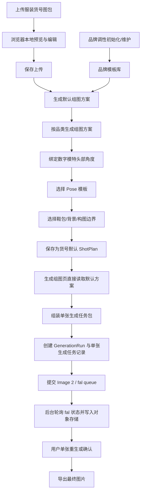

# 生成流程

## 1. 总体流程



这里要明确：Image 2 只在 `逐张生成预览图` 环节工作。服装识别、品牌调性抽象、搭配选择、Pose 选择、镜头取景和组图脚本生成，都属于前置预处理/策划层。

当前实现中，Image 2 不在前端 HTTP 请求内同步等待生成完成。点击“生成组图”后，后端会立即创建生成批次和每张图的任务记录，将每张图提交到 fal queue，然后返回 `GenerationRun`。后续由后端后台 poller 查询 fal 的真实状态，前端定时读取后端状态并显示运行计时、排队中、生成中、已完成或失败。

## 1.1 三层架构

| 层级 | 目标 | 主要技术路线 | 是否每次生成都运行 |
| --- | --- | --- | --- |
| 预处理层 | 把素材变成结构化资产 | 视觉识别模型/VLM、人工确认、标签库 | 保存或更新服装默认方案时运行；品牌初始化时运行 |
| 策划层 | 生成货号默认组图拍摄方案 | 推理模型/规则引擎/模板检索 | 上传保存后或用户在服装素材页更新默认方案时运行 |
| 生成层 | 把方案合成为图片 | Image 2 | 每张图运行 |

生产中不应该让 Image 2 每次重新理解 品牌调性。品牌调性应在品牌初始化或模板修改时推理一次，沉淀成模板库；每次生成只做模板匹配和调用。

## 2. 素材上传与管理

当前 MVP 不做素材图片类型识别，也不要求用户维护“正面图/背面图/细节图”等标签。系统只保留上传顺序，并约定第一张图片默认作为封面和主要参考图。

支持的上传方式：

- 上传 N 张图片，并填写货号，对应一个图包。
- 上传一个文件夹，货号默认等于文件夹名称，并支持修改。
- 上传 N 个文件夹，货号默认等于各文件夹名称，并支持逐个修改。

上传交互：

```text
上传新货号 -> 预览与编辑 -> 保存并上传 -> 生成默认组图方案
```

预览与编辑阶段：

- 图片只在浏览器本地暂存。
- 用户可以编辑货号和标题。
- 用户可以删除不需要的图片。
- 图片卡片与已保存素材卡片保持一致，展示文件名、尺寸、文件大小。
- 暂不支持 ZIP 上传。

## 3. 服装识别

系统应输出结构化识别结果：

- 货号
- 品类
- 主颜色
- 辅助颜色
- 面料视觉特征
- 版型
- 领型
- 袖长
- 裤长或裙长
- 关键结构
- 推荐展示重点
- 穿着长度
- 廓形宽度
- 下摆露出比例
- 袖窿/领口/下摆等关键比例

示例：

```json
{
  "sku": "125329C0908714",
  "category": "马甲",
  "color": "浅灰",
  "fabric": "人字纹粗纺感",
  "fit": "标准偏修身",
  "structure": ["V领", "四粒扣", "双袋盖", "无袖", "后片纯色"],
  "focus": ["领口", "纽扣", "袋盖", "收腰", "背面"]
}
```

## 4. 用户确认

用户不需要从零填写服装信息，只需要确认或修正系统识别结果。

MVP 阶段需要用户确认：

- 品类是否正确
- 版型是否正确
- 面料感觉是否正确
- 穿着长度是否正确
- 廓形宽度是否正确
- 品牌调性模板是否正确
- Pose 是否符合 品牌调性
- 是否有必须保真的结构
- 是否有特别需要展示的部位

## 5. 默认组图方案生成

系统根据品类自动生成一套镜头清单，并保存在货号下作为默认组图方案。生成页不再每次临时生成方案，而是直接读取并使用该默认方案。

每张图包含：

- 图片用途
- 镜头范围
- 模特姿态
- 拍摄角度
- 商品展示重点
- 背景
- 裁切比例

示例：

```json
{
  "shot": 1,
  "role": "首图",
  "frame": "正面半身",
  "pose": "自然站立，手臂放松",
  "angle": "正面",
  "focus": "V领、纽扣、腰线",
  "background": "浅灰棚拍",
  "aspectRatio": "1:1"
}
```

默认方案规则：

- 上传新图包保存后自动创建默认方案。
- 用户可在“服装素材”页点击“生成默认方案 / 更新默认方案”。
- 一个货号可保留多条历史方案；当前最新一条作为默认方案。
- 生成组图页如果发现货号缺少默认方案，会提示回到服装素材页保存方案。

## 6. 生成请求组装

底层生成请求不直接由用户 prompt 组成，而是由系统生成一个 `单张生成任务包`。任务包需要包含：

- 模特头部参考图
- 服装正面图
- 服装背面图
- 服装细节图
- 当前镜头的拍摄方案
- 当前镜头绑定的头部角度
- 当前镜头绑定的 Pose 模板
- 品牌调性参考图与 Styling 边界
- 服装穿着比例约束
- 默认风格约束
- 服装保真约束
- 输出比例与尺寸
- 前置策划器生成的短文本任务
- 品牌模板检索出的同品类真实参考图

关键约束：

- 保持同一模特脸、发型、气质
- 保持服装颜色、面料、结构
- 不改变纽扣数量、口袋位置、领型、袖长、裤长、裙长
- 背景干净，不生成无关文字、水印、logo
- 构图接近目标品牌 白/浅灰棚拍主图

Image 2 的输入原则：

- 图片负责事实和风格参考。
- 参数负责比例。
- 模板负责品牌边界。
- 短文本只负责任务、优先级和禁止项。
- 不用长 prompt 重复描述图片里已经明确的商品细节。

### 6.1 GPT Image-2 / fal 调用方式

当前接入 fal 的 GPT Image-2 edit endpoint：

```text
提交：POST https://queue.fal.run/openai/gpt-image-2/edit
状态：使用 fal 返回的 status_url
结果：使用 fal 返回的 response_url
```

提交给 fal 的核心入参：

```json
{
  "prompt": "中文生成提示词",
  "image_urls": ["上传到 fal 后得到的参考图 URL"],
  "image_size": "auto",
  "quality": "high",
  "num_images": 1,
  "output_format": "png",
  "sync_mode": false
}
```

所有 Gemini 和 Image 2 调用提示词统一使用中文。Image 2 prompt 由系统根据 `task_package` 自动合成，用户不直接编写长 prompt。

参考图通过对象存储短期预签名 URL 进入 `image_urls`。每个生成任务会保存对象 key、预签名 URL、provider URL 和图片角色，方便追溯。

### 6.2 生成状态与刷新恢复

生成状态以数据库为准，前端只轮询后端，不直接轮询 fal。

单张图状态：

```text
QUEUED -> SUBMITTED -> IN_QUEUE -> IN_PROGRESS -> SUCCEEDED
```

失败和取消状态：

```text
FAILED / CANCELLED
```

生成批次状态由子任务聚合：

```text
CREATED / RUNNING / PARTIAL_SUCCEEDED / SUCCEEDED / FAILED / CANCELLED
```

计时器不每秒写库。后端保存 `created_at`、`submitted_at`、`completed_at`、`last_status_checked_at`，前端根据时间戳动态计算运行时长。刷新页面后，前端会恢复最近一次生成记录并继续轮询后端状态；后端服务重启后，后台 poller 会扫描未完成的任务继续查询 fal。

## 7. 重生机制

MVP 阶段不做自动质检，但必须支持人工重生。

单张重生时，应保留：

- 同一个货号
- 同一个模特
- 同一个服装识别结果
- 同一张图的用途
- 同一个镜头范围

用户可调整：

- 姿态
- 镜头范围
- 背景白/浅灰
- 补充要求

当前实现中，重生不再额外新增一条 `GenerationImage` 记录。每个图位生成任务保持一条记录，重生会在同一条记录的 `attempts_json` 中追加一次 attempt，并更新当前输出图、provider request、provider response、fal request id 和状态。这样“生成记录”的粒度保持为“每个生成任务一条”，历史尝试通过 attempts 追溯。

## 8. 导出

MVP 输出建议：

- 文件夹按货号命名
- 每张图按用途命名

示例：

```text
125329C0908714/
  01-首图-正面半身.jpg
  02-全身搭配.jpg
  03-侧身版型.jpg
  04-背面.jpg
  05-局部细节.jpg
```
