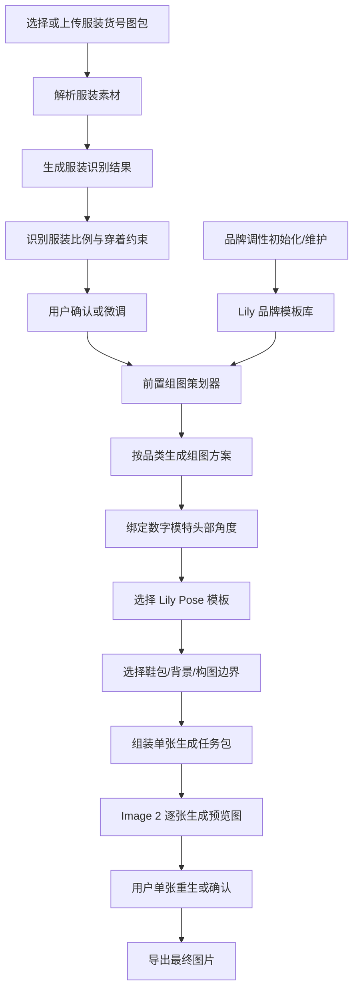

# 生成流程

## 1. 总体流程



这里要明确：Image 2 只在 `逐张生成预览图` 环节工作。服装识别、品牌调性抽象、搭配选择、Pose 选择、镜头取景和组图脚本生成，都属于前置预处理/策划层。

## 1.1 三层架构

| 层级 | 目标 | 主要技术路线 | 是否每次生成都运行 |
| --- | --- | --- | --- |
| 预处理层 | 把素材变成结构化资产 | 视觉识别模型/VLM、人工确认、标签库 | 服装每个货号运行；品牌初始化时运行 |
| 策划层 | 生成本次组图拍摄方案 | 推理模型/规则引擎/模板检索 | 每次生成运行 |
| 生成层 | 把方案合成为图片 | Image 2 | 每张图运行 |

生产中不应该让 Image 2 每次重新理解 Lily 调性。Lily 调性应在品牌初始化或模板修改时推理一次，沉淀成模板库；每次生成只做模板匹配和调用。

## 2. 素材解析

系统读取一个货号文件夹中的图片，并尽量识别：

- 正面图
- 背面图
- 细节图
- 颜色图
- 面料图
- 3D 或多角度参考图

当前 Lily 单品图包中常见文件类型包括：

- 平铺正面图
- 平铺背面图
- 领口、纽扣、袖口、口袋等细节图
- 面料纹理图
- 颜色图
- 3D 正反面图

## 3. 服装识别

系统应输出结构化识别结果：

- 货号
- 品类
- 主颜色
- 辅助颜色
- 面料视觉特征
- 版型
- 领型
- 袖长
- 裤长或裙长
- 关键结构
- 推荐展示重点
- 穿着长度
- 廓形宽度
- 下摆露出比例
- 袖窿/领口/下摆等关键比例

示例：

```json
{
  "sku": "125329C0908714",
  "category": "马甲",
  "color": "浅灰",
  "fabric": "人字纹粗纺感",
  "fit": "标准偏修身",
  "structure": ["V领", "四粒扣", "双袋盖", "无袖", "后片纯色"],
  "focus": ["领口", "纽扣", "袋盖", "收腰", "背面"]
}
```

## 4. 用户确认

用户不需要从零填写服装信息，只需要确认或修正系统识别结果。

MVP 阶段需要用户确认：

- 品类是否正确
- 版型是否正确
- 面料感觉是否正确
- 穿着长度是否正确
- 廓形宽度是否正确
- 品牌调性模板是否正确
- Pose 是否符合 Lily 调性
- 是否有必须保真的结构
- 是否有特别需要展示的部位

## 5. 组图方案生成

系统根据品类自动生成一套镜头清单。

每张图包含：

- 图片用途
- 镜头范围
- 模特姿态
- 拍摄角度
- 商品展示重点
- 背景
- 裁切比例

示例：

```json
{
  "shot": 1,
  "role": "首图",
  "frame": "正面半身",
  "pose": "自然站立，手臂放松",
  "angle": "正面",
  "focus": "V领、纽扣、腰线",
  "background": "浅灰棚拍",
  "aspectRatio": "1:1"
}
```

## 6. 生成请求组装

底层生成请求不直接由用户 prompt 组成，而是由系统生成一个 `单张生成任务包`。任务包需要包含：

- 模特头部参考图
- 服装正面图
- 服装背面图
- 服装细节图
- 当前镜头的拍摄方案
- 当前镜头绑定的头部角度
- 当前镜头绑定的 Lily Pose 模板
- Lily 品牌调性参考图与 Styling 边界
- 服装穿着比例约束
- Lily 默认风格约束
- 服装保真约束
- 输出比例与尺寸
- 前置策划器生成的短文本任务
- 品牌模板检索出的同品类真实参考图

关键约束：

- 保持同一模特脸、发型、气质
- 保持服装颜色、面料、结构
- 不改变纽扣数量、口袋位置、领型、袖长、裤长、裙长
- 背景干净，不生成无关文字、水印、logo
- 构图接近 Lily 白/浅灰棚拍主图

Image 2 的输入原则：

- 图片负责事实和风格参考。
- 参数负责比例。
- 模板负责品牌边界。
- 短文本只负责任务、优先级和禁止项。
- 不用长 prompt 重复描述图片里已经明确的商品细节。

## 7. 重生机制

MVP 阶段不做自动质检，但必须支持人工重生。

单张重生时，应保留：

- 同一个货号
- 同一个模特
- 同一个服装识别结果
- 同一张图的用途
- 同一个镜头范围

用户可调整：

- 姿态
- 镜头范围
- 背景白/浅灰
- 补充要求

## 8. 导出

MVP 输出建议：

- 文件夹按货号命名
- 每张图按用途命名

示例：

```text
125329C0908714/
  01-首图-正面半身.jpg
  02-全身搭配.jpg
  03-侧身版型.jpg
  04-背面.jpg
  05-局部细节.jpg
```
