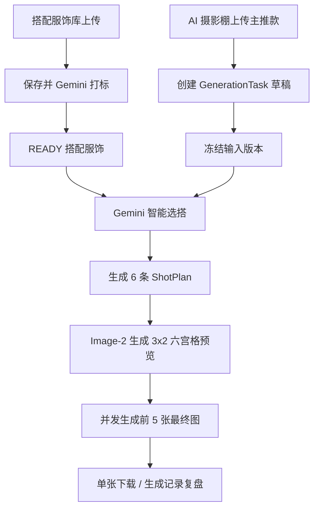

# 生成流程

## 1. 总体流程

新版 Ruyi-Dream 的生成链路是：



职责边界：

- `Gemini 智能选搭` 只负责从搭配服饰库选择配角服饰。
- `ShotPlan` 负责穿着关系、图位、景别、姿势、身位、环境、光影、镜头、构图和生成配饰边界。
- `Image-2` 负责按输入图片和 ShotPlan 生成六宫格预览与最终成片。
- 鞋、包、饰品在 MVP 阶段不是可售级商品事实源，只能作为生成配饰文字边界出现。

## 2. 搭配服饰库预处理

搭配服饰库保存可被真实生成到最终图里的配角服装。MVP 暂不支持鞋、包、饰品入库。

上传规则：

- 散图上传视为一套搭配服饰。
- 单文件夹视为一套搭配服饰。
- 多个一级文件夹视为多套搭配服饰。
- 单套服饰最多 6 张，推荐 1-3 张。
- 前端批量上传图片或文件夹时可以先列出超过 6 张，便于用户删除和排序；点击 `导入` 保存前必须降到 6 张以内。
- 不做图片角色识别，只保留排序；第一张默认主视图。

状态：

```text
DRAFT -> TAGGING_RUNNING -> READY
TAGGING_FAILED
DELETED
```

点击 `导入` 后保存搭配服饰并触发 Gemini 打标。导入动作本身表示搭配服饰已经进入库；后续打标状态显示在新建搭配服饰卡片上并自动刷新。打标执行期间锁定该搭配服饰的图片集合、排序、标签编辑和归档。已保存搭配服饰的图片排序、替换、删除或追加会影响打标，UI 应提供 `仅保存` 与 `保存并重新打标`。标签体系是后续重点优化对象，但 MVP 必须有稳定、瘦小、准确的 schema。选搭阶段会把全部可用 tags 传给 Gemini，因此 tags 不应膨胀成冗长描述。

## 3. 主推款输入版本

主推款只属于本次 `GenerationTask`，MVP 不建立长期主推款商品库。

上传规则：

- 最多 8 张，推荐 3-5 张。
- 支持散图或单文件夹。
- 文件夹名可作为默认任务名。
- 任务名可重名、可修改。
- 同一任务内文件名重名需提示。
- 不做图片角色识别，排序越靠前越重要。

点击 `AI 智能选搭` 后冻结当前输入，创建 `GenerationTaskInputVersion`。用户之后返回上一步修改主推款图片，会创建新的输入版本，并要求后续阶段重新生成；旧版本数据保留。

## 4. AI 智能选搭

输入：

- 当前输入版本的主推款图片。
- 当前全部 `READY` 搭配服饰的完整 tags。
- 每套搭配服饰的压缩标识信息，例如 ID、code、category、colors、style、season、brief。

不输入：

- 搭配服饰图片本身。
- embedding / 向量检索结果。
- 用户提示词。MVP 暂不支持。

输出：

```json
{
  "selected_material_ids": [1, 2],
  "hero_visual_summary": "short internal summary",
  "reason_summary": "short explanation",
  "warnings": []
}
```

规则：

- `SourceMaterialIDs` 为当前全部可用搭配服饰。
- 被选中的搭配服饰图片与 tags 在选搭完成时写入快照；后续预览与成片读取快照，库内归档或更新不得覆盖已有任务事实源。用户明确执行级联删除时，实际选中过该服饰的任务、快照、主推款上传素材和生成输出随之一并删除。
- 空的 `selected_material_ids` 允许。
- 非法 ID、重复 ID、选择非 READY 素材、JSON 不可解析视为失败。
- MVP 不支持成功后重新搭配，不支持手动替换或移除配角。
- `hero_visual_summary` 只是链路上下文，不是商品事实权威；商品事实仍以主推款图片为准。

## 5. ShotPlan

预览前，系统为 6 个格子生成结构化 ShotPlan。ShotPlan 是最终生成与记录复盘的结构化事实，不应只依赖六宫格图片像素。

每条 ShotPlan 至少包含：

```json
{
  "sort_order": 1,
  "shot_type": "hero | full_body | half_body | side | back | detail | reference",
  "framing": "string",
  "pose": "string",
  "camera_angle": "string",
  "main_focus": "string",
  "visible_garments": ["hero", "styling:123"],
  "generated_accessory_notes": "string",
  "background_lighting": "string",
  "composition_notes": "string",
  "negative_constraints": ["string"]
}
```

第 6 条 ShotPlan 可以生成并保存，但 MVP 最终直接忽略第 6 格，不进入最终成片。

## 6. 六宫格预览

预览阶段调用 Image-2，输出一张 3x2 六宫格总图。

输入包括：

- 主推款图片。
- 选中搭配服饰图片。
- 数字模特图片。
- 6 条 ShotPlan。
- 品牌棚拍边界与生成配饰边界。

MVP 不裁切六宫格，不存 6 个 frame，只保存总图。成功后不支持换一版预览；失败可重试当前预览阶段。

## 7. 最终成片生成

最终阶段固定生成前 5 格，5 张图并发调用 Image-2。

每张图输入：

- 同一张六宫格预览图。
- 对应的 ShotPlan。
- 主推款图片。
- 选中搭配服饰图片。
- 数字模特图片。
- 品牌棚拍边界和禁止项。

提示词需要明确：

```text
参考六宫格预览图中的第 N 格作为姿势、身位、景别、构图和光影方向。六宫格不是商品事实来源。主推款和搭配服饰的商品事实始终以各自服装参考图为准。
```

最终图按“结果批次 -> 5 个图位 -> 每图多次 attempt”建模。单张失败可重试该张；成功后 MVP 不支持换一版整组。

## 8. 重试与失败

MVP 支持失败后重试当前阶段：

- 打标失败可重试打标。
- 选搭失败可重试选搭。
- 预览失败可重试预览。
- 最终单张失败可重试该张。

MVP 不支持成功后的重新搭配、重新预览或重新整组生成。这些能力后续扩展。

## 9. 记录与恢复

生成记录只展示进入过 AI 阶段的任务。草稿保存但不污染生成记录列表。

历史记录保存：

- 主推款输入版本快照。
- 搭配服饰选择快照。
- 数字模特快照。
- 六宫格预览图。
- 6 条 ShotPlan。
- 前 5 张最终结果和 attempts。
- provider request/response。

历史再次生成默认使用当时快照，不读取素材库或数字模特的最新版本。
