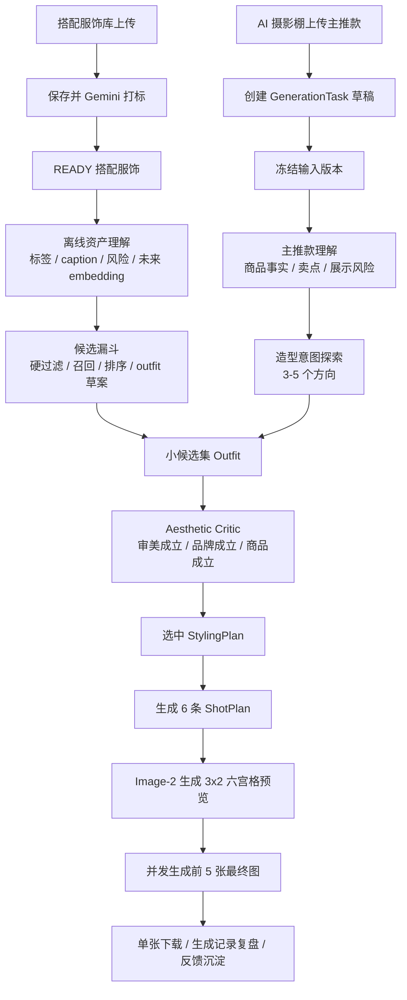

# 生成流程

## 1. 总体流程

Ruyi-Dream 的新版生成链路以 `AI Stylist` 为策划核心。系统不是把主推款和搭配库交给模型直接返回几个 ID，也不是只检查主推款是否露出，而是让模型像品牌造型师一样先理解主推款，再探索造型方向、生成多套 outfit 候选，用 Aesthetic Critic 判断这套搭配是否真正好看、符合 Lily 并让主推款更好卖，最后输出可追溯的 `StylingPlan`。



职责边界：

- `AI Stylist` 负责主推款理解、造型方向探索、候选 outfit 组合、审美与商品可见性自评，并输出 `StylingPlan`。
- `Aesthetic Critic` 是 AI Stylist 的必经质量门，负责否决逻辑可穿但视觉难看、比例失衡、色块沉重、品牌感不足或模板化的 outfit。
- 候选漏斗层负责把 READY 搭配服饰按标签、caption、颜色、品类、季节、风险、品牌样本相似度和后续 embedding 压缩成少量可判断候选，不负责最终审美决策。
- `StylingPlan` 是选搭阶段的结构化产物，记录造型意图、候选方案、选中 outfit、拒绝理由、评分和警告。
- `ShotPlan` 承接 `StylingPlan`，负责穿着关系、图位、景别、姿势、身位、环境、光影、镜头、构图、主推款展示重点和生成配饰边界。
- `Image-2` 负责按输入图片、`StylingPlan` 和 `ShotPlan` 生成六宫格预览与最终成片，不负责选搭、状态管理或历史追溯。
- 鞋、包、饰品在 MVP 阶段不是可售级商品事实源，只能作为生成配饰文字边界出现。

核心原则：

```text
搭配服饰服务主推款，而不是主推款服务整套造型。
```

模型可以探索，但每个探索都必须回答：是否好看、是否符合 Lily、是否让主推款更好卖。主推款可见只是底线，不是充分条件。

## 2. 搭配服饰库预处理

搭配服饰库保存可被真实生成到最终图里的配角服装。MVP 暂不支持鞋、包、饰品入库。

上传规则：

- 散图上传视为一套搭配服饰。
- 单文件夹视为一套搭配服饰。
- 多个一级文件夹视为多套搭配服饰。
- 单套服饰最多 6 张，推荐 1-3 张。
- 前端批量上传图片或文件夹时可以先列出超过 6 张，便于用户删除和排序；点击 `导入` 保存前必须降到 6 张以内。
- 不做图片角色识别，只保留排序；第一张默认主视图。

状态：

```text
DRAFT -> TAGGING_RUNNING -> READY
DRAFT -> TAGGING_RUNNING -> TAGGING_READY
DRAFT -> TAGGING_RUNNING -> TAGGING_FAILED
DELETED
```

点击 `导入` 后保存搭配服饰并触发 Gemini 打标。导入动作本身表示搭配服饰已经进入库；后续打标状态显示在新建搭配服饰卡片上并自动刷新。打标执行期间锁定该搭配服饰的图片集合、排序、标签编辑和归档。已保存搭配服饰的图片排序、替换、删除或追加会影响打标，UI 应提供 `仅保存` 与 `保存并重新打标`。打标使用 `lily-garment-tags-v1` 的完整判定规程并由后端校验；低置信度、fallback 或品类风险结果进入 `TAGGING_READY`，不参与选搭。列表保持标签摘要，详情展示完整分层标签和默认折叠的调用快照。

## 3. 主推款输入版本

主推款只属于本次 `GenerationTask`，MVP 不建立长期主推款商品库。

上传规则：

- 最多 8 张，推荐 3-5 张。
- 支持散图或单文件夹。
- 文件夹名可作为默认任务名。
- 任务名可重名、可修改。
- 同一任务内文件名重名需提示。
- 不做图片角色识别，排序越靠前越重要。

点击 `AI 智能选搭` 后冻结当前输入，创建 `GenerationTaskInputVersion`。用户之后返回上一步修改主推款图片，会创建新的输入版本，并要求后续阶段重新生成；旧版本数据保留。

## 4. AI Stylist 智能选搭

### 4.1 输入

- 当前输入版本的主推款图片。
- 候选漏斗输出的小候选集，而不是当前全部 `READY` 搭配服饰。
- Top 候选服饰的压缩事实卡片，例如 ID、code、category、colors、fit、season、pairing_brief、wearability、risk、短 caption 和遮挡风险。
- Top 候选服饰的主图或缩略图。Gemini 只看少量候选图，不看全库图片。
- 后端生成的 3-8 套 outfit 草案，每套包含候选服饰、穿着方式、主推款卖点收益和风险。
- 与本次主推款和候选最相关的 Lily 官方品牌样本摘要。阶段 1 可用品牌边界文本占位，阶段 2 必须使用 `Lily Brand Style Index`。
- Lily 品牌边界、商品主角原则和生产验收维度。

MVP 阶段默认不输入用户长 prompt。用户只确认拍摄信息和结果，不被训练成 prompt 工程师。

### 4.2 工作流

`AI Stylist` 至少分为三个逻辑步骤，可在工程上按多次 Gemini 调用实现，也可先以一次调用返回完整结构，但输出必须保留分步结果。

1. **Hero Understanding**
   - 识别主推款事实、品类、颜色、廓形、关键卖点和不可遮挡区域。
   - 判断主推款是否本身已经是完整 look，例如连衣裙、套装、强设计上衣。
   - 输出 `hero_visual_summary`、`hero_selling_points`、`hero_visibility_risks`。

2. **Styling Intent Exploration**
   - 生成 3-5 个造型方向，例如单穿主推、轻通勤、松弛叠穿、同色系高级感、反差色、轻社交。
   - 每个方向说明适用条件、商品展示收益和风险。
   - 允许探索，但不能把主推款降级为整套 look 的背景元素。

3. **Outfit Proposals + Aesthetic Critic**
   - 基于候选漏斗和 outfit 草案提出多套完整 outfit 候选。
   - 每套候选说明真实搭配服饰、生成配饰、穿着方式、主推款展示重点。
   - 由 Aesthetic Critic 同时诊断：色彩重量、廓形体量、腰线比例、季节材质、模板化风险和品牌采用可能性。
   - 同时打分：`aesthetic_score`、`brand_fit_score`、`hero_visibility_score`、`commercial_readiness_score`。
   - 最终选择一套 outfit；空的库内搭配是合法优秀结果，不是失败。

### 4.3 输出

选搭阶段输出 `StylingPlan`，而不是只输出 ID。

```json
{
  "schema_version": "styling-plan-v1",
  "hero_understanding": {
    "hero_visual_summary": "深蓝色V领短袖牛仔连衣裙，附带棕色收腰皮带",
    "hero_selling_points": ["V领", "腰带", "裙身廓形", "面料肌理"],
    "hero_visibility_risks": ["外套可能遮挡前襟和腰带"]
  },
  "styling_intents": [
    {
      "id": "hero_first_single_piece",
      "title": "主推款单穿",
      "reason": "连衣裙本身已经构成完整通勤 look",
      "risk": "需要用鞋包丰富画面但不能抢主推款"
    }
  ],
  "outfit_candidates": [
    {
      "id": "candidate_a",
      "mode": "hero_first_single_piece",
      "selected_material_ids": [],
      "generated_accessories": ["低存在感棕色乐福鞋"],
      "wearing_notes": "主推连衣裙单穿，鞋包呼应腰带",
      "hero_focus": ["腰带", "V领", "裙摆比例"],
      "aesthetic_diagnosis": {
        "color_weight": "鞋包只做低存在感呼应，不形成大面积深色压迫",
        "silhouette_balance": "单穿保持连衣裙完整腰线和裙身比例",
        "waistline_proportion": "腰带和收腰位置完整可见",
        "season_material_fit": "牛仔连衣裙适合轻通勤表达",
        "template_risk": "避免套用外套叠穿模板",
        "brand_read": "干净、利落、轻熟通勤"
      },
      "scores": {
        "aesthetic_score": 0.86,
        "brand_fit_score": 0.9,
        "hero_visibility_score": 0.95,
        "commercial_readiness_score": 0.92
      },
      "risk_notes": []
    }
  ],
  "selected_outfit_id": "candidate_a",
  "selected_material_ids": [],
  "reason_summary": "主推连衣裙自带完整造型，采用单穿并以生成鞋包补足通勤氛围。",
  "rejected_candidates": [
    {
      "id": "candidate_b",
      "reason": "外套会弱化V领、腰带和连衣裙廓形"
    }
  ],
  "warnings": []
}
```

### 4.4 业务校验

后端不写死审美规则，但必须校验基础真实性、生产边界和最低质量门：

- 选中的搭配服饰 ID 必须来自当前 READY 候选。
- 不允许重复 ID。
- `selected_material_ids` 可为空。
- 组合必须是一个可穿 outfit；如果选择多个外套、多个互斥上装或其它明显冲突组合，必须由 `StylingPlan` 解释具体穿着方式，否则视为失败或要求重试。
- 当 `aesthetic_score`、`brand_fit_score`、`hero_visibility_score` 或 `commercial_readiness_score` 任一低于阈值时，不自动进入预览；前台可显示风险并允许用户确认或重新选搭。
- 如果所有评分都是满分，但 `risk_notes` 和 `aesthetic_diagnosis` 缺失，视为低可信输出，应重试或降级为空选搭。
- 选择外套搭配高腰裤、连衣裙或强腰线商品时，必须说明外套如何不破坏腰线和主推比例。
- request snapshot 必须保存主推款快照、候选漏斗结果、传给 Gemini 的候选卡片/候选图片/品牌样本证据、完整 prompt/任务说明和每步响应。

### 4.5 失败案例与新口径

白色高腰阔腿裤选择深棕针织衫和深棕西装外套的方案，虽然能让裤子露出，也写明了上衣塞腰、外套敞开，但实际预览呈现出上半身沉重、色块生硬、季节感偏厚、裤子的轻盈高级感被压住。这类结果应判定为选搭失败。

新版口径：

```text
商品可见性合格但审美失败，仍然是失败。
```

如果候选库里没有真正适合白色阔腿裤的轻量短上装、浅色马甲或干净内搭，系统应优先选择空选搭或单件轻量配角，而不是硬凑深色通勤三件套。

## 5. 候选漏斗与品牌风格检索

系统不能把全量 READY 服饰图片、缩略图或完整 tags 一次性喂给 Gemini。新版使用“检索负责找候选，排序负责控噪音，Gemini 负责审美决策”的候选漏斗。完整方案见 `brand_style_retrieval_workflow.md`。

漏斗目标：

- 保留 Gemini 的审美自主性。
- 缩小候选噪音，提升稳定性和可解释性。
- 支持搭配库扩展到几百或上千件后，Gemini 请求体仍保持小候选集。
- 让 Lily 官方风格证据进入选搭，而不是只靠抽象品牌形容词。

四层漏斗：

1. **离线资产理解**：入库时生成标签、短 caption、衣长体量、遮挡风险、可塞腰/可敞开、未来 embedding。
2. **主推款理解与硬过滤**：根据主推款品类、卖点和不可遮挡区域，排除互斥品类并降权高风险单品。
3. **召回与兼容性排序**：按品类互补、色彩关系、廓形关系、季节材质、Lily 风格相似度和模板化惩罚输出 12-20 件候选与 3-8 套 outfit 草案。
4. **Gemini 决策**：只看小候选集、候选图、主推款图和品牌样本证据，输出 `StylingPlan`。

阶段 1 可以不引入向量库，先使用规则、标签、caption 和风险降权。阶段 3 再引入多模态 embedding 和向量检索。

## 6. ShotPlan

预览前，系统为 6 个格子生成结构化 ShotPlan。ShotPlan 是最终生成与记录复盘的结构化事实，不应只依赖六宫格图片像素。

ShotPlan 必须读取选中的 `StylingPlan`，尤其是：

- `mode`：单穿主推、轻外搭、内搭层次、成套通勤等。
- `hero_focus`：每格必须服务的主推款卖点。
- `wearing_notes`：真实搭配服饰如何穿到模特身上。
- `generated_accessories`：鞋、包、饰品的风格边界。
- `risk_notes`：遮挡、喧宾夺主、商品细节弱化等风险。

每条 ShotPlan 至少包含：

```json
{
  "sort_order": 1,
  "shot_type": "hero | full_body | half_body | side | back | detail | reference",
  "framing": "string",
  "pose": "string",
  "camera_angle": "string",
  "main_focus": "string",
  "visible_garments": ["hero", "styling:123"],
  "hero_selling_points": ["string"],
  "wearing_notes": "string",
  "generated_accessory_notes": "string",
  "background_lighting": "string",
  "composition_notes": "string",
  "negative_constraints": ["string"]
}
```

第 6 条 ShotPlan 可以生成并保存，但 MVP 最终直接忽略第 6 格，不进入最终成片。

## 7. 六宫格预览

预览阶段调用 Image-2，输出一张 3x2 六宫格总图。

输入包括：

- 主推款图片。
- 选中搭配服饰图片；如果 `selected_material_ids` 为空，则不传库内搭配服饰图片。
- 数字模特图片。
- 选中 `StylingPlan`。
- 6 条 ShotPlan。
- 品牌棚拍边界与生成配饰边界。

MVP 不裁切六宫格，不存 6 个 frame，只保存总图。失败可重试当前预览阶段；成功后是否允许换一版预览仍是待拍板决策，当前实现暂时允许并保留历史结果。

## 8. 最终成片生成

最终阶段固定生成前 5 格，5 张图并发调用 Image-2。

每张图输入：

- 同一张六宫格预览图。
- 对应的 ShotPlan。
- 选中 `StylingPlan`。
- 主推款图片。
- 选中搭配服饰图片。
- 数字模特图片。
- 品牌棚拍边界和禁止项。

提示词需要明确：

```text
参考六宫格预览图中的第 N 格作为姿势、身位、景别、构图和光影方向。六宫格不是商品事实来源。主推款和搭配服饰的商品事实始终以各自服装参考图为准。搭配服饰和生成配饰必须服务主推款展示，不得让主推款沦为整套造型的背景元素。
```

最终图按“结果批次 -> 5 个图位 -> 每图多次 attempt”建模。单张失败可重试该张；成功后是否允许换一版整组仍是待拍板决策，当前实现暂时允许并保留历史结果。

## 9. 重试与失败

MVP 支持失败后重试当前阶段：

- 打标失败可重试打标。
- 选搭失败可重试 AI Stylist。
- 预览失败可重试预览。
- 最终单张失败可重试该张。

成功后的重新搭配、重新预览或重新整组生成是待拍板决策；当前实现暂时允许整阶段重跑并保留历史结果。若后续决定禁止，需要同步收紧前后端状态机。

## 10. 记录、恢复与反馈

生成记录只展示进入过 AI 阶段的任务。草稿保存但不污染生成记录列表。

历史记录保存：

- 主推款输入版本快照。
- 候选召回快照。
- `StylingPlan` 完整快照。
- 被选中和被拒绝搭配服饰快照。
- 数字模特快照。
- 六宫格预览图。
- 6 条 ShotPlan。
- 前 5 张最终结果和 attempts。
- provider request/response。

历史再次生成默认使用当时快照，不读取素材库或数字模特的最新版本。

后续生产增强应记录用户对方案的接受、拒绝、重选、下载和人工反馈，沉淀品牌偏好库。反馈不能直接覆盖历史任务，只能影响未来候选召回和 AI Stylist 排序。
