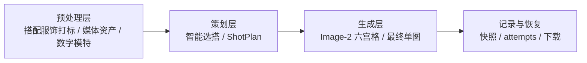

# 生成要素职责拆分总表

## 1. 核心结论

新版 Ruyi-Dream 的稳定性来自职责拆分：

```text
商品图片负责事实，标签负责选搭，ShotPlan 负责导演，文本负责边界，产品负责组装，Image-2 负责生成。
```

Image-2 是最终视觉生成器，不是选搭大脑、标签系统、历史记录系统或任务状态机。

## 2. 要素总览

| 要素 | 目标 |
| --- | --- |
| 主推款事实 | 本次核心商品必须商品级保真 |
| 搭配服饰事实 | 被选中的配角服饰也必须商品级保真 |
| 数字模特身份 | 保持同一位默认数字模特 |
| 智能选搭 | 从 READY 搭配服饰 tags 中选择配角 |
| ShotPlan | 定义每格图位、姿态、景别、穿着关系、构图、光影 |
| 六宫格预览 | 提供前 5 张最终图的导演分镜参考 |
| 生成配饰 | 鞋、包、饰品只辅助画面，不做商品级验收 |
| 同组一致性 | 通过同一输入快照、同一六宫格、同一模特快照和 ShotPlan 保持 |
| 平台输出 | MVP 先单张下载，批量导出后续实现 |

## 3. 职责拆分

| 要素 | 主要责任 | 辅助责任 | 不应由谁负责 |
| --- | --- | --- | --- |
| 主推款事实 | 主推款图片 | 输入版本快照、短文本保真边界 | Gemini 文本描述、Image-2 自由想象 |
| 搭配服饰事实 | 搭配服饰图片 | 搭配服饰快照、短文本保真边界 | 生成配饰描述 |
| 搭配服饰标签 | Gemini 打标 + 稳定 schema | 人工 tags | Image-2 |
| 智能选搭 | Gemini 基于主推款图片和全量 tags 选择 | 标签 schema、READY 状态过滤 | Image-2 |
| 数字模特 | 数字模特图片和参数快照 | 文本身份边界 | 模型默认人物 |
| ShotPlan | 规则/Gemini 生成结构化拍摄方案 | 品类图位参考、品牌边界 | 六宫格像素反推 |
| 六宫格预览 | Image-2 | ShotPlan、商品图片、模特图 | 业务状态机 |
| 最终成片 | Image-2 | 六宫格第 N 格、ShotPlan、商品图片 | Gemini 选图或替换商品 |
| 生成配饰 | ShotPlan/prompt 文本边界 | 品牌模板参考 | 搭配服饰库商品事实 |
| 历史复盘 | 快照和 attempt | provider request/response | 当前素材库最新状态 |

## 4. 三层架构



预处理层：

- 搭配服饰上传和打标
- 媒体三层衍生图
- 数字模特维护
- 主推款输入版本冻结

策划层：

- Gemini 智能选搭
- 6 条 ShotPlan
- Image-2 10 图预算选图器

生成层：

- 3x2 六宫格预览
- 前 5 格并发最终生成
- 单张失败重试

记录与恢复：

- 输入快照
- 搭配服饰快照
- 数字模特快照
- provider attempts
- 技术详情

## 5. 关键禁止项

- 不把用户训练成 prompt 工程师。
- 不让 Image-2 从全库选择搭配服饰。
- 不把鞋包饰品当作商品级事实源，除非未来它们正式入库。
- 不用当前素材库最新状态覆盖历史生成快照。
- 不把第 6 格纳入最终生成。
