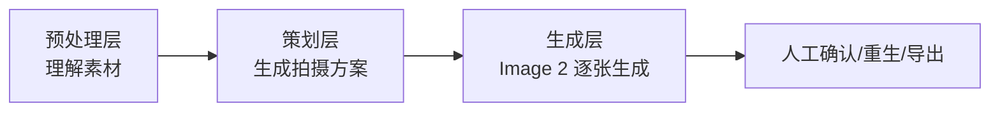

# 生成要素职责拆分总表

## 1. 核心结论

要稳定生成 电商 AI 模特图，不能把需求都塞进 prompt。产品必须把最终目标拆成多个要素，并明确每个要素由谁负责。

总原则：

`图片负责事实，参数负责比例，模板负责调性，文本负责任务，产品负责组装。`

进一步落到技术架构：

`视觉/推理模型负责预处理，规则和模板负责稳定复用，组图策划器负责决策，Image 2 负责最终生成。`

Image 2 是最终视觉合成器，不是整条链路的大脑。品牌调性、鞋包搭配、Pose、镜头取景和组图方案应在 Image 2 之前完成。

更完整地说：

- 商品事实由服装图片决定。
- 模特身份由数字模特图片决定。
- 品牌调性由 品牌真实图库模板决定。
- 身体动作由 pose 参考图决定。
- 尺寸比例由模特尺寸和服装尺寸决定。
- 单张图要拍什么由镜头任务文本决定。
- 禁止跑偏项由短文本边界决定。
- 批量一致性由上一张已确认图和组图状态决定。

## 2. 最终目标要素总览

| 序号 | 要素 | 目标 |
| --- | --- | --- |
| 1 | 商品身份 | 必须是同一件衣服，不能变款 |
| 2 | 商品结构 | 领型、袖型、下摆、拉链、褶边、口袋等必须准确 |
| 3 | 商品颜色 | 颜色接近原图，不能漂色 |
| 4 | 商品材质 | 面料质感不能被抹平或错误美化 |
| 5 | 商品比例 | 衣长、裙长、裤长、下摆宽度、褶边露出准确 |
| 6 | 模特身份 | 必须是指定数字模特，而不是相似脸 |
| 7 | 模特身体 | 身高、体型、肩宽、腿长比例稳定 |
| 8 | 姿态动作 | 符合 品牌真实电商 pose 语言 |
| 9 | 鞋包配饰 | 有自由度，但必须在 目标品牌边界内 |
| 10 | 背景光线 | 白/浅灰棚拍，干净、柔和 |
| 11 | 构图裁切 | 符合主图、半身、背面、局部等图位 |
| 12 | 组图结构 | 每个品类自动生成合理的一组图 |
| 13 | 同组一致性 | 同一组图中脸、身体、服装、光线一致 |
| 14 | 平台输出 | 输出尺寸、比例、命名、可上传结构正确 |

## 3. 职责拆分总表

| 要素 | 主要责任 | 辅助责任 | 不应由谁负责 |
| --- | --- | --- | --- |
| 商品身份 | 服装正面/背面/细节图 | 短文本禁止变款 | 长 prompt 描述 |
| 商品结构 | 服装图 | 商品识别卡 | 模型自由想象 |
| 商品颜色 | 服装图 | 颜色校准/后处理 | 审美词 |
| 商品材质 | 细节图/面料图 | 材质标签 | 泛化描述 |
| 商品比例 | 服装图 + 尺寸参数 | 视觉比例字段 | 单独一句“短款/A字” |
| 模特身份 | 头部图包 | 身份锁定强度 | 年龄/气质描述 |
| 模特身体 | 数字模特身体档案 | 尺寸参数 | 模型默认人体 |
| 姿态动作 | Pose 参考图 | Pose 模板文本 | “自然站立”这类泛词 |
| 鞋包配饰 | 品牌调性参考图 | Styling 自由度 | 鞋履白名单或完全自由 |
| 背景光线 | 品牌真实图库 | 模板文本 | 随机场景描述 |
| 构图裁切 | 镜头任务 | 输出规格 | 模型自动猜 |
| 组图结构 | 品类组图规则 | 用户微调 | 单 prompt 自行发挥 |
| 同组一致性 | 已确认图/组图状态 | 固定参数 | 每张独立随机 |
| 平台输出 | 产品导出模块 | 命名规则 | 生图模型 |

## 3.1 技术路线总表

| 要素 | 技术路线 | 运行时机 | 生产操作 | Image 2 的角色 |
| --- | --- | --- | --- | --- |
| 商品事实 | VLM 识别 + 人工确认 | 每个货号首次生成 | 上传/选择货号图包，系统生成商品事实卡，用户确认关键字段；当前不做图片角色分类 | 参考服装图还原 |
| 商品比例 | 商品图视觉判断 + 可选尺寸表映射 | 每个货号首次生成；尺寸变化时更新 | 用户可填衣长/裙长/裤长/下摆宽/穿着尺码，不填也可生成 | 按比例约束生成，不能单独推理尺寸 |
| 模特身份 | 数字模特多角度头部档案 | 模特维护时；每次生成调用 | 在数字模特中维护正脸/侧脸/回头等头像；允许头像先处于未设置状态再分配角度 | 保持脸和发型一致 |
| 模特身体 | 模特身体参数档案 | 模特维护时；每次生成调用 | 当前维护身高、体重、身型、胸围、腰围、臀围、其它信息 | 按固定身体比例生成 |
| 品牌调性 | 历史真实图分析 + 模板库 + 标签检索 | 品牌初始化或模板修改时 | 分析 品牌历史图，沉淀品类模板和参考图索引 | 按参考图和短边界执行 |
| 鞋包搭配 | 品牌模板 + 同品类参考图 + 策划器选择 | 每次生成策划时 | 系统按品类/季节/图位选择搭配边界 | 在边界内生成具体鞋包 |
| Pose | Pose 模板库 + 图位规则 | 每次生成策划时 | 系统为每张图绑定 pose 参考图 | 按 pose 参考图生成身体动作 |
| 镜头取景 | 品类组图规则 + 平台比例规则 | 每次生成策划时 | 系统生成首图/侧身/背面/半身/局部等脚本 | 按镜头任务生成画面 |
| 背景光线 | 品牌模板 + 真实参考图 | 每次生成策划时 | 默认白/浅灰棚拍，必要时选择同风格参考图 | 执行背景和光线 |
| 同组一致性 | 已确认图 + 固定任务上下文 | 每张图确认后 | 首图确认后作为后续一致性参考 | 参考已确认图保持一致 |
| 平台导出 | 产品导出模块 | 生成完成后 | 按货号和图位命名导出 | 不参与 |

## 3.2 三层职责边界



预处理层包括：

- 服装图包解析
- 商品事实卡
- 数字模特档案
- 品牌调性初始化
- Pose/参考图标签化

策划层包括：

- 品类判断
- 组图结构生成
- 鞋包搭配边界选择
- Pose 选择
- 镜头取景
- 单张生成任务包组装

生成层包括：

- 把任务包交给 Image 2
- 单张生成
- 带入已确认图保持一致性

这个边界可以避免两个问题：一是 Image 2 每次重新理解品牌导致漂移，二是长 prompt 同时描述太多事实导致冲突。

## 4. 产品模块拆分

### 4.1 服装事实模块

负责：

- 商品身份
- 商品结构
- 商品颜色
- 商品材质
- 商品基础比例

输入：

- 正面图
- 背面图
- 细节图
- 面料图
- 颜色图
- 3D 图

产品实现：

1. 用户上传或选择货号图包。
2. 当前不自动分类图片角色，默认按上传顺序使用。
3. 系统生成商品识别卡。
4. 用户只确认或修正关键字段。

生成时文本写法：

```text
Garment references are the source of truth for exact clothing design, color, fabric, construction, length, width, and proportions.
```

不要写：

```text
black sleeveless A-line dress with blue striped ruffle...
```

生产例子：

货号 `125309C7948510` 中，蓝白条纹袖窿、黑色主体、背中线、下摆露出都由服装图决定。文本只声明这些图是商品事实源。

预期效果：

- 降低文本和图片冲突
- 减少变款
- 减少裙摆被语义放大的概率

### 4.2 数字模特身份模块

负责：

- 脸
- 发型
- 刘海
- 头部角度
- 耳饰
- 表情边界

输入：

- 多角度头部图
- 模特身份档案

产品实现：

1. 数字模特中心维护多模特。
2. 每个模特保存多张头像，允许部分头像暂未设置角度。
3. 用户在数字模特页逐张为头像分配角度、替换、删除和排序。
4. 生成时优先使用当前镜头所需角度；`front` 作为封面与主要预览来源。

生产例子：

- 正面首图：使用 `front.png`
- 侧身图：使用 `left45.png` 或 `right90.png`
- 背面图：使用 `back.png`
- 回头图：使用 `back-turn-left45.png`

预期效果：

- 解决“像短发女模特但不是 Face-01”的问题
- 提高同组脸一致性
- 减少多图生成时身份漂移

### 4.3 数字模特身体模块

负责：

- 身高
- 体型
- 肩宽
- 腿长比例
- 基础穿着比例

输入：

- 模特身高
- 体型标签
- 可选三围/肩宽/腿长

产品实现：

1. 数字模特档案中维护身体参数。
2. 默认可用简化参数。
3. 精确参数可选填写。
4. 生成时每张图共享同一身体档案。

生产例子：

当前 Face-01 实际维护字段为：

```json
{
  "height": "170cm",
  "weight": "",
  "bodyShape": "H型",
  "bust": "80cm",
  "waist": "59cm",
  "hips": "89cm",
  "notes": "都市、通勤、轻熟、自然、克制；短棕色 bob，轻薄刘海"
}
```

预期效果：

- 同一组图中身高、腿长、肩宽不乱变
- 为服装尺寸映射提供基准

### 4.4 尺寸可选增强模块

负责：

- 裙长
- 裤长
- 衣长
- 袖长
- 下摆围
- 褶边露出
- 穿着松量

输入：

- 模特尺寸
- 服装尺码表
- 用户选择穿着尺码

产品实现：

1. 在服装识别卡中增加折叠区：`尺寸增强（可选）`。
2. 默认不填也能生成。
3. 填写后生成视觉比例字段。
4. 视觉比例字段进入生成请求。

生产例子：

如果本款有尺寸：

```json
{
  "modelHeight": 170,
  "wearSize": "M",
  "dressLength": 82,
  "hemWidth": 112,
  "ruffleExposure": 8,
  "visualLength": "膝上中段",
  "visualHem": "轻A字，不是大伞摆"
}
```

生成时文本只写：

```text
Use the provided measurements to keep wearing length and hem width accurate.
```

预期效果：

- 真正解决裙长和裙摆宽度不稳定
- 避免只靠“短款/A字”导致模型过度美化

### 4.5 品牌调性模板模块

负责：

- 品牌感
- 鞋包配饰边界
- 背景光线
- pose 气质
- 画面克制程度

输入：

- 品牌历史真实成片
- 按品类/图位/pose/鞋包标签化的参考图

产品实现：

1. 建立 `默认电商棚拍调性` 模板。
2. 从历史图库中抽取并标签化真实图。
3. 生成时按当前品类自动选择同类参考图。
4. 给 Image 2 自由度，但限制在参考图边界内。

不要实现为：

- 固定鞋履白名单
- 一长串鞋包文字描述
- 完全自由让模型选

生产例子：

当前货号是连衣裙，系统应该优先检索：

- 连衣裙全身图
- 连衣裙侧身图
- 短裙/无袖裙图
- 有轻松鞋履或小包的 品牌图

而不是使用全品类大杂烩参考板。

预期效果：

- 鞋包更符合目标品牌
- pose 更自然
- 保留一定自由度，不机械
- 不再生成老气尖头职业鞋的概率会下降

### 4.6 Pose 模板模块

负责：

- 身体朝向
- 重心
- 手臂动作
- 腿部动作
- 头部朝向
- 走动感

输入：

- 目标品牌 真实 pose 参考图
- pose 标签

产品实现：

1. 从真实图中抽 pose。
2. 每个 pose 变成模板。
3. 每张图位绑定 pose 模板。
4. 生成时传入 pose 参考图，而不是只写“自然站立”。

生产例子：

连衣裙图组：

```json
[
  {"shot": "首图", "pose": "正面轻松站姿，重心偏移"},
  {"shot": "侧身", "pose": "侧身走动感，一腿前伸"},
  {"shot": "背面", "pose": "背面自然站姿，可手拿包"},
  {"shot": "半身", "pose": "微侧头，肩颈放松"}
]
```

预期效果：

- 避免站军姿
- 姿态更接近真实 目标品牌 主图
- 不靠模型自己猜“品牌 pose”

### 4.7 镜头任务模块

负责：

- 当前这张图到底拍什么
- 全身/半身/背面/局部
- 画面重点
- 裁切比例

输入：

- 品类组图规则
- 用户微调

产品实现：

1. 系统按品类生成默认 5 张。
2. 每张图都有独立任务。
3. 每张图独立生成、独立重生。

生产例子：

```json
{
  "shotId": "02",
  "role": "侧身全身",
  "focus": "裙身侧面和下摆层次",
  "framing": "3:4 vertical full-body",
  "poseTemplate": "dress-side-walk-01",
  "headReference": "left45.png"
}
```

预期效果：

- 组图结构稳定
- 每张图可控
- 重生时不会影响其他图

### 4.8 禁止项模块

负责：

- 防止常见跑偏

输入：

- 商品禁止项
- 模特禁止项
- 品牌禁止项

产品实现：

1. 从识别卡自动生成商品禁止项。
2. 从数字模特档案生成身份禁止项。
3. 从品牌模板生成调性禁止项。
4. 文本只保留短边界。

生产例子：

```text
Do not create a different face.
Do not change garment design or proportions.
Do not use styling outside 目标品牌 real-photo references.
Do not add text or watermark.
```

预期效果：

- 比长 prompt 更稳定
- 减少冲突
- 清晰告诉模型底线

### 4.9 组图一致性模块

负责：

- 同一货号 5 张图的一致性

输入：

- 已确认图
- 同一数字模特
- 同一服装识别卡
- 同一品牌模板
- 同一身体参数

产品实现：

1. 第 1 张生成并确认后，作为后续图的一致性参考。
2. 后续图生成时带入 `Previous Approved Output`。
3. 单张重生时保持同一上下文。

生产例子：

首图确认后，侧身图生成时输入：

- 服装图
- 侧身头部图
- 品牌参考图
- pose 参考图
- 已确认首图

预期效果：

- 模特身体更稳定
- 光线和肤色更统一
- 同组不像拼凑

## 5. 生产环境完整例子

以 `125309C7948510` 为例。

### 5.1 用户看到的页面

`生成组图`

用户选择：

- 服装货号：`125309C7948510`
- 数字模特：`Face-01`
- 品牌调性模板：`默认电商棚拍调性`
- 输出组图：连衣裙默认 5 张
- 尺寸增强：暂不填写

系统自动生成：

- 商品识别卡
- 品牌参考图
- pose 参考图
- 镜头任务
- 短 prompt

### 5.2 系统内部组装

Shot 02 侧身图：

图片输入：

- 服装正面图
- 服装背面图
- 服装细节图
- `Face-01/left45.png`
- 连衣裙侧身 pose 参考图
- 连衣裙调性参考图 3-6 张
- 可选：已确认首图

参数输入：

- 模特身高：170cm
- 服装尺寸：未提供
- 视觉推断：膝上、轻 A 字、下摆露出窄层次

文本输入：

```text
任务：
生成一张 电商 AI 模特图，当前图位为 02：侧身全身。

图片角色：
- 服装参考图是商品事实来源。
- 模特头部图是身份事实来源。
- Pose 参考图定义身体动作。
- 品牌真实成片参考图定义品牌调性边界。

当前图要求：
侧身走动感全身图，展示侧面廓形和下摆层次。

禁止：
不要改变模特身份、服装设计、服装比例，不要生成超出目标品牌 参考图边界的造型。
```

### 5.3 预期效果

如果所有职责都正确拆分，理论上应达到：

- 脸更像指定模特
- 服装更少变款
- 裙长和裙摆更接近原商品
- pose 不再站军姿
- 鞋包不再靠模型自由乱猜
- 同一组图风格统一

如果仍不理想，问题也能定位：

- 脸不像：身份模块或头部角度不够
- pose 僵：pose 参考图不对
- 鞋跑偏：品牌调性参考图选择不对
- 裙长错：缺尺寸或比例推导不够
- 服装变款：服装事实图不足或图片角色不清

## 6. 两轮元校验

### 第一轮校验：是否覆盖最终目标的全部要素

已覆盖：

- 商品事实
- 商品比例
- 模特身份
- 模特身体
- pose
- 鞋包配饰
- 品牌调性
- 背景光线
- 构图
- 组图结构
- 组图一致性
- 输出规格

缺口：

- 自动质量检测当前仍不纳入 MVP。
- 尺寸信息当前无数据，只能先设计，暂不能验证。

结论：作为产品骨架拆分，覆盖是完整的。

### 第二轮校验：是否能指导生产，而不是停留在概念

每个要素都已明确：

- 由什么输入负责
- 在哪个产品模块实现
- 生成时如何进入 Image 2
- 对生产结果有什么影响
- 失败时如何定位

结论：这一版可以直接指导产品原型和后续工程实现。
