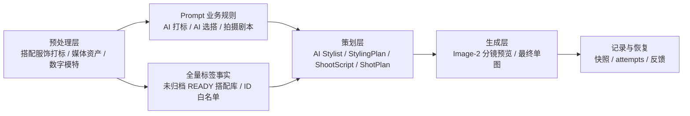

# 生成要素职责拆分总表

## 1. 核心结论

新版 Ruyi-Dream 的稳定性来自职责拆分，也来自让模型在正确层级发挥自主性：

```text
商品图片负责事实，Prompt 维护和搭配库全量标签事实负责业务输入，AI Stylist 负责选搭和造型判断，
StylingPlan 负责选搭意图和验收，ShootScript 负责导演，ShotPlan 负责单镜头，Image-2 负责生成。
```

Image-2 是最终视觉生成器，不是选搭大脑、标签系统、历史记录系统或任务状态机。

MVP 阶段 Gemini 在 `AI Stylist` 阶段是唯一选搭业务脑。它基于主推款图片、Prompt 维护中的业务规则、未归档 READY 搭配库的全量 AI 标签事实卡和 Lily 品牌边界，交付结构化 `StylingPlan`、候选理由、拒绝理由、质量信号和审美/品牌/商品可见性评分。后端不做预筛选、排序、评分、质量判断或改选；Prompt 输入输出统一使用搭配服饰 `code`，后端只做状态、快照、code 到内部 ID 的持久化映射和 schema 校验。`styling_garments.ai_tags_json` 是 AI Stylist 的标签事实输入，必须以 `ai_tags` 对象进入候选卡；后端不能按固定字段名摘取“品类/颜色/材质”等摘要来替代完整标签事实。人工业务标记和复核信息只作为辅助字段进入。

## 2. 要素总览

| 要素 | 目标 |
| --- | --- |
| 主推款事实 | 本次核心商品必须商品级保真 |
| 主推款理解 | 识别品类、卖点、不可遮挡区域和展示风险 |
| 穿法合法性 | 判断搭配服饰是否支持塞腰、半塞、敞开、扣合、自然下摆等真实穿法 |
| 搭配服饰事实 | 被选中的配角服饰也必须商品级保真 |
| 数字模特身份 | 保持同一位默认数字模特，脸、五官、头型、发长、发型轮廓、刘海和气质不可被剧本或分镜覆盖 |
| 全量标签事实 | 将未归档 READY 搭配服装库标签事实完整交给 AI Stylist |
| 品牌样本库 | 保存 Lily 官方和客户确认的风格证据、配饰边界和未来 embedding |
| Prompt 业务规则 | 维护选搭、质量、配饰、品牌和空库内搭配规则，并直接影响 AI 打标与 AI 摄影棚 |
| AI Stylist | 探索造型方向、生成多套 outfit、做审美和商品可见性自评 |
| Aesthetic Critic | 判断 outfit 是否真正好看、符合 Lily、让主推款更有购买吸引力 |
| StylingPlan | 保存选中方案、备选方案、穿着方式、评分、风险和理由 |
| ShootScript / 拍摄剧本 | 定义整组导演设定、搭配风险、配饰调整和 6 个镜头 |
| ShotPlan | 定义单格图位、姿态、景别、取景范围、穿着关系、构图、光影 |
| 分镜预览 | 提供前 5 张最终图的导演分镜参考 |
| 生成配饰 | 鞋、包、饰品只辅助画面，不做商品级验收 |
| 同组一致性 | 通过同一输入快照、同一 StylingPlan、同一 ShootScript、同一分镜预览、同一模特快照和 ShotPlan 保持 |
| 平台输出 | MVP 先单张下载，批量导出后续实现 |

## 3. 职责拆分

| 要素 | 主要责任 | 辅助责任 | 不应由谁负责 |
| --- | --- | --- | --- |
| 主推款事实 | 主推款图片 | 输入版本快照、短文本保真边界 | Gemini 文本描述、Image-2 自由想象 |
| 主推款理解 | 前置视觉理解服务 / AI Stylist | 主推款图片、品牌边界、商品拍摄验收维度 | 任务名启发式、Image-2、用户长 prompt |
| 搭配服饰事实 | 搭配服饰图片 | 搭配服饰快照、短文本保真边界 | 生成配饰描述 |
| 搭配服饰标签 | Gemini 按完整标签规程打标 + 后端校验/复核策略 | 人工业务 tags、调用快照 | Image-2 |
| 品牌样本库 | 后端品牌样本服务 | Lily 官网/天猫/淘宝/官方社媒/客户 lookbook、未来 embedding | Gemini 临场编造品牌风格 |
| 搭配库候选卡 | 后端快照服务 | 未归档 READY 状态范围、搭配服饰 code、完整 `ai_tags_json` 标签事实、人工业务标记、复核信息 | 后端排序、后端评分、字段名白名单摘要、Image-2 |
| Prompt 业务规则 | Prompt 维护中的 AI 选搭 Prompt 正文 | 品牌边界、配饰边界、质量信号口径 | Python if/else、独立策略配置入口 |
| AI Stylist | Gemini 基于主推款图片、全量标签事实和 Prompt 业务规则生成多套 outfit 并自评 | Lily 品牌边界、商品主角原则 | 后端选择器、Image-2 |
| Aesthetic Critic | AI Stylist 必经质量信号 | 色彩重量、廓形体量、季节材质、模板化风险、穿法质量、官方样本证据、品牌采用可能性 | 后端硬编码大量审美 if/else、Image-2 事后补救 |
| StylingPlan | AI Stylist 输出 + 后端校验 | 候选快照、被拒方案、评分、审美诊断、风险提示 | ShotPlan 像素反推 |
| 数字模特 | 数字模特图片、参数快照和 `ModelIdentityContract` | 文本身份边界、`image_reference_manifest` | 模型默认人物、品牌妆发想象、分镜预览像素反推 |
| ShootScript | AI 导演基于 StylingPlan 一次性生成结构化拍摄剧本 | 品类图位矩阵、品牌规则、主推款卖点、数字模特身份契约、搭配风险 | Image-2、前端临时状态、分镜预览像素反推、临场改模特脸或发型 |
| ShotPlan | ShootScript 的单镜头结构 | 主推品类、镜头用途、商品卖点、不可遮挡区域 | 通用全身图模板、分镜预览像素反推 |
| 分镜预览 | Image-2 | StylingPlan、ShootScript、ShotPlan、商品图片、模特身份图、输入参考图角色清单 | 业务状态机、商品事实源、模特身份事实源 |
| 最终成片 | Image-2 | 分镜预览第 N 格、StylingPlan、ShootScript、ShotPlan、商品图片、模特身份图、输入参考图角色清单 | Gemini 选图或替换商品、根据分镜覆盖商品或模特身份 |
| 生成配饰 | StylingPlan/ShootScript/ShotPlan 文本边界 | 品牌模板参考 | 搭配服装库商品事实 |
| 历史复盘 | 快照和 attempt | provider request/response | 当前素材库最新状态 |

## 4. 分层架构



预处理层：

- 搭配服饰上传和打标
- 搭配服饰 caption、检索字段和未来 embedding
- 搭配服饰穿法能力和穿法禁忌
- 媒体三层衍生图
- 数字模特维护
- 主推款输入版本冻结
- Lily 官方和客户确认品牌样本维护

Prompt 与标签事实层：

- 未归档 READY 状态过滤
- 标签事实卡组装
- 未归档搭配库全量 AI 标签事实 `library_tag_cards`
- 提示词输入只暴露搭配服饰 `code` 和 `ai_tags` 标签事实；内部 ID 仅用于后端持久化映射
- Prompt 维护中的 AI 打标、AI 选搭和拍摄剧本业务规则
- 后端不做预筛选、排序、评分、映射、质量判断或 outfit 草案

策划层：

- AI Stylist 主推款理解
- 造型意图探索
- 多套 outfit 候选
- Aesthetic Critic 自评和否决，包含穿法质量与官方样本证据
- 选中 StylingPlan
- 生成 ShootScript 拍摄剧本
- 按主推品类生成 6 条 ShotPlan
- Image-2 10 图预算选图器

生成层：

- 3x2 分镜预览
- 前 5 格并发最终生成
- 单张失败重试

记录与恢复：

- 输入快照
- 全量搭配库标签事实快照
- 未归档搭配库全量标签事实快照
- StylingPlan 快照
- 搭配服饰快照
- 数字模特快照
- provider attempts
- 技术详情
- 用户采纳/拒绝/下载反馈

ID / CODE 边界：

- 系统表主键一律使用 ID，例如 `StylingPlan.selected_material_ids`、任务包图片引用和后端快照关联。
- UI、生成记录、人类审核和文案一律展示业务主键 CODE，例如搭配服饰 `code` 和 `StylingPlan.selected_material_codes`。
- AI Stylist 可以同时输出 `material_id` 和 `material_code` 便于审计，但可执行关联只能信任 `material_id`；`material_code` 必须原样复制候选卡片，不能编造或反查替代 ID。

## 5. 关键禁止项

- 不把用户训练成 prompt 工程师。
- 不让 Image-2 从全库选择搭配服饰。
- 不把全量搭配服装库图片直接喂给 Gemini；可以给 AI Stylist 提供未归档搭配库的全量标签事实。
- 不把 AI Stylist 降级成一次性 `selected_material_ids` 分类器。
- 不把任务名启发式当作主推品类和卖点的权威来源。
- 不让 `category = unknown` 的主推款直接进入正常选搭通过状态。
- 不把当前主推款自己作为搭配服饰候选。
- 不把搭配失败只归因于模型审美；必须检查 AI Stylist 是否正确比较了空库内搭配、库内配角和被拒方案。
- 不为露出腰线强行生成搭配服饰不支持的穿法。
- 不用一套通用全身图模板生成所有品类 ShotPlan。
- 不让 ShootScript、分镜预览、品牌妆发文字或 provider 默认审美改变数字模特的脸型、五官、头型、发长、发型轮廓、刘海/碎发形态、肤色和气质。
- 不把分镜预览当作模特身份事实源；最终成片只能从 `model_identity` 参考图和 `ModelIdentityContract` 继承模特身份。
- 不把审美规则写死成大量 if/else；只保留真实性、可穿性、商品主角和状态合法性等生产边界。
- 不把鞋包饰品当作商品级事实源，除非未来它们正式入库。
- 不用当前素材库最新状态覆盖历史生成快照。
- 不把第 6 格纳入最终生成。
