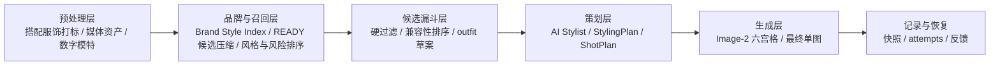

# 生成要素职责拆分总表

## 1. 核心结论

新版 Ruyi-Dream 的稳定性来自职责拆分，也来自让模型在正确层级发挥自主性：

```text
商品图片负责事实，标签、品牌样本和候选漏斗负责候选，AI Stylist 负责造型判断，
StylingPlan 负责选搭意图和验收，ShotPlan 负责导演，Image-2 负责生成。
```

Image-2 是最终视觉生成器，不是选搭大脑、标签系统、历史记录系统或任务状态机。

Gemini 在 `AI Stylist` 阶段应被当作造型总监，而不是简单分类器或全库搜索引擎。它可以探索多套搭配方案，但必须基于主推款视觉理解、候选漏斗提供的小候选集、真实候选图和 Lily 官方风格证据，交付结构化 `StylingPlan`、候选理由、拒绝理由和审美/品牌/商品可见性评分。主推款可见只是底线；如果 outfit 色块沉重、廓形失衡、穿法别扭、品牌感不足或视觉上难看，即使商品露出也必须判定失败。

## 2. 要素总览

| 要素 | 目标 |
| --- | --- |
| 主推款事实 | 本次核心商品必须商品级保真 |
| 主推款理解 | 识别品类、卖点、不可遮挡区域和展示风险 |
| 穿法合法性 | 判断搭配服饰是否支持塞腰、半塞、敞开、扣合、自然下摆等真实穿法 |
| 搭配服饰事实 | 被选中的配角服饰也必须商品级保真 |
| 数字模特身份 | 保持同一位默认数字模特 |
| 候选召回 | 从 READY 搭配服饰中压缩出可判断候选 |
| 品牌样本库 | 保存 Lily 官方和客户确认的风格证据、配饰边界和未来 embedding |
| 候选漏斗 | 从全量 READY 服饰压缩到少量候选和 outfit 草案 |
| 搭配库充足性诊断 | 判断库内是否确实有更合适候选，区分选搭逻辑失败与供给不足 |
| AI Stylist | 探索造型方向、生成多套 outfit、做审美和商品可见性自评 |
| Aesthetic Critic | 判断 outfit 是否真正好看、符合 Lily、让主推款更有购买吸引力 |
| StylingPlan | 保存选中方案、备选方案、穿着方式、评分、风险和理由 |
| ShotPlan | 定义每格图位、姿态、景别、穿着关系、构图、光影 |
| 六宫格预览 | 提供前 5 张最终图的导演分镜参考 |
| 生成配饰 | 鞋、包、饰品只辅助画面，不做商品级验收 |
| 同组一致性 | 通过同一输入快照、同一 StylingPlan、同一六宫格、同一模特快照和 ShotPlan 保持 |
| 平台输出 | MVP 先单张下载，批量导出后续实现 |

## 3. 职责拆分

| 要素 | 主要责任 | 辅助责任 | 不应由谁负责 |
| --- | --- | --- | --- |
| 主推款事实 | 主推款图片 | 输入版本快照、短文本保真边界 | Gemini 文本描述、Image-2 自由想象 |
| 主推款理解 | 前置视觉理解服务 / AI Stylist | 主推款图片、品牌边界、商品拍摄验收维度 | 任务名启发式、Image-2、用户长 prompt |
| 搭配服饰事实 | 搭配服饰图片 | 搭配服饰快照、短文本保真边界 | 生成配饰描述 |
| 搭配服饰标签 | Gemini 按完整标签规程打标 + 后端校验/复核策略 | 人工业务 tags、调用快照 | Image-2 |
| 品牌样本库 | 后端品牌样本服务 | Lily 官网/天猫/淘宝/官方社媒/客户 lookbook、未来 embedding | Gemini 临场编造品牌风格 |
| 候选召回 | 后端召回服务 | effective tags、caption、未来 embedding、历史反馈 | Image-2、Gemini 全库搜索 |
| 候选漏斗 | 后端排序和 outfit 草案服务 | 主推款理解、品牌样本、风险降权、兼容性 ranker | Gemini 直接看全量图库 |
| 搭配库充足性诊断 | 后端候选漏斗服务 | READY 服饰统计、排除原因、被拒候选、人工补库建议 | Gemini 事后猜测、Image-2 视觉补救 |
| AI Stylist | Gemini 基于主推款图片、小候选集、候选图和品牌证据生成多套 outfit 并自评 | Lily 品牌边界、商品主角原则、候选漏斗 | 单次 ID 选择器、Image-2、全库搜索 |
| Aesthetic Critic | AI Stylist 必经质量门 | 色彩重量、廓形体量、季节材质、模板化风险、穿法质量、官方样本证据、品牌采用可能性 | 后端硬编码大量审美 if/else、Image-2 事后补救 |
| StylingPlan | AI Stylist 输出 + 后端校验 | 候选快照、被拒方案、评分、审美诊断、风险提示 | ShotPlan 像素反推 |
| 数字模特 | 数字模特图片和参数快照 | 文本身份边界 | 模型默认人物 |
| ShotPlan | 规则/Gemini 基于主推品类和 StylingPlan 生成结构化拍摄方案 | 品类图位矩阵、品牌样本、主推款卖点 | 通用全身图模板、六宫格像素反推 |
| 六宫格预览 | Image-2 | StylingPlan、ShotPlan、商品图片、模特图 | 业务状态机 |
| 最终成片 | Image-2 | 六宫格第 N 格、StylingPlan、ShotPlan、商品图片 | Gemini 选图或替换商品 |
| 生成配饰 | StylingPlan/ShotPlan/prompt 文本边界 | 品牌模板参考 | 搭配服饰库商品事实 |
| 历史复盘 | 快照和 attempt | provider request/response | 当前素材库最新状态 |

## 4. 分层架构



预处理层：

- 搭配服饰上传和打标
- 搭配服饰 caption、检索字段和未来 embedding
- 搭配服饰穿法能力和穿法禁忌
- 媒体三层衍生图
- 数字模特维护
- 主推款输入版本冻结
- Lily 官方和客户确认品牌样本维护

召回层：

- READY 状态过滤
- 标签压缩
- 品类、颜色、季节、风格、遮挡风险排序
- 品牌样本相似度和配饰边界检索
- 未来接入视觉 embedding、人工反馈、销售/点击数据

候选漏斗层：

- 主推款视觉理解出的品类、卖点和不可遮挡区域硬过滤
- 排除当前主推款同 code、同输入素材或同商品身份的候选
- 穿法合法性过滤和风险降权
- 风险降权和多样性保留
- 按主推品类生成 3-8 套 outfit 草案，而不是固定使用排序前几件
- 搭配库充足性诊断，说明是否存在更好候选或补库缺口
- 12-20 件小候选集和必要候选图

策划层：

- AI Stylist 主推款理解
- 造型意图探索
- 多套 outfit 候选
- Aesthetic Critic 自评和否决，包含穿法质量与官方样本证据
- 选中 StylingPlan
- 按主推品类生成 6 条 ShotPlan
- Image-2 10 图预算选图器

生成层：

- 3x2 六宫格预览
- 前 5 格并发最终生成
- 单张失败重试

记录与恢复：

- 输入快照
- 候选召回快照
- 搭配库充足性诊断快照
- StylingPlan 快照
- 搭配服饰快照
- 数字模特快照
- provider attempts
- 技术详情
- 用户采纳/拒绝/下载反馈

## 5. 关键禁止项

- 不把用户训练成 prompt 工程师。
- 不让 Image-2 从全库选择搭配服饰。
- 不把全量搭配服饰库直接喂给 Gemini。
- 不把 AI Stylist 降级成一次性 `selected_material_ids` 分类器。
- 不把任务名启发式当作主推品类和卖点的权威来源。
- 不让 `category = unknown` 的主推款直接进入正常候选漏斗。
- 不把当前主推款自己作为搭配服饰候选。
- 不把搭配失败只归因于模型审美；必须同时判断搭配服饰库是否缺少合适供给。
- 不为露出腰线强行生成搭配服饰不支持的穿法。
- 不用一套通用全身图模板生成所有品类 ShotPlan。
- 不把审美规则写死成大量 if/else；只保留真实性、可穿性、商品主角和状态合法性等生产边界。
- 不把鞋包饰品当作商品级事实源，除非未来它们正式入库。
- 不用当前素材库最新状态覆盖历史生成快照。
- 不把第 6 格纳入最终生成。
