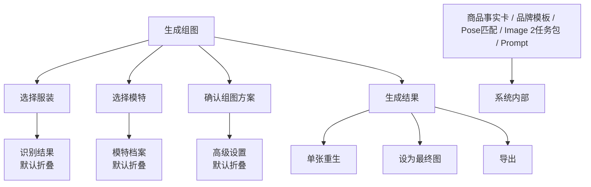

# 普通用户视角 UI/UX 设计

## 1. 核心判断

前台 UI 不应该展示 AI 生成链路的全部复杂性。

产品内部可以有：

- 商品事实卡
- 品牌调性模板
- 前置组图策划器
- Pose 模板匹配
- Image 2 任务包
- prompt 组装
- 图片职责拆分

但普通用户不应该默认看到这些。用户真正关心的是：

1. 选哪件衣服
2. 用哪个模特
3. 生成哪几张图
4. 风格是否是 Lily
5. 结果能不能用
6. 不满意时怎么改

所以前台产品应该像一个 `拍摄任务工作台`，不是一个 `AI 参数控制台`。

## 2. 设计原则

### 2.1 复杂性内置

技术复杂性必须存在，但应藏在系统里。

| 用户看到 | 系统内部完成 |
| --- | --- |
| 系统识别：无袖短款连衣裙 | 商品事实卡、图片角色识别、品类判断 |
| Lily 默认棚拍风格 | 品牌模板匹配、参考图检索、鞋包边界 |
| 连衣裙默认 5 张 | 品类组图规则、Pose 模板、镜头策划 |
| 预计生成 5 张，可单张重生 | 单张任务包、Image 2 请求、已确认图回灌 |
| 高级设置 | 尺寸增强、拍摄角度、补充要求 |

### 2.2 用户只决策业务问题

默认流程只让用户做必要决策：

- 服装是否选对
- 模特是否选对
- 组图方案是否符合本次需求
- 是否开始生成
- 哪张图保留、哪张图重生

不要让用户决策：

- prompt 怎么写
- 图片角色怎么分配
- Image 2 输入顺序
- Pose 模板 ID
- 品牌参考图 ID
- 禁止项如何表达

### 2.3 主流程要短

生成一组图的默认路径应控制在 4 步：

```text
选择服装 -> 选择模特 -> 确认组图方案 -> 生成/确认/导出
```

高级能力放在折叠区或二级入口。

## 3. 信息层级

### 3.1 默认展示

默认页面只展示：

- 服装卡片
- 数字模特卡片
- 组图方案
- Lily 风格摘要
- 生成按钮
- 结果区

### 3.2 折叠展示

用户需要时才展开：

- 服装识别详情
- 尺寸增强
- 拍摄角度微调
- 补充要求
- 风格参考说明

### 3.3 默认隐藏

这些只给系统或调试模式使用：

- 前置组图策划器状态
- Image 2 任务包
- prompt
- 图片职责拆分
- 品牌规则库明细
- Pose 模板 ID
- 参考图检索结果

## 4. 页面信息架构



## 5. 生成组图页面设计

### 5.1 页面定位

页面名称：

`生成组图`

页面副标题：

`选择服装和模特，确认组图后即可生成电商主图`

页面目标：

让普通运营/视觉人员在不理解 AI 内部机制的情况下，完成一次稳定的组图生成任务。

### 5.2 顶部导航

建议导航：

- `生成组图`
- `服装素材`
- `数字模特`
- `品牌模板`

其中 `品牌模板` 是必要辅助入口，但不是普通用户日常高频入口。MVP 阶段可以弱化显示或只给管理员使用。

### 5.3 主体布局

推荐使用三步任务流 + 结果区：

```text
生成组图

[1 选择服装]  [2 选择模特]  [3 确认组图方案]

[生成组图] [预览方案]

[生成结果]
```

## 6. 模块设计

### 6.1 选择服装

默认展示：

- 当前货号
- 服装主图
- 系统识别摘要
- 更换服装按钮

示例：

```text
选择服装

125309C7948510
系统识别：无袖短款连衣裙

[更换服装]
识别结果已确认 >
```

折叠区展示：

- 品类
- 颜色
- 面料
- 关键细节
- 风险点
- 可选尺寸增强

### 6.2 选择模特

默认展示：

- 模特头像
- 模特名称
- 模特标签
- 更换模特按钮

示例：

```text
选择模特

Face-01
默认模特 / 短发 / 适合棚拍

[更换模特]
```

不要默认展示：

- 多角度头部图完整列表
- 身体参数明细
- 身份锁定策略

这些可以进入模特详情页或高级折叠区。

### 6.3 确认组图方案

默认展示 5 个图位：

```text
01 正面全身
02 侧身全身
03 上半身
04 背面
05 下摆细节
```

同时展示风格摘要：

```text
Lily 默认棚拍风格
白/浅灰背景 · 自然姿态 · 简洁搭配
```

用户可操作：

- 删除某张图
- 增加图位
- 调整顺序
- 展开高级设置

默认不展示：

- 每张图的完整任务包
- 每张图绑定的 pose ID
- 每张图使用的品牌参考图 ID

### 6.4 高级设置

默认折叠。

包含：

- 尺寸增强
- 拍摄角度
- 背景：白色 / 浅灰
- 补充要求
- Styling 自由度

高级设置不是主流程。只有当用户对结果不满意，或某款服装有特殊要求时才使用。

### 6.5 生成结果

结果区默认展示 5 张图的状态：

- 待生成
- 生成中
- 已生成
- 已确认
- 需重生

每张图卡片提供：

- 单张重生
- 设为最终图
- 查看大图
- 下载/导出

组图完成后提供：

- 批量导出
- 继续生成同款
- 更换模特重生

## 7. 操作流程

### 7.1 默认流程

```text
进入生成组图
-> 选择服装
-> 默认选择 Face-01
-> 系统自动生成连衣裙 5 张方案
-> 用户点击生成组图
-> 查看结果
-> 单张重生或确认
-> 导出
```

### 7.2 修改流程

如果用户发现系统识别不准：

```text
展开识别结果
-> 修改品类/长度/版型/关键细节
-> 重新生成组图方案
```

如果用户对结果不满意：

```text
选择某张图
-> 点击单张重生
-> 选择原因：姿势不对 / 脸不像 / 服装不准 / 搭配不合适 / 其他
-> 系统内部调整任务包
-> 重生单张
```

这里用户选择的是业务问题，不是修改 prompt。

## 8. 文案规范

### 8.1 推荐文案

- `选择服装`
- `选择模特`
- `确认组图方案`
- `生成组图`
- `预览方案`
- `单张重生`
- `设为最终图`
- `导出`
- `识别结果已确认`
- `Lily 默认棚拍风格`
- `预计生成 5 张，可单张重生`

### 8.2 避免文案

- `Prompt`
- `Image 2 任务包`
- `前置组图策划器`
- `图片职责拆分`
- `品牌规则库命中`
- `Pose Template ID`
- `Reference Image IDs`
- `Negative Prompt`

这些概念可以存在于内部文档和调试模式，但不应该成为普通用户的默认 UI 文案。

## 9. 页面状态

### 9.1 空状态

用户首次进入：

```text
选择一个服装货号开始生成组图
```

主按钮：

`选择服装`

### 9.2 已选服装未生成

展示三步任务卡和待生成结果区。

主按钮：

`生成组图`

### 9.3 生成中

展示进度：

```text
正在生成 5 张主图，已完成 2/5
```

每张图独立显示状态。

### 9.4 已生成

展示结果网格。

主操作：

- 单张重生
- 设为最终图
- 导出

### 9.5 单张重生

用户选择重生原因：

- 姿势不合适
- 模特不像
- 服装不准确
- 搭配不合适
- 构图不合适
- 其他补充

系统内部将原因映射到对应模块：

| 用户原因 | 系统处理 |
| --- | --- |
| 姿势不合适 | 更换 Pose 模板 |
| 模特不像 | 强化身份参考 |
| 服装不准确 | 强化服装事实图 |
| 搭配不合适 | 调整品牌模板/Styling 边界 |
| 构图不合适 | 调整图位和裁切 |

## 10. MVP 页面草图

```text
┌────────────────────────────────────────────────────────────────────┐
│ Lily AI 模特图   生成组图  服装素材  数字模特  品牌模板              │
├────────────────────────────────────────────────────────────────────┤
│ 生成组图                                                          │
│ 选择服装和模特，确认组图后即可生成电商主图                          │
│                                                                    │
│ ┌──────────────┐ ┌──────────────┐ ┌──────────────────────────────┐ │
│ │ 1 选择服装    │ │ 2 选择模特    │ │ 3 确认组图方案                │ │
│ │ 125309...    │ │ Face-01      │ │ 01 正面全身  02 侧身全身      │ │
│ │ [服装缩略图]  │ │ [模特头像]    │ │ 03 上半身    04 背面          │ │
│ │ 无袖短款裙    │ │ 默认模特      │ │ 05 下摆细节                  │ │
│ │ 识别已确认 >  │ │ 更换模特      │ │ Lily 默认棚拍风格             │ │
│ └──────────────┘ └──────────────┘ │ 高级设置 >                   │ │
│                                   └──────────────────────────────┘ │
│                                                                    │
│ [生成组图] [预览方案]   预计生成 5 张，可单张重生                    │
│                                                                    │
│ 生成结果                                                           │
│ ┌──────┐ ┌──────┐ ┌──────┐ ┌──────┐ ┌──────┐                     │
│ │待生成│ │待生成│ │待生成│ │待生成│ │待生成│                     │
│ │正面  │ │侧身  │ │上身  │ │背面  │ │局部  │                     │
│ └──────┘ └──────┘ └──────┘ └──────┘ └──────┘                     │
└────────────────────────────────────────────────────────────────────┘
```

## 11. 对现有产品设计的修正

之前的设计文档中提到的 `商品事实卡`、`品牌模板`、`前置组图策划器`、`单张生成任务包` 仍然成立，但它们是系统能力，不是默认前台信息。

产品前台应遵守：

```text
用户看到拍摄任务，系统处理 AI 细节。
```

也就是说：

- 不减少系统能力。
- 不牺牲生成质量。
- 只减少普通用户默认看到的复杂度。

