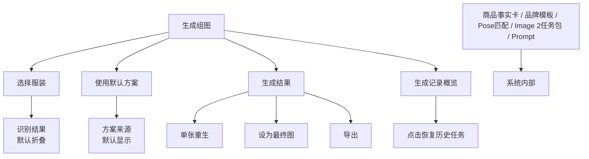

# 普通用户视角 UI/UX 设计

## 1. 核心判断

前台 UI 不应该展示 AI 生成链路的全部复杂性。

产品内部可以有：

- 商品事实卡
- 品牌调性模板
- 前置组图策划器
- Pose 模板匹配
- Image 2 任务包
- prompt 组装
- 图片职责拆分

但普通用户不应该默认看到这些。用户真正关心的是：

1. 选哪件衣服
2. 用哪个模特
3. 默认生成哪几张图
4. 风格是否是 目标品牌
5. 结果能不能用
6. 不满意时怎么改
7. 如何找回、复盘和继续使用之前的生成任务

所以前台产品应该像一个 `拍摄任务工作台`，不是一个 `AI 参数控制台`。

## 2. 设计原则

### 2.1 复杂性内置

技术复杂性必须存在，但应藏在系统里。

| 用户看到 | 系统内部完成 |
| --- | --- |
| 系统识别：无袖短款连衣裙 | 商品事实卡、品类判断；当前不做图片角色识别 |
| 默认棚拍风格 | 品牌模板匹配、参考图检索、鞋包边界 |
| 连衣裙默认 5 张 | 品类组图规则、Pose 模板、镜头策划 |
| 预计生成 5 张，可单张重生 | 单张任务包、Image 2 请求、已确认图回灌 |
| 历史任务 | GenerationRun、GenerationImage、attempts、provider 调用快照 |
| 高级设置 | 尺寸增强、拍摄角度、补充要求 |

### 2.2 用户只决策业务问题

默认流程只让用户做必要决策：

- 服装是否选对
- 默认组图方案是否已保存
- 是否开始生成
- 哪张图保留、哪张图重生
- 要查看或恢复哪一次历史任务

不要让用户决策：

- prompt 怎么写
- 图片角色怎么分配
- Image 2 输入顺序
- Pose 模板 ID
- 品牌参考图 ID
- 禁止项如何表达

### 2.3 主流程要短

生成一组图的默认路径应控制在 4 步：

```text
上传/选择服装 -> 保存默认组图方案 -> 预览分镜 -> 生成最终组图 -> 确认/重生/导出 -> 生成记录复盘/恢复
```

高级能力放在折叠区或二级入口。

## 3. 信息层级

### 3.1 默认展示

默认页面只展示：

- 服装卡片
- 默认组图方案
- 品牌风格摘要
- 生成按钮
- 结果区

### 3.2 折叠展示

用户需要时才展开：

- 服装识别详情
- 尺寸增强
- 拍摄角度微调
- 补充要求
- 风格参考说明

### 3.3 默认隐藏

这些只给系统或调试模式使用：

- 前置组图策划器状态
- Image 2 任务包
- prompt
- 图片职责拆分
- 品牌规则库明细
- Pose 模板 ID
- 参考图检索结果

## 4. 页面信息架构



## 5. 生成组图页面设计

### 5.1 页面定位

页面名称：

`生成组图`

页面副标题：

`选择服装货号，直接使用默认组图方案生成电商主图`

页面目标：

让普通运营/视觉人员在不理解 AI 内部机制的情况下，完成一次稳定的组图生成任务。

### 5.2 顶部导航

建议导航：

- `生成组图`
- `服装素材`
- `数字模特`
- `生成记录`

`品牌模板` 是必要辅助能力，但当前 MVP 暂不作为普通用户顶部 Tab 暴露。

### 5.3 主体布局

推荐使用拍摄任务工作台：

```text
生成组图

[当前拍摄任务：货号 / 摘要 / 状态条]

[左侧：服装货号] [中间：生产进度 + 结果区] [右侧：下一步 + 任务摘要 + 当前货号记录]

[分镜预览 / 最终组图]
```

右侧保留生成记录概览：

```text
[生成记录]
  [缩略图] 125329C0908714
          已生成 · 5/5 张
          记录 #7 · 重生 1
```

点击概览卡后，不跳离生成组图页，而是直接恢复该历史任务：选中对应货号、加载当时使用的组图方案、展示该任务的生成结果。

工作台只保留一个明确主操作。按钮文案跟随当前阶段变化：导入或选择服装、确认方案、生成分镜预览、生成最终组图、导出。其它操作保持为次级入口。

## 6. 模块设计

### 6.1 选择服装

默认展示：

- 当前货号
- 服装主图
- 系统识别摘要
- 更换服装按钮

示例：

```text
选择服装

125309C7948510
系统识别：无袖短款连衣裙

[更换服装]
识别结果已确认 >
```

折叠区展示：

- 品类
- 颜色
- 面料
- 关键细节
- 风险点
- 可选尺寸增强

### 6.2 使用默认方案

默认展示：

- 默认组图方案名称
- 绑定数字模特
- 图位数量
- 方案编号

示例：

```text
使用默认方案

默认棚拍风格
将使用 Face-01 数字模特和 5 张图位方案

[已保存默认方案]
```

不要默认展示：

- 多角度头部图完整列表
- 身体参数明细
- 身份锁定策略

这些可以进入模特详情页或高级折叠区。

### 6.2.1 数字模特页

数字模特页当前是一个“档案 + 头像角度面板”的并列编辑器。

左侧：

- 模特列表
- 新建模特入口

右侧：

- 基础档案表单
- 头像角度面板
- 保存档案 / 删除模特

基础档案字段：

- 模特 ID
- 名称
- 身高
- 体重
- 身型
- 胸围
- 腰围
- 臀围
- 其它信息
- 默认模特

头像角度面板要求：

- 固定保留一张“上传头像”卡片，始终排在第一位
- 支持多图上传
- 每张头像卡片都可单独设置角度、替换、删除、拖拽排序
- 角度下拉默认项使用 `未设置`
- 若当前没有 `正脸` 头像，顶部给出弱提示，不阻塞保存
- 同一具体角度只能绑定一张头像；已被占用的角度在其他卡片中禁用
- 允许存在 `未设置` 头像，方便用户先把素材传上来再慢慢整理

### 6.3 服装素材页的默认组图方案

默认展示 5 个图位：

```text
01 正面全身
02 侧身全身
03 上半身
04 背面
05 下摆细节
```

同时展示风格摘要：

```text
默认棚拍风格
白/浅灰背景 · 自然姿态 · 简洁搭配
```

用户可操作：

- 生成默认方案
- 更新默认方案
- 展开高级设置查看图位详情

默认不展示：

- 每张图的完整任务包
- 每张图绑定的 pose ID
- 每张图使用的品牌参考图 ID

### 6.4 服装素材上传预览

上传预览页是生产链路的一部分，不是临时文件列表。它必须和已保存素材保持同样的信息密度。

支持：

- 上传 N 张图片，对应一个图包。
- 上传一个或多个文件夹，对应一个或多个图包。
- 上传前编辑货号和标题。
- 上传前删除图片。
- 图包级保存上传。
- 全部待保存图包批量保存上传。

图片卡片：

- 与已保存素材卡片同风格。
- 展示文件名、尺寸、大小。
- 右下角提供删除按钮。
- 不展示图片角色标签。
- 第一张图片默认封面，通过文案提示，不提供角色下拉框。

补充要求：

- 图包在保存上传前保留在浏览器本地，不写入后端。
- 用户可以在预览阶段修改货号和标题，再逐个保存上传。
- 保存上传成功后立即触发默认组图方案生成；Gemini 不可用时显示失败原因，不使用 fallback 方案兜底。

### 6.5 高级设置

默认折叠。

包含：

- 尺寸增强
- 拍摄角度
- 背景：白色 / 浅灰
- 补充要求
- Styling 自由度

高级设置不是主流程。只有当用户对结果不满意，或某款服装有特殊要求时才使用。

### 6.6 生成结果

结果区默认展示 5 张图的状态：

- 待生成
- 生成中
- 已生成
- 已确认
- 需重生

每张图卡片提供：

- 单张重生
- 设为最终图
- 查看大图
- 下载/导出

组图完成后提供：

- 批量导出
- 继续生成同款
- 更换模特重生

## 7. 操作流程

### 7.1 默认流程

```text
进入生成组图
-> 选择服装
-> 系统读取该货号默认组图方案
-> 用户生成分镜预览
-> 确认分镜方向后生成最终组图
-> 查看结果
-> 单张重生或确认
-> 导出
```

### 7.2 修改流程

如果用户发现系统识别不准：

```text
进入服装素材页
-> 更新默认组图方案
-> 回到生成组图页直接生成
```

如果用户对结果不满意：

```text
选择某张图
-> 点击单张重生
-> 选择原因：姿势不对 / 脸不像 / 服装不准 / 搭配不合适 / 其他
-> 系统内部调整任务包
-> 重生单张
```

这里用户选择的是业务问题，不是修改 prompt。

## 8. 文案规范

### 8.1 推荐文案

- `选择服装`
- `使用默认方案`
- `默认组图方案`
- `生成默认方案`
- `更新默认方案`
- `生成组图`
- `单张重生`
- `设为最终图`
- `导出`
- `识别结果已确认`
- `默认棚拍风格`
- `预计生成 5 张，可单张重生`

### 8.2 避免文案

- `Prompt`
- `Image 2 任务包`
- `前置组图策划器`
- `图片职责拆分`
- `品牌规则库命中`
- `Pose Template ID`
- `Reference Image IDs`
- `Negative Prompt`

这些概念可以存在于内部文档和调试模式，但不应该成为普通用户的默认 UI 文案。

## 9. 页面状态

### 9.1 空状态

用户首次进入：

```text
选择一个服装货号开始生成组图
```

主按钮：

`选择服装`

### 9.2 已选服装未生成

展示三步任务卡和待生成结果区。

主按钮：

`生成组图`

### 9.3 生成中

展示进度：

```text
正在生成 5 张主图，已完成 2/5
```

每张图独立显示状态。

### 9.4 已生成

展示结果网格。

主操作：

- 单张重生
- 设为最终图
- 导出

### 9.5 单张重生

用户选择重生原因：

- 姿势不合适
- 模特不像
- 服装不准确
- 搭配不合适
- 构图不合适
- 其他补充

系统内部将原因映射到对应模块：

| 用户原因 | 系统处理 |
| --- | --- |
| 姿势不合适 | 更换 Pose 模板 |
| 模特不像 | 强化身份参考 |
| 服装不准确 | 强化服装事实图 |
| 搭配不合适 | 调整品牌模板/Styling 边界 |
| 构图不合适 | 调整图位和裁切 |

## 10. 生成记录与恢复

生成记录页面向“复盘”和“恢复”，不是事件日志页面。

### 10.1 记录粒度

- 一次“预览 -> 生成”的完整任务一条记录。
- 同一个素材包重复生成一次，就是另一条记录。
- 预览重生和单张结果图重生收纳在该任务内对应图位的 attempts 中，不额外占用一条任务记录。

### 10.2 列表体验

列表卡片展示：

- 缩略图
- 货号
- 任务状态
- 完成张数
- 最终图数量
- 重生次数
- 创建时间

列表默认分页加载，避免历史任务多时一次性渲染过多图片。生成组图页右侧只展示当前货号或最近任务的少量概览，完整复盘进入“生成记录”页。

点击列表卡片进入任务详情，URL 为：

```text
/generation-runs/{runId}
```

### 10.3 详情体验

详情页展示：

- 任务总览
- 本次入参快照
- 输出与重生过程
- 每张图的 attempts
- 高级调试 JSON

长 prompt、任务文本、provider 响应摘要必须在固定文本区域内自动换行，不能撑开页面宽度。

### 10.4 恢复到生成页

用户点击“恢复到生成页”或生成组图页右侧历史概览卡时，应进入：

```text
/generate?run={runId}
```

恢复后仍在生成组图页面，直接展示该历史任务对应的货号、方案和生成结果。

## 11. URL 与浏览器行为

前端应支持可恢复、可分享的 URL。

当前约定：

```text
/generate
/generate?sku={sku}
/generate?run={runId}
/garment-skus
/garment-skus/{sku}
/model-profiles
/model-profiles/{modelId}
/generation-runs
/generation-runs/{runId}
```

行为要求：

- 顶部 Tab 切换更新 URL。
- 刷新页面不丢失当前 Tab 和核心对象。
- 浏览器前进 / 后退应能回到上一个页面状态。
- SKU、模特、生成任务可以通过 URL 直接发给他人查看。
- 临时草稿、折叠状态、弹窗、hover 不写入 URL。

## 12. 列表、图片与性能体验

货号、素材图片、数字模特和生成记录都可能持续增长。前台体验应遵守：

- 列表默认只加载首屏数据，底部提供“加载更多”。
- 货号详情的素材图片默认只展示首屏，用户需要时再继续加载。
- 搜索和筛选文案面向业务对象：货号、标题、状态、记录号；不暴露数据库字段。
- 搜索框必须搜索服务端完整数据集，不能只过滤当前已加载的首屏结果。
- 图片列表使用缩略图或预览图，不直接用原图铺满页面。
- 图片加载失败时显示轻量占位，不打断主流程。

图片三档使用规则：

| 图片档位 | UI 场景 |
|---|---|
| `thumbUrl` | 货号列表、模特列表、生成记录缩略图 |
| `previewUrl` | 素材详情网格、结果网格、普通弹窗预览 |
| `originalUrl` | 放大查看、导出、AI 输入、质检 |

前端仍可兼容旧字段 `url` / `coverUrl`，但新界面优先使用三档 URL。

## 13. MVP 页面草图

```text
┌────────────────────────────────────────────────────────────────────┐
│ AI 模特图   生成组图  服装素材  数字模特  生成记录              │
├────────────────────────────────────────────────────────────────────┤
│ 生成组图                                                          │
│ 选择服装货号，直接使用默认组图方案生成电商主图                       │
│                                                                    │
│ ┌──────────────────────┐ ┌──────────────────────────────────────┐ │
│ │ 1 选择服装            │ │ 2 使用默认方案                       │ │
│ │ 125309...            │ │ 默认棚拍风格                    │ │
│ │ [服装缩略图]          │ │ Face-01 / 5 张图位 / 方案 #4         │ │
│ │ 已保存默认方案        │ │ 缺少方案时：去服装素材页保存方案      │ │
│ └──────────────────────┘ └──────────────────────────────────────┘ │
│                                                                    │
│ [生成组图]   将直接使用默认方案，可单张重生                          │
│                                                                    │
│ 生成结果                                                           │
│ ┌──────┐ ┌──────┐ ┌──────┐ ┌──────┐ ┌──────┐                     │
│ │待生成│ │待生成│ │待生成│ │待生成│ │待生成│                     │
│ │正面  │ │侧身  │ │上身  │ │背面  │ │局部  │                     │
│ └──────┘ └──────┘ └──────┘ └──────┘ └──────┘                     │
│                                                生成记录            │
│                                                125329... 已生成     │
│                                                记录 #7 · 5/5 张     │
└────────────────────────────────────────────────────────────────────┘
```

## 14. 对现有产品设计的修正

之前的设计文档中提到的 `商品事实卡`、`品牌模板`、`前置组图策划器`、`单张生成任务包` 仍然成立，但它们是系统能力，不是默认前台信息。

产品前台应遵守：

```text
用户看到拍摄任务，系统处理 AI 细节。
```

也就是说：

- 不减少系统能力。
- 不牺牲生成质量。
- 只减少普通用户默认看到的复杂度。
