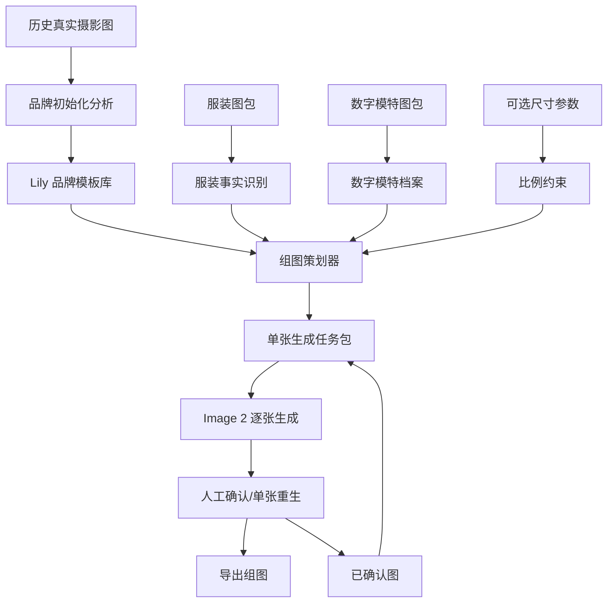

# 技术路线与生产实操

## 1. 核心判断

当前产品不应该设计成：

```text
用户上传图片 -> 写一段长 prompt -> Image 2 生成组图
```

更稳的路线应该是：

```text
素材上传/选择
-> 预处理层生成结构化资产
-> 策划层生成拍摄方案
-> Image 2 逐张生成
-> 人工确认/重生/导出
```

Image 2 是最终视觉生成器，不是品牌策略、搭配、Pose 和镜头规划的大脑。

## 2. 总体技术架构



## 3. 三类模型/能力分工

| 能力 | 角色 | 适合做什么 | 不适合做什么 |
| --- | --- | --- | --- |
| 视觉识别/VLM | 预处理 | 识别服装品类、结构、颜色、材质、图位；分析真实图标签 | 最终生成图片 |
| 推理模型/规则引擎 | 策划 | 选择模板、Pose、镜头、搭配边界；生成任务包 | 直接替代图片事实 |
| Image 2 | 生成 | 根据图片、模板、参数和短文本合成电商图 | 每次重新推理品牌调性、随机决定搭配和镜头 |

这里的推理模型可以是三方模型，也可以是 OpenAI 多模态推理模型。关键不是供应商，而是产品链路上必须存在 `前置策划层`。

## 4. 品牌调性初始化

### 4.1 输入

- Lily 历史真实摄影图
- 已有货号/品类信息，如果能拿到更好
- 人工确认的品牌关键词和禁区

### 4.2 技术路线

1. 用视觉推理模型批量分析真实图。
2. 抽取背景、光线、Pose、鞋履、包、配饰、构图、人物占比。
3. 按品类、图位、季节感、搭配方向打标签。
4. 生成 Lily 品牌总模板和品类子模板。
5. 人工审核和修正。

### 4.3 生产操作

品牌初始化时运行一次。后续只有在 Lily 风格变化、新增系列、新增季节模板时才重新分析。

产物示例：

```json
{
  "templateId": "lily-dress-summer-commute",
  "category": "连衣裙",
  "background": ["白色棚拍", "浅灰棚拍", "简洁室内"],
  "lighting": ["柔和", "干净阴影", "自然肤色"],
  "pose": ["重心偏移站姿", "侧身走动感", "手拿小包", "自然回头"],
  "footwearMood": ["轻便", "简洁", "低存在感", "都市"],
  "avoid": ["老气尖头职业鞋", "厚底鞋", "夸张高跟", "复杂绑带", "网红摆拍"]
}
```

## 5. 单个货号生成流程

### 5.1 服装事实识别

输入：货号图包。

技术路线：

- 图片角色分类：正面、背面、细节、面料、颜色、3D。
- VLM 生成商品事实卡。
- 用户确认关键字段。

生产操作：

用户选择货号后，系统自动展示：

```text
品类：无袖连衣裙
颜色：黑色
关键结构：圆领、无袖、蓝白条纹荷叶边、短款裙摆
风险点：裙长容易变长，裙摆容易被放大
```

### 5.2 数字模特绑定

输入：数字模特档案。

技术路线：

- 多角度头部图管理。
- 可选身体参数管理。
- 每张图自动匹配头部角度。

生产操作：

当前默认选择 `Face-01`。未来可以支持多个数字模特，但每次任务只选择一个模特作为组图主体。

### 5.3 组图策划

输入：

- 商品事实卡
- Lily 品牌模板
- 数字模特档案
- 可选尺寸参数
- 品类组图规则

技术路线：

- 规则引擎先确定默认图位。
- 推理模型选择合适的 Pose、鞋包边界、构图重点。
- 模板检索器选择同品类真实参考图。
- 输出每张图的生成任务包。

生产操作：

连衣裙默认组图：

```text
01 正面全身首图
02 侧身走动全身
03 上半身细节
04 背面展示
05 下摆/面料局部
```

## 6. 单张生成任务包

Image 2 不直接接收一段长 prompt，而是接收系统组装后的任务包。

示例：

```json
{
  "shotId": "02",
  "shotRole": "侧身走动全身",
  "inputs": {
    "garment": ["front", "back", "hem_detail"],
    "modelHead": "Face-01-left45",
    "brandRefs": ["lily-dress-side-001", "lily-dress-fullbody-003"],
    "poseRef": "dress-side-walk-01",
    "previousApproved": "01-front-fullbody"
  },
  "constraints": {
    "identity": "以模特头部图为身份事实",
    "garment": "以服装图为商品事实",
    "styling": "以 Lily 连衣裙模板为鞋包和姿态边界",
    "proportion": "如有尺寸参数，以尺寸参数控制裙长和下摆"
  },
  "prompt": "Generate one Lily e-commerce side full-body photo. Use the provided images as source of truth. Keep styling within Lily references. Do not change face, garment design, garment proportions, or add text."
}
```

## 7. 每个要素的生产落点

| 要素 | 产品位置 | 技术实现 | 用户是否需要操作 |
| --- | --- | --- | --- |
| 服装事实 | 服装素材/生成组图 | VLM 识别 + 图片角色分类 | 只确认关键字段 |
| 模特身份 | 数字模特 | 多角度头图档案 | 选择模特 |
| 模特身体 | 数字模特 | 身体参数档案 | 默认不填，可维护 |
| 尺寸比例 | 服装事实卡折叠区 | 尺寸表映射为视觉约束 | 可选填写 |
| 品牌调性 | 品牌调性模板 | 历史图分析 + 模板库 | 默认使用 Lily 模板 |
| 鞋包搭配 | 组图策划器 | 模板检索 + 推理选择 | 默认自动，必要时人工改 |
| Pose | Pose 模板 | 真实图抽取/标签化 | 默认自动，必要时换模板 |
| 镜头取景 | 组图方案 | 品类规则 + 平台规则 | 默认自动，必要时删改图位 |
| 背景光线 | 品牌模板 | 真实参考图 + 短边界 | 默认自动 |
| 组图一致性 | 生成结果页 | 已确认图作为后续参考 | 人工确认首图 |
| 导出 | 导出模块 | 命名/尺寸/格式规则 | 点击导出 |

## 8. 对当前 MVP 的建议

MVP 不需要一次做成完整 SaaS，但要先把骨架搭对：

1. 主入口只保留 `生成组图`。
2. 保留 `服装素材`、`数字模特`、`品牌调性模板` 作为必要配置入口。
3. 品牌模板库先只做 Lily 默认模板和连衣裙/上衣/裤装/半裙/外套几个子模板。
4. 尺寸模块先做可选字段，不作为必填。
5. 暂不做自动质检，但保留单张重生和人工确认。
6. 每张图单独生成，不做一张大图一次性出全组。

## 9. 预期效果与边界

可以明显改善：

- 模特脸不一致
- Pose 僵硬
- 鞋包随机跑偏
- 组图结构不像真实拍摄
- 不同图之间风格割裂

只能降低风险、不能完全解决：

- 没有尺寸数据时的裙长、裤长、下摆比例漂移
- 服装图本身不清晰导致的细节丢失
- 数字模特头部角度不足导致的侧脸/背面回头不稳定

所以当前阶段最重要的不是继续加长 prompt，而是把 `品牌模板库`、`组图策划器`、`单张生成任务包` 这三个中间层做出来。
