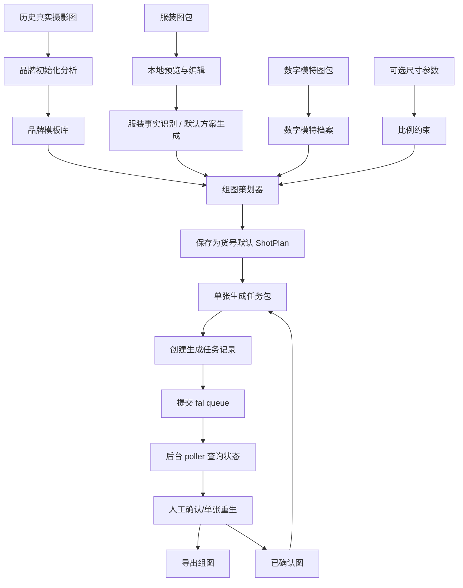

# 技术路线与生产实操

## 1. 核心判断

当前产品不应该设计成：

```text
用户上传图片 -> 写一段长 prompt -> Image 2 生成组图
```

更稳的路线应该是：

```text
素材上传/选择
-> 浏览器本地预览与编辑
-> 保存上传并生成默认拍摄方案
-> 提交 Image 2 / fal queue 逐张生成
-> 后台轮询状态并写入对象存储
-> 人工确认/重生/导出
```

Image 2 是最终视觉生成器，不是品牌策略、搭配、Pose 和镜头规划的大脑。

## 2. 总体技术架构



### 2.1 媒体任务扩展边界

当前实现仍以图片 MVP 为主，运行时实体是 `generation_runs` 和 `generation_images`。为了避免后续 Seedance 2.0 视频能力硬塞进图片模型，架构上按以下概念预留边界：

| 概念 | 当前 MVP 映射 | 后续视频扩展 |
|---|---|---|
| `MediaRun` | `generation_runs` | 一次图片组图或主视频生产任务 |
| `MediaAsset` | S3 对象 key + 输入/输出快照 | 图片、首帧、参考视频、生成视频、导出包 |
| `ImageGenerationTask` | `generation_images` | Image 2 单图位任务 |
| `VideoGenerationTask` | 暂不落库 | Seedance 2.0 任务，包含时长、首帧、参考视频、音画要求 |

视频能力落地前必须先做 media task 设计，不复用 `generation_images` 的图片字段表达视频状态。

## 3. 三类模型/能力分工

| 能力 | 角色 | 适合做什么 | 不适合做什么 |
| --- | --- | --- | --- |
| 视觉识别/VLM | 预处理 | 识别服装品类、结构、颜色、材质、图位；分析真实图标签 | 最终生成图片 |
| 推理模型/规则引擎 | 策划 | 选择模板、Pose、镜头、搭配边界；生成任务包 | 直接替代图片事实 |
| Image 2 | 生成 | 根据图片、模板、参数和短文本合成电商图 | 每次重新推理品牌调性、随机决定搭配和镜头 |

这里的推理模型可以是三方模型，也可以是 OpenAI 多模态推理模型。关键不是供应商，而是产品链路上必须存在 `前置策划层`。

## 4. 品牌调性初始化

### 4.1 输入

- 品牌历史真实摄影图
- 已有货号/品类信息，如果能拿到更好
- 人工确认的品牌关键词和禁区

### 4.2 技术路线

1. 用视觉推理模型批量分析真实图。
2. 抽取背景、光线、Pose、鞋履、包、配饰、构图、人物占比。
3. 按品类、图位、季节感、搭配方向打标签。
4. 生成 目标品牌总模板和品类子模板。
5. 人工审核和修正。

### 4.3 生产操作

品牌初始化时运行一次。后续只有在 品牌风格变化、新增系列、新增季节模板时才重新分析。

产物示例：

```json
{
  "templateId": "dress-summer-commute",
  "category": "连衣裙",
  "background": ["白色棚拍", "浅灰棚拍", "简洁室内"],
  "lighting": ["柔和", "干净阴影", "自然肤色"],
  "pose": ["重心偏移站姿", "侧身走动感", "手拿小包", "自然回头"],
  "footwearMood": ["轻便", "简洁", "低存在感", "都市"],
  "avoid": ["老气尖头职业鞋", "厚底鞋", "夸张高跟", "复杂绑带", "网红摆拍"]
}
```

## 5. 单个货号生产流程

### 5.1 服装素材上传与预览

输入：用户选择的散图或文件夹。

当前 MVP 支持：

- 上传 N 张图片并填写货号。
- 上传一个文件夹，默认货号为文件夹名。
- 上传 N 个文件夹，生成 N 个待保存图包。
- 上传 ZIP 暂不做。
- 上传前先在浏览器本地预览，支持编辑货号/标题、删除图片，再保存上传。
- 第一张图片默认作为封面；不做正面/背面/细节/3D 等图片角色识别。

工程要点：

- 前端预览卡片和已保存素材卡片保持同一结构和样式。
- 卡片展示文件名、图片尺寸、文件大小。
- 后端将应用内素材副本写入 S3 兼容对象存储，不覆盖用户原始素材。
- 私有化部署默认使用 RustFS；云部署时同一套 S3 配置可指向 OSS、COS、AWS S3、GCS 兼容接口等对象存储。
- 图片读取默认通过后端生成短期预签名 URL，当前私有图片场景不引入 CDN。
- 上传成功后同步生成 `thumb` / `preview` 两档 WebP 衍生图，前端列表和详情优先读取衍生图。

### 5.1.1 媒体对象与分页加载

图片对象保留三档访问语义：

| 档位 | 存储 | 用途 |
|---|---|---|
| `originalUrl` | 原始上传或生成对象 | AI 输入、导出、质检、放大查看 |
| `previewUrl` | `_derived/preview/*.webp` | 素材详情、结果网格、普通预览 |
| `thumbUrl` | `_derived/thumb/*.webp` | 货号列表、模特列表、历史记录缩略图 |

实现规则：

- 原图对象 key 不迁移、不改名，避免破坏历史记录。
- 衍生图与原图同目录，保存在 `_derived/thumb/` 和 `_derived/preview/`。
- 新上传素材、数字模特头像和新生成结果都同步生成衍生图。
- 旧数据缺少衍生图时，读取 API 可尝试即时补生成；失败时回退到原图 URL。
- 删除单张素材、删除/替换头像时必须同步清理衍生图；删除整个货号或模特时通过对象前缀清理。

列表读取采用 offset 分页，避免一次性读取和渲染大量图片：

- 货号、模特、生成记录列表返回 `items + limit + offset + nextOffset + hasMore`。
- 货号详情的 `images` 只返回当前图片页，后续通过 `/api/garment-skus/{sku_id}/images` 继续加载。
- 当前阶段使用手动“加载更多”，不引入虚拟滚动库、服务端搜索框架或后台队列系统。

### 5.2 服装事实识别与默认方案

生产操作：

保存上传后，系统调用 Gemini API 生成 `garment + brandStyle + shots`。如果 Gemini 不可用，方案状态更新为 `FAILED` 并在 UI 显示错误；不再使用 fallback 默认方案或复用历史真实方案兜底。

用户选择货号后，系统展示：

```text
品类：无袖连衣裙
颜色：黑色
关键结构：圆领、无袖、蓝白条纹荷叶边、短款裙摆
风险点：裙长容易变长，裙摆容易被放大
```

### 5.3 数字模特绑定

输入：数字模特档案。

技术路线：

- 多角度头部图管理。
- 可选身体参数管理。
- 每张图自动匹配头部角度。

生产操作：

当前默认选择 `Face-01`。未来可以支持多个数字模特，但每次任务只选择一个模特作为组图主体。

### 5.4 组图策划

输入：

- 商品事实卡
- 目标品牌模板
- 数字模特档案
- 可选尺寸参数
- 品类组图规则

技术路线：

- 规则引擎先确定默认图位。
- 推理模型选择合适的 Pose、鞋包边界、构图重点。
- 模板检索器选择同品类真实参考图。
- 输出每张图的生成任务包。

生产操作：

连衣裙默认组图：

```text
01 正面全身首图
02 侧身走动全身
03 上半身细节
04 背面展示
05 下摆/面料局部
```

默认方案保存规则：

- `POST /api/shot-plans` 会创建新的 `shot_plans` 记录。
- 一个货号可有多条方案历史。
- 当前默认品牌模板以 `brand_template_versions` 记录版本，生成任务包和 `template_snapshot_json` 都保存模板 id/version。
- `GET /api/garment-skus/{sku_id}/default-shot-plan` 取最新一条作为默认方案。
- 生成组图页不再临时创建方案，只使用默认方案。

## 6. 单张生成任务包

Image 2 不直接接收一段长 prompt，而是接收系统组装后的任务包。

示例：

```json
{
  "shotId": "02",
  "shotRole": "侧身走动全身",
  "inputs": {
    "garment": ["front", "back", "hem_detail"],
    "modelHead": "Face-01-left45",
    "brandRefs": ["dress-side-001", "dress-fullbody-003"],
    "poseRef": "dress-side-walk-01",
    "previousApproved": "01-front-fullbody"
  },
  "constraints": {
    "identity": "以模特头部图为身份事实",
    "garment": "以服装图为商品事实",
    "styling": "以 连衣裙模板为鞋包和姿态边界",
    "proportion": "如有尺寸参数，以尺寸参数控制裙长和下摆"
  },
  "prompt": "任务：生成一张 电商 AI 模特图，当前图位为 02：侧身走动全身。图片角色：服装参考图是商品事实来源；模特头部图是身份事实来源；品牌真实成片参考图定义姿态、鞋包、配饰、光线、背景和构图边界。禁止换脸、改变服装结构、生成文字、水印或 logo。"
}
```

所有模型调用提示词统一使用中文，包括 Gemini 组图策划、Image 2 生成、重生补充要求和禁止项。前端用户不直接维护 prompt，系统从结构化任务包中合成短中文任务文本。

## 6.1 Image 2 / fal queue 接入

当前生产接入使用 fal 的 GPT Image-2 edit queue：

```text
模型 ID：openai/gpt-image-2/edit
提交 URL：https://queue.fal.run/openai/gpt-image-2/edit
同步 URL：https://fal.run/openai/gpt-image-2/edit
```

MVP 正式生成走 queue，不走同步等待。同步 URL 只作为 fal 官方接口信息保留，不作为产品主流程。

fal 提交入参：

```json
{
  "prompt": "中文 Image 2 生成提示词",
  "image_urls": [
    "https://v3b.fal.media/files/.../product-reference.jpg",
    "https://v3b.fal.media/files/.../Face-01-left45.png",
    "https://v3b.fal.media/files/.../brand-reference.jpg"
  ],
  "image_size": "auto",
  "quality": "high",
  "num_images": 1,
  "output_format": "png",
  "sync_mode": false
}
```

对象存储图片通过预签名 URL 生成 `image_urls` 后再提交。每个生成任务需要保存：

- 原始 `task_package`
- 中文 `prompt`
- 对象 key、预签名 URL 与 fal URL 映射
- fal 提交请求和响应
- `request_id`
- `status_url` / `response_url` / `cancel_url`
- fal 状态响应
- 最终图片写入对象存储后的 `output_path` 对象 key
- 最终图片对应的 `thumb` / `preview` 衍生图 key

## 6.2 后台生成与状态恢复

点击“预览”或“生成”后，后端不等待 Image-2 完成。

后端流程：

1. 点击“预览”时创建 `generation_runs`，并创建一条 `shot_index = 0` 的 2x3 分镜预览任务。
2. 点击“生成”时复用同一条 run，追加 `shot_index = 1..5` 的最终单图任务。
3. 组装单张 `task_package` 和中文 prompt。
4. 使用对象存储预签名 URL 读取参考图，先上传到 fal，再用 fal Image URLs 组装 `image_urls`。
5. 提交 fal queue，保存 `request_id` 和 queue URLs。
6. API 立即返回 `GenerationRun`。
7. 后台 poller 周期性扫描未完成任务。
8. poller 调用 fal `status_url`，将 fal 状态映射为应用内状态。
9. 完成后调用 `response_url`，下载结果图并写入对象存储输出前缀。
10. 更新单张任务状态，并聚合更新 run 状态。

前端流程：

1. 点击“预览”后进入分镜预览结果区；预览成功后点击“生成”进入最终组图结果区。
2. 保存最近一次 `runId` 到本地。
3. 每 3 秒轮询 `GET /api/generation-runs/{run_id}`。
4. 根据 `submittedAt` / `completedAt` 动态显示整组和单图计时。
5. 刷新页面后恢复最近一次生成记录并继续显示状态。

当前不做 webhook。后续生产环境可以升级为 webhook 为主、poller 兜底。

应用内状态枚举：

```text
GenerationImage:
QUEUED / SUBMITTED / IN_QUEUE / IN_PROGRESS / SUCCEEDED / FAILED / CANCELLED

GenerationRun:
CREATED / RUNNING / PARTIAL_SUCCEEDED / SUCCEEDED / FAILED / CANCELLED
```

fal 状态保存到 `provider_status` 和 `provider_status_json`，不覆盖应用内业务状态。

## 7. 每个要素的生产落点

| 要素 | 产品位置 | 技术实现 | 用户是否需要操作 |
| --- | --- | --- | --- |
| 服装事实 | 服装素材 | Gemini 识别摘要；当前不做图片角色分类；Image-2 prompt 不复述具体服装事实 | 查看关键字段 |
| 模特身份 | 数字模特 | 多角度头图档案 | 维护默认模特；生成使用默认方案绑定的模特 |
| 模特身体 | 数字模特 | 身体参数档案 | 默认不填，可维护 |
| 尺寸比例 | 服装事实卡折叠区 | 尺寸表映射为视觉约束 | 可选填写 |
| 品牌调性 | 品牌调性模板 | 历史图分析 + 模板库 | 默认使用 品牌模板 |
| 鞋包搭配 | 组图策划器 | 模板检索 + 推理选择 | 默认自动，必要时人工改 |
| Pose | Pose 模板 | 真实图抽取/标签化 | 默认自动，必要时换模板 |
| 镜头取景 | 默认组图方案 | 品类规则 + 平台规则 | 默认自动，必要时更新默认方案 |
| 背景光线 | 品牌模板 | 真实参考图 + 短边界 | 默认自动 |
| 组图一致性 | 生成结果页 | 已确认图作为后续参考 | 人工确认首图 |
| 生成状态 | 生成结果页 | fal queue request id + 后台 poller + 前端轮询 | 自动 |
| 重生历史 | 生成任务记录 | 同一 `generation_images` 下追加 attempts | 点击重生 |
| 导出 | 导出模块 | 命名/尺寸/格式规则 | 点击导出 |

## 8. 对当前 MVP 的建议

MVP 不需要一次做成完整 SaaS，但要先把骨架搭对：

1. 生产入口保留 `生成组图`，素材准备入口为 `服装素材`。
2. `服装素材` 承担上传预览、素材管理和默认组图方案生成/更新。
3. 品牌模板库先只做 默认模板和连衣裙/上衣/裤装/半裙/外套几个子模板。
4. 尺寸模块先做可选字段，不作为必填。
5. 暂不做自动质检，但保留单张重生和人工确认。
6. 每张图单独生成，不做一张大图一次性出全组。
7. 真实 Image 2 生成必须走持久化异步任务，不在前端请求内同步等待十几分钟。

## 9. 预期效果与边界

可以明显改善：

- 模特脸不一致
- Pose 僵硬
- 鞋包随机跑偏
- 组图结构不像真实拍摄
- 不同图之间风格割裂

只能降低风险、不能完全解决：

- 没有尺寸数据时的裙长、裤长、下摆比例漂移
- 服装图本身不清晰导致的细节丢失
- 数字模特头部角度不足导致的侧脸/背面回头不稳定

所以当前阶段最重要的不是继续加长 prompt，而是把 `品牌模板库`、`组图策划器`、`单张生成任务包` 这三个中间层做出来。
