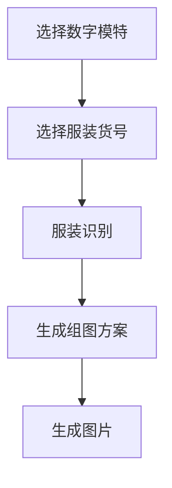
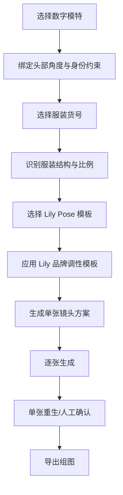

# 真实样片对比问题与产品优化

本文件基于货号 `125309C7948510` 的 AI 预览图与真实摄影图对比，记录暴露出的关键问题、根本原因和对应产品优化方案。

真实摄影图目录：

`/Users/fushuai/Desktop/项目/Lily/Lily-AI模特组图生成-MVP/simulations/125309C7948510/real`

AI 预览图：

`/Users/fushuai/Desktop/项目/Lily/Lily-AI模特组图生成-MVP/simulations/125309C7948510/outputs/generated-group-preview.png`

## 0. 总体判断

本次 AI 预览证明了“服装识别 -> 组图规划 -> 模特试穿 -> 棚拍预览”的流程可走通，但距离 Lily 可用图还有明显差距。

关键问题不是单张 prompt 不够细，而是产品流程缺少 4 个硬约束模块：

1. 数字模特身份锁定
2. Lily 品牌 pose 参考
3. 鞋履/配饰/造型搭配约束
4. 服装尺寸与穿着比例约束

因此后续产品不能只做“上传服装 + 上传脸 + 生成组图”，必须在生成前增加结构化约束。

## 1. 问题一：模特面部与提供模特严重不一致

### 表现

AI 图中的模特脸虽然有短发、刘海、大致年龄感，但五官、脸型、眼神、气质与 `Face-01` 提供的数字模特不一致。

### 根本原因

当前流程把模特头部图包当成“风格参考”，而不是“身份约束”。

也就是说，生成模型理解到了：

- 年轻女性
- 短发
- 刘海
- 淡妆
- Lily 式克制表情

但没有被强制锁定：

- 同一张脸
- 同一脸型
- 同一眼距、鼻型、嘴型
- 同一发际线、刘海形态、发尾长度
- 同一耳饰与耳位

此外，本次生成是“一张 5 宫格图”，模型在同一画面里同时生成多个头部角度，进一步增加了身份漂移。

### 产品优化

新增 `数字模特锁定模块`。

#### 1.1 数字模特档案必须区分两类信息

身份硬约束：

- 正脸
- 左右 45 度
- 侧脸
- 背面
- 回头
- 发型结构
- 耳饰
- 脸型与五官稳定描述

风格软约束：

- 年龄感
- 气质
- 妆容
- 表情
- Lily 调性

身份硬约束必须优先于风格软约束。

#### 1.2 每个镜头选择对应头部参考

产品中每张图的拍摄方案要绑定头部参考：

| 镜头 | 应使用的头部参考 |
| --- | --- |
| 正面全身 | `front.png` 或 `front_2.png` |
| 3/4 转体 | `left45.png` / `back-turn-right45.png` |
| 侧面 | `right90.png` |
| 背面 | `back.png` |
| 回头 | `back-turn-left45.png` / `back-turn-right45.png` |

不能让模型自行猜测头部角度。

#### 1.3 生成策略改为单张生成

正式产品不应使用一张 prompt 生成 5 宫格图。应该按 5 张镜头分别生成，因为：

- 每张图可以绑定不同头部角度
- 每张图可以绑定不同 pose 参考
- 每张图可以单独重生
- 身份一致性更容易控制

## 2. 问题二：模特姿势太呆，不符合品牌调性

### 表现

AI 图中模特几乎是标准站军姿：正面站立、双手下垂、身体僵直。真实摄影图中则更自然：

- 侧身走动感
- 手臂自然垂落但不僵硬
- 一手叉腰或手拿包
- 重心偏移
- 腿部有步态与节奏
- 头部有轻微转向

### 根本原因

当前产品只有“镜头类型”，没有“品牌 pose 语法”。

我们告诉模型：

- 正面全身
- 3/4 转体
- 背面

但没有告诉它 Lily 真实主图里的身体语言：

- 重心怎么放
- 手放哪里
- 腿如何错开
- 肩颈如何松弛
- 模特与镜头的关系是什么

缺少 pose 参考时，模型会回到最安全、最无聊的商品目录姿态。

### 产品优化

新增 `Lily Pose 模板库`。

#### 2.1 从真实样片提取 pose 模板

每个 pose 模板应包含：

- pose 名称
- 适用品类
- 身体朝向
- 头部朝向
- 手部动作
- 腿部动作
- 重心位置
- 镜头距离
- 适用图位
- 参考图

示例：

```json
{
  "poseId": "lily-dress-side-walk-01",
  "name": "连衣裙侧身走动感",
  "category": "连衣裙",
  "bodyAngle": "侧身约70度",
  "headAngle": "微微看向镜头或前方",
  "arms": "双臂自然垂落，一侧手臂贴近身体",
  "legs": "一腿向前，形成轻微步态",
  "weight": "重心落在后腿",
  "shot": "全身/侧身图",
  "reference": "real/002.webp"
}
```

#### 2.2 组图方案不只写镜头，也要写 pose

错误写法：

`图 2：3/4 转体，全身。`

优化写法：

`图 2：参考 Lily 连衣裙侧身走动 pose，身体侧向约 70 度，一腿向前，手臂自然下垂，头部轻微转向镜头，突出裙身侧面廓形。`

#### 2.3 Pose 模板按品类维护

连衣裙当前至少需要：

- 正面自然站姿，但重心偏移
- 侧身走动感
- 一手叉腰正面
- 背面自然站姿
- 手拿小包正/背对照

## 3. 问题三：搭配鞋子太丑，不符合品牌调性

### 表现

AI 图中生成了尖头黑色低跟鞋，比较老气、办公室感重，和 Lily 真实图中的轻松休闲搭配不一致。

真实样片更偏：

- 黑色平底凉鞋/乐福式凉鞋
- 更轻松
- 更年轻
- 更都市
- 可搭配黑色手提包

### 根本原因

当前产品没有 `造型搭配约束`。模型在看到“Lily、通勤、棚拍、连衣裙”后，自动脑补了通勤尖头鞋。

这说明鞋子不是小细节，而是会显著改变品牌调性的 styling 元素。

### 产品优化

原先“鞋履白名单”的方案过于机械，不适合 Lily。更合理的方案是新增 `品牌调性模板库`。

真实样片说明，Lily 的鞋包不是单一固定款，而是一套风格边界。Image 2 应该被允许自由选择鞋包，但自由度必须被 Lily 真实图库约束。

#### 3.1 从真实图中沉淀品牌调性模板

模板不直接规定“必须穿某双鞋”，而是规定：

- 哪些鞋包气质属于 Lily
- 哪些鞋包气质不属于 Lily
- 哪类品类常搭配什么姿态和鞋包
- 鞋包在画面里应该多弱、多克制

#### 3.2 使用真实参考图限制自由度

生成时，应传入同品类或相近品类的 Lily 真实参考图，作为 `Brand Style References`。

文本只写：

```text
Use the Lily real-photo references as the brand-style boundary for footwear, bags, accessories, pose, lighting, and composition. Choose styling freely only within this visual language.
```

不要长篇描述鞋子，也不要把鞋款写死。

#### 3.3 文本只保留禁止边界

如果需要文本补充，只写抽象边界：

- 不要老气职业尖头鞋
- 不要夸张高跟
- 不要运动鞋
- 不要厚底潮鞋
- 不要大 logo 包

具体搭配由真实参考图和模型自由度共同决定。

## 4. 问题四：裙长过长，裙摆宽度过宽

### 表现

AI 图中裙长比真实样片更长，裙摆横向展开更宽，整体更像宽松 A 字娃娃裙。真实摄影图中：

- 黑色主体长度更短
- 蓝白条纹下摆露出高度有限
- 整体裙摆没有那么外扩
- 侧面看裙身相对直筒/轻 A 字，不是大伞摆

### 根本原因

当前流程只识别了“短款 A 字连衣裙”，但没有建立商品尺寸比例约束。

模型会根据语义自动美化：

- A 字裙 -> 更宽的裙摆
- 短裙 -> 仍可能生成到膝上较长
- 褶边下摆 -> 增大褶边露出面积

真实电商生成不能只靠品类词，需要把服装图中的比例转换成约束。

### 产品优化

新增 `服装比例锁定模块`。

#### 4.1 从平铺图自动提取比例

至少提取：

- 肩宽 / 下摆宽比例
- 衣长 / 肩宽比例
- 黑色主体长度 / 蓝白下摆露出高度比例
- 袖窿褶边外露宽度
- 裙摆扩张角度

对于本款，应识别为：

- A 字但外扩克制
- 黑色主体为主，蓝白下摆仅作为底部露出层
- 裙长膝上，不接近膝盖
- 下摆宽度不能大幅超过真实平铺比例

#### 4.2 用户确认时增加“穿着长度”

当前识别卡应新增：

- 穿着裙长：膝上中段 / 膝上偏短 / 及膝 / 过膝
- 裙摆宽度：直筒 / 轻 A 字 / 大 A 字 / 伞摆
- 下摆露出：窄 / 标准 / 宽

本款推荐：

- 穿着裙长：膝上中段
- 裙摆宽度：轻 A 字
- 下摆露出：标准偏窄

#### 4.3 生成 prompt 中禁用语义过度放大

不要只写：

`A-line dress with ruffled hem`

应写：

`a restrained slight A-line mini dress, above-knee length; the blue striped ruffle is a narrow underlayer visible below the black dress, not a wide skirt; keep the hem width close to the garment reference.`

## 5. 对产品流程的调整

原流程：



优化后流程：



## 6. MVP 必须新增的字段

### 数字模特字段

- 模特 ID
- 当前图位使用的头部角度
- 身份锁定强度：高

### Pose 字段

- pose 模板 ID
- 身体朝向
- 头部朝向
- 手部动作
- 腿部动作
- 重心
- 参考图路径

### 品牌调性字段

- 品牌调性模板 ID
- 同品类真实参考图
- Styling 自由度：低 / 标准 / 高
- 鞋包配饰边界
- 禁止跑偏项

### 服装比例字段

- 穿着长度
- 裙摆宽度
- 下摆露出高度
- 袖窿褶边宽度
- 黑色主体与蓝白条纹比例

## 7. 对 125309C7948510 的优化默认值

```json
{
  "sku": "125309C7948510",
  "model": {
    "modelId": "Face-01",
    "identityLock": "high"
  },
  "garment": {
    "category": "连衣裙",
    "lengthOnBody": "膝上中段",
    "silhouette": "轻A字，不要大伞摆",
    "ruffleHemExposure": "标准偏窄",
    "mainBody": "黑色主体占主导",
    "accent": "蓝白条纹只作为袖窿和下摆装饰"
  },
  "brandStyleTemplate": "Lily 默认电商棚拍调性",
  "stylingFreedom": "标准；在 Lily 真实参考图边界内自由选择鞋包，不写死鞋款",
  "poseDirection": {
    "hero": "参考真实图正面轻松站姿，不要站军姿",
    "side": "参考真实图侧身走动感",
    "back": "参考真实图正背对照，手拿黑色包可选"
  }
}
```
